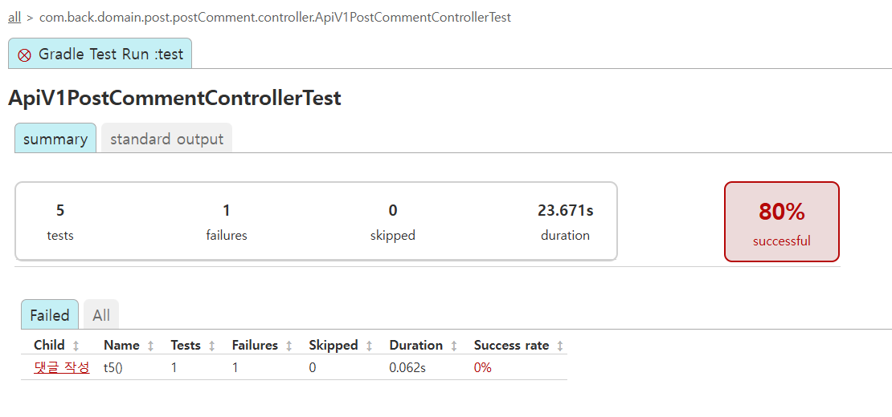
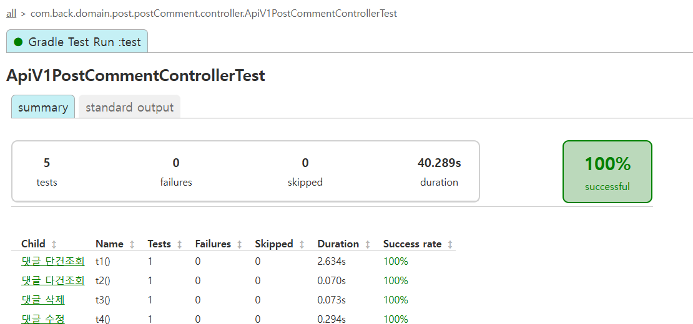
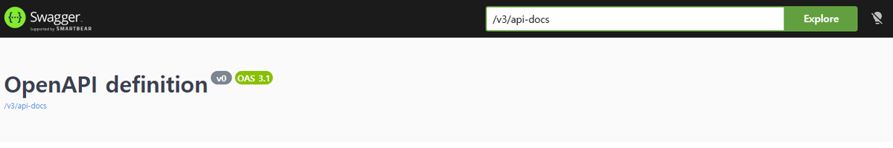
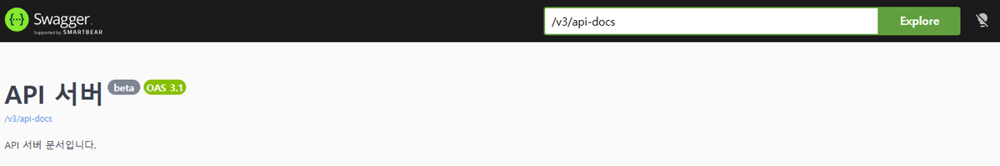
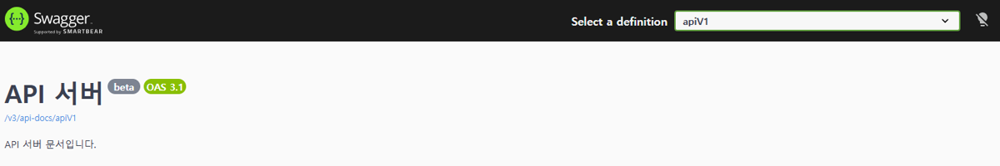
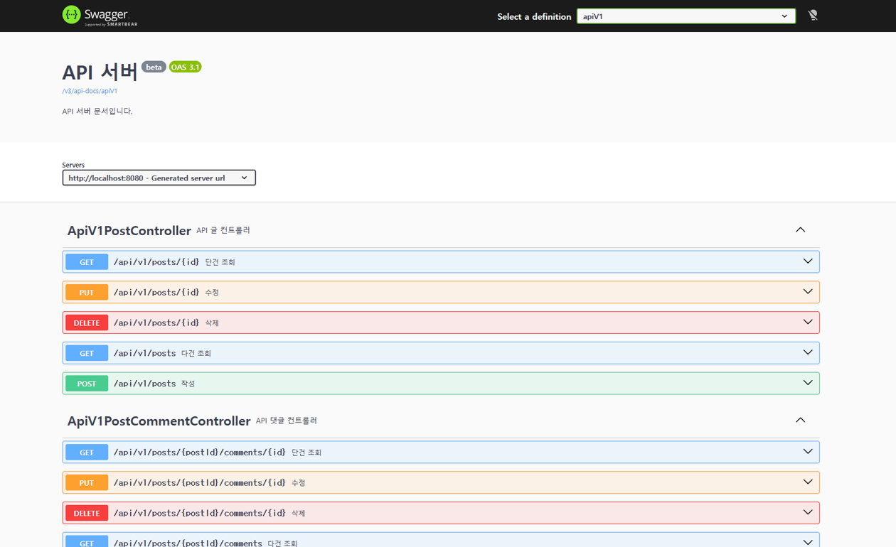
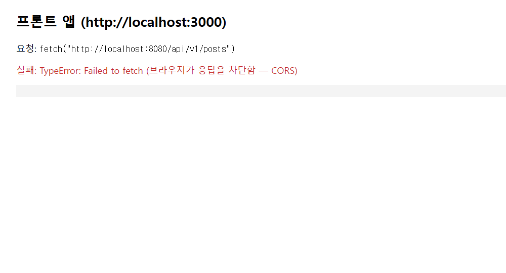
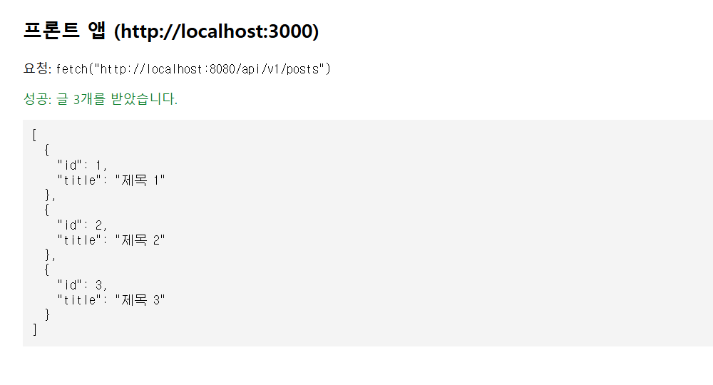

# REST4 — 스프링부트 REST API by TDD

글/댓글 REST API를 처음부터 만들고, 테스트 코드로 다듬고, API 문서를 자동 생성한 뒤, 회원과 작성자 권한까지 TDD로 구현해 나가는 학습용 저장소입니다.

- 모든 커밋에는 `001`, `002` … 처럼 **순번 태그**가 붙어 있습니다.
- 커밋 메세지에는 **무엇을 / 왜 / 확인** 이 자세히 적혀 있습니다.
- 아래 작업내역을 위에서부터 따라 읽으면 됩니다.

## 목차
- [기술 스택과 실행 방법](#기술-스택과-실행-방법)
- [커밋 따라가는 방법](#커밋-따라가는-방법)
- [실험 커밋 목록](#실험-커밋-목록)
- [패키지 구조](#패키지-구조)
- [API 명세](#API-명세)
- [작업내역](#작업내역)

## 기술 스택과 실행 방법

| 구분 | 내용 |
|---|---|
| 언어 / 빌드 | Java 25, Gradle (Kotlin DSL, 래퍼 포함) |
| 프레임워크 | Spring Boot 4.1.2, Spring Web MVC |
| 편의 도구 | Lombok, Spring Boot DevTools |
| 데이터 | Spring Data JPA, H2 (개발용 파일 DB / 테스트용 메모리 DB), H2 콘솔 |
| 검증 | Bean Validation (spring-boot-starter-validation) |
| 테스트 | JUnit 5, MockMvc, AssertJ, Hamcrest |
| API 문서 | SpringDoc OpenAPI 3.2.0 (Swagger UI) |

> 이후 단계에서 의존성이 늘어나면 이 표도 함께 갱신됩니다.

실행:
```bash
./gradlew bootRun    # 서버 실행 (기본 포트 8080, dev 프로파일, 샘플 데이터 자동 생성)
./gradlew test       # 테스트 실행 (test 프로파일, 메모리 DB)
```

| 주소 | 설명 |
|---|---|
| http://localhost:8080/ | 메인 페이지 (서버 정보, API 문서 링크) |
| http://localhost:8080/swagger-ui/index.html | API 문서 (Swagger UI, `apiV1` / `home` 그룹) |
| http://localhost:8080/v3/api-docs | OpenAPI 명세 JSON |
| http://localhost:8080/h2-console | H2 콘솔 (개발 DB) |

- CORS 허용 출처(`/api/**`): `https://cdpn.io`, `http://localhost:3000`

## 커밋 따라가는 방법

- **변경 내용(diff)** : `https://github.com/tbafe26/REST4/commit/태그` — 커밋 메세지와 바뀐 코드를 함께 봅니다.
- **그 시점의 코드** : `https://github.com/tbafe26/REST4/tree/태그` — 그 단계의 README와 코드 전체를 봅니다.
- **내 PC에서** :
  ```bash
  git clone https://github.com/tbafe26/REST4.git
  cd REST4
  git checkout 010      # 010 단계 코드로 이동
  git checkout main     # 최신으로 복귀
  ```
- 표시
  - **[실험]** : 일부러 문제가 드러나는 상태를 남긴 커밋입니다. 바로 다음 커밋에서 해결합니다.
  - 🔴 Red : 실패하는 테스트를 먼저 작성한 커밋
  - 🟢 Green : 테스트를 통과하도록 구현한 커밋
  - 🔵 Refactor : 동작은 그대로 두고 구조를 다듬은 커밋

## 실험 커밋 목록

일부러 문제가 드러나는 상태를 남긴 커밋입니다. 바로 뒤 커밋에서 해결합니다.

| 태그 | 실험 | 드러나는 문제 |
|---|---|---|
| [`009`](https://github.com/tbafe26/REST4/commit/009) | 엔티티를 그대로 JSON 으로 반환 | 글 ↔ 댓글 순환 참조로 직렬화가 끝나지 않음 (`Document nesting depth (501) exceeds the maximum allowed`) |
| [`014`](https://github.com/tbafe26/REST4/commit/014) | 엔티티 필드명 `createDate` → `createdDate` | 응답 JSON 키가 바뀌고 기존 행의 값이 `null` 이 됨 |
| [`015`](https://github.com/tbafe26/REST4/commit/015) | 엔티티 필드명 `title`/`content` → `subject`/`body` | 응답 키가 `subject`, `body` 로 바뀌고, 댓글까지 키가 `body` 로 바뀜 |
| [`017`](https://github.com/tbafe26/REST4/commit/017) | getter 없는 `PostDto` 반환 | 오류 없이 빈 객체가 응답됨: 다건 `[{},{},{}]`, 단건 `{}` |
| [`024`](https://github.com/tbafe26/REST4/commit/024) | `@Transactional` 없이 댓글 삭제 | "1번 댓글이 삭제되었습니다." 응답 후에도 댓글이 그대로 남아 있음 |
| [`030`](https://github.com/tbafe26/REST4/commit/030) | 댓글 전용 `RsData` 로 글 삭제 응답 | 컴파일 오류: `PostDto cannot be converted to PostCommentDto` |
| [`082`](https://github.com/tbafe26/REST4/commit/082) | `flush()` 없이 댓글 작성 후 응답 | 응답이 `0번 댓글이 작성되었습니다.`, `data.id = 0`, 날짜 `null` |

## 패키지 구조

```
com.back
├─ BackApplication
├─ domain
│  ├─ home
│  │  └─ home
│  │     └─ controller   HomeController (메인 페이지, fetch 실습)
│  └─ post
│     ├─ post
│     │  ├─ controller   ApiV1PostController
│     │  ├─ dto          PostDto
│     │  ├─ entity       Post
│     │  ├─ repository   PostRepository
│     │  └─ service      PostService
│     └─ postComment
│        ├─ controller   ApiV1PostCommentController
│        ├─ dto          PostCommentDto
│        └─ entity       PostComment
└─ global
   ├─ aspect             ResponseAspect (resultCode → HTTP 상태 코드)
   ├─ globalExceptionHandler  GlobalExceptionHandler (예외 → RsData 응답)
   ├─ initData           BaseInitData (샘플 데이터)
   ├─ jpa.entity         BaseEntity
   ├─ rsData             RsData (공통 응답)
   ├─ springDoc          SpringDocConfig (API 문서 설정)
   └─ webMvc             WebMvcConfig (CORS)
```

도메인(`domain`)은 `기능/세부기능/계층` 순서로 나누고, 여러 도메인이 함께 쓰는 코드는 `global` 에 둡니다.

## API 명세

기본 경로는 `http://localhost:8080` 입니다. 단계가 진행되면서 응답 형태가 바뀌므로, 아래는 **최신 단계 기준**이며 단계별 변화는 작업내역에 적혀 있습니다.

### 글 `/api/v1/posts`

| 메서드 | 경로 | 요청 본문 | 성공 응답 |
|---|---|---|---|
| GET | `/api/v1/posts` | - | 200, `PostDto[]` |
| GET | `/api/v1/posts/{id}` | - | 200, `PostDto` |
| POST | `/api/v1/posts` | `{"title", "content"}` | 201, `RsData<PostDto>` (`201-1`) |
| PUT | `/api/v1/posts/{id}` | `{"title", "content"}` | 200, `RsData<Void>` (`200-1`) |
| DELETE | `/api/v1/posts/{id}` | - | 200, `RsData<Void>` (`200-1`) |

### 댓글 `/api/v1/posts/{postId}/comments`

| 메서드 | 경로 | 요청 본문 | 성공 응답 |
|---|---|---|---|
| GET | `/api/v1/posts/{postId}/comments` | - | 200, `PostCommentDto[]` |
| GET | `/api/v1/posts/{postId}/comments/{id}` | - | 200, `PostCommentDto` |
| POST | `/api/v1/posts/{postId}/comments` | `{"content"}` | 201, `RsData<PostCommentDto>` (`201-1`) |
| PUT | `/api/v1/posts/{postId}/comments/{id}` | `{"content"}` | 200, `RsData<Void>` (`200-1`) |
| DELETE | `/api/v1/posts/{postId}/comments/{id}` | - | 200, `RsData<Void>` (`200-1`) |

### 응답 규칙

조회를 제외한 응답은 `RsData` 형태이며, `resultCode` 앞자리가 HTTP 상태 코드가 됩니다(`ResponseAspect`).

```json
{
  "resultCode": "201-1",
  "msg": "4번 글이 작성되었습니다.",
  "data": { "id": 4, "createDate": "...", "modifyDate": "...", "title": "제목", "content": "내용" }
}
```

실패 응답도 같은 형태입니다(`GlobalExceptionHandler`).

| 상황 | HTTP 상태 | resultCode | msg |
|---|---|---|---|
| 없는 글/댓글 조회 | 404 | `404-1` | 해당 데이터가 존재하지 않습니다. |
| 요청 본문 검증 실패 | 400 | `400-1` | `필드-제약-메시지` (여러 줄, 정렬) |
| JSON 문법 오류 | 400 | `400-1` | 요청 본문이 올바르지 않습니다. |

## 작업내역

### 0부. 저장소 준비 (001)

#### 001 저장소 준비
[이 시점의 코드](https://github.com/tbafe26/REST4/tree/001) · [변경 내용](https://github.com/tbafe26/REST4/commit/001)

**무엇을** README 뼈대, `.gitignore`, `.gitattributes` 를 만들었습니다.

**왜** 단계마다 "무엇을 왜 바꿨는지"를 README에 쌓아 가는 학습 기록이므로 그 틀을 먼저 세웁니다. `.gitattributes` 로 `gradlew`(LF)와 `gradlew.bat`(CRLF)의 줄바꿈을 고정해 OS가 달라도 실행 스크립트가 깨지지 않게 합니다.

### 1부. 프로젝트 세팅과 REST API (002 ~ 048)

| 태그 | 내용 | 핵심 개념 |
|---|---|---|
| [`002`](https://github.com/tbafe26/REST4/commit/002) | 스프링부트 프로젝트 생성(webmvc, lombok, devtools) | Spring Initializr, Gradle 래퍼 |
| [`003`](https://github.com/tbafe26/REST4/commit/003) | JPA, H2, validation, H2 콘솔 의존성 추가 | starter 의존성 |
| [`004`](https://github.com/tbafe26/REST4/commit/004) | dev/test 프로파일, H2·JPA·로그 설정 | 프로파일, 파일/메모리 DB |
| [`005`](https://github.com/tbafe26/REST4/commit/005) | BaseEntity(id, 생성/수정 시각) + @EnableJpaAuditing | @MappedSuperclass, Auditing |
| [`006`](https://github.com/tbafe26/REST4/commit/006) | Post, PostComment 엔티티(1:N, cascade, orphanRemoval) | 연관관계 매핑, cascade |
| [`007`](https://github.com/tbafe26/REST4/commit/007) | PostRepository, PostService | Spring Data JPA, 서비스 계층 |
| [`008`](https://github.com/tbafe26/REST4/commit/008) | 샘플 데이터(글 3, 댓글 5) 생성 | ApplicationRunner, 자기 주입 @Lazy |
| [`009`](https://github.com/tbafe26/REST4/commit/009) | [실험] 글 다건조회 API, 엔티티 순환 참조로 JSON 무한 중첩 | Jackson 직렬화, 순환 참조 |
| [`010`](https://github.com/tbafe26/REST4/commit/010) | @JsonIgnore 로 순환 참조 해결 | @JsonIgnore |
| [`011`](https://github.com/tbafe26/REST4/commit/011) | @RestController 로 통합 | @RestController |
| [`012`](https://github.com/tbafe26/REST4/commit/012) | 클래스 레벨 @RequestMapping 으로 공통 경로 분리 | @RequestMapping |
| [`013`](https://github.com/tbafe26/REST4/commit/013) | 글 단건조회 GET /api/v1/posts/{id} | @PathVariable |
| [`014`](https://github.com/tbafe26/REST4/commit/014) | [실험] 엔티티 필드명 createDate → createdDate 변경 | 엔티티 = API 스펙, ddl-auto update |
| [`015`](https://github.com/tbafe26/REST4/commit/015) | [실험] 엔티티 필드명 title/content → subject/body | 엔티티 변경의 파급 범위 |
| [`016`](https://github.com/tbafe26/REST4/commit/016) | 엔티티 필드명 원상복구 | 엔티티와 API 응답의 분리 필요성 |
| [`017`](https://github.com/tbafe26/REST4/commit/017) | [실험] PostDto 도입(getter 없음) | DTO, Jackson 직렬화는 getter 기반 |
| [`018`](https://github.com/tbafe26/REST4/commit/018) | `fail-on-empty-beans` 설정 메모 | Jackson 직렬화 설정 |
| [`019`](https://github.com/tbafe26/REST4/commit/019) | PostDto 에 @Getter | Lombok @Getter, 직렬화 대상 속성 |
| [`020`](https://github.com/tbafe26/REST4/commit/020) | PostDto → record | record, 불변 DTO |
| [`021`](https://github.com/tbafe26/REST4/commit/021) | DTO 필드명을 createDate/modifyDate/title/content 로 | DTO 덕분에 엔티티 수정 없이 응답 변경 |
| [`022`](https://github.com/tbafe26/REST4/commit/022) | `.map(PostDto::new)` | 생성자 메서드 참조 |
| [`023`](https://github.com/tbafe26/REST4/commit/023) | 댓글 다건/단건조회, PostCommentDto | 중첩 리소스 경로, 다중 @PathVariable |
| [`024`](https://github.com/tbafe26/REST4/commit/024) | [실험] 댓글 삭제(GET 임시), @Transactional 없음 | 트랜잭션과 더티체킹 |
| [`025`](https://github.com/tbafe26/REST4/commit/025) | 액션 메서드에 @Transactional / readOnly | 영속성 컨텍스트, orphanRemoval, readOnly 트랜잭션 |
| [`026`](https://github.com/tbafe26/REST4/commit/026) | 삭제 응답을 Map(resultCode, msg) 으로 | 조회 외 응답의 결과 코드·메시지 |
| [`027`](https://github.com/tbafe26/REST4/commit/027) | RsData(resultCode, msg) record | 공통 응답 객체 |
| [`028`](https://github.com/tbafe26/REST4/commit/028) | RsData 에 data(PostCommentDto) 추가 | 부가 데이터 응답 |
| [`029`](https://github.com/tbafe26/REST4/commit/029) | 글 삭제(GET 임시) | CascadeType.REMOVE |
| [`030`](https://github.com/tbafe26/REST4/commit/030) | [실험] 글 삭제 응답에 RsData 재사용 | 타입이 고정된 공통 응답의 한계 |
| [`031`](https://github.com/tbafe26/REST4/commit/031) | ForPostRsData 임시 도입 | 타입별 응답 클래스의 중복 |
| [`032`](https://github.com/tbafe26/REST4/commit/032) | ForPostRsData 제거, data 타입 Object | 범용화(Object)의 대가 |
| [`033`](https://github.com/tbafe26/REST4/commit/033) | RsData<T> 제네릭, 글 삭제는 RsData<PostDto> | 제네릭으로 타입 안정성 확보 |
| [`034`](https://github.com/tbafe26/REST4/commit/034) | 댓글 삭제 RsData<PostCommentDto> | raw 타입 지양 |
| [`035`](https://github.com/tbafe26/REST4/commit/035) | 삭제 응답 RsData<Void>, data 없는 생성자 | Void 타입 인자 |
| [`036`](https://github.com/tbafe26/REST4/commit/036) | 글/댓글 삭제 → `DELETE /{id}` | HTTP 메서드의 의미 |
| [`037`](https://github.com/tbafe26/REST4/commit/037) | 글 작성 `POST /api/v1/posts`, JSON 본문 + 검증 | @RequestBody, @Valid |
| [`038`](https://github.com/tbafe26/REST4/commit/038) | PostWriteForm → PostWriteReqBody | 이름이 역할을 드러내게 |
| [`039`](https://github.com/tbafe26/REST4/commit/039) | 작성 응답 data 를 List(totalCount, post) 로 | data 에 여러 값 담기 |
| [`040`](https://github.com/tbafe26/REST4/commit/040) | List → Map(totalCount, post) | 이름 있는 응답 필드 |
| [`041`](https://github.com/tbafe26/REST4/commit/041) | Map → 전용 record PostWriteResBody | 액션별 응답 본문 타입 |
| [`042`](https://github.com/tbafe26/REST4/commit/042) | 지역 변수 제거, 인라인 생성 | 가독성 정리 |
| [`043`](https://github.com/tbafe26/REST4/commit/043) | 작성 성공 resultCode `201-1` | 201 Created, resultCode ≠ HTTP 상태 |
| [`044`](https://github.com/tbafe26/REST4/commit/044) | ResponseEntity + HttpStatus.CREATED | HTTP 상태 코드 직접 지정 |
| [`045`](https://github.com/tbafe26/REST4/commit/045) | ResponseEntity 되돌리기 | 비용 대비 효과 판단 |
| [`046`](https://github.com/tbafe26/REST4/commit/046) | ResponseAspect(AOP), RsData.statusCode | @Around, 공통 후처리 |
| [`047`](https://github.com/tbafe26/REST4/commit/047) | 글 수정 `PUT /api/v1/posts/{id}`, statusCode @JsonIgnore | PUT, @JsonIgnore |
| [`048`](https://github.com/tbafe26/REST4/commit/048) | 댓글 수정 `PUT /api/v1/posts/{postId}/comments/{id}` | 중첩 리소스 수정 |

#### 002 스프링부트 프로젝트 생성
[이 시점의 코드](https://github.com/tbafe26/REST4/tree/002) · [변경 내용](https://github.com/tbafe26/REST4/commit/002)

**무엇을** Spring Initializr 로 만든 프로젝트를 올렸습니다. `build.gradle.kts`(webmvc, lombok, devtools), `settings.gradle.kts`, Gradle 래퍼, `BackApplication`, `application.yaml`, 컨텍스트 로딩 테스트(`BackApplicationTests`)가 들어 있습니다. `.gitignore` 에는 `build/`, `.gradle` 같은 Initializr 기본 항목을 합쳤습니다.

**왜** 이후 모든 단계가 이 뼈대 위에 쌓입니다. 래퍼(`gradlew`)가 들어 있어 Gradle 을 따로 설치하지 않아도 같은 버전으로 빌드됩니다.

**확인** `./gradlew test` 통과.

#### 003 의존성 추가 (JPA, H2, validation, H2 콘솔)
[이 시점의 코드](https://github.com/tbafe26/REST4/tree/003) · [변경 내용](https://github.com/tbafe26/REST4/commit/003)

**무엇을** `build.gradle.kts` 에 `spring-boot-starter-data-jpa`, `spring-boot-starter-validation`, `spring-boot-h2console`, 런타임 `h2` 와 각각의 테스트 starter 를 추가했습니다.

**왜** 글/댓글을 DB에 저장하려면 JPA 와 DB 드라이버가 필요합니다. H2 는 별도 설치 없이 파일/메모리로 동작해 학습용으로 알맞고, 검증 starter 는 이후 요청 데이터 검증에 씁니다.

**확인** `./gradlew test` 통과. 아직 DB 접속 설정이 없지만 H2 임베디드 기본 설정으로 컨텍스트가 뜹니다.

#### 004 프로파일과 DB·JPA·로그 설정
[이 시점의 코드](https://github.com/tbafe26/REST4/tree/004) · [변경 내용](https://github.com/tbafe26/REST4/commit/004)

**무엇을** `application.yaml` 에 기본 프로파일(`dev`), Hikari `auto-commit: false`, JPA(`show-sql`, `ddl-auto: update`, SQL 포맷), 로그 레벨을 설정했습니다. `application-dev.yaml` 은 파일 DB(`jdbc:h2:./db_dev`), `application-test.yaml` 은 메모리 DB(`jdbc:h2:mem:db_test`)를 가리킵니다. `.gitignore` 에는 H2 파일(`db_dev.*`)을 추가했습니다.

**왜** 개발 중에는 서버를 껐다 켜도 데이터가 남는 파일 DB가 편하고, 테스트는 매번 깨끗한 메모리 DB가 필요해 환경별 설정을 나눕니다. 실행되는 SQL 과 바인딩 값, 트랜잭션 시작/종료를 로그로 보면 JPA 가 무엇을 하는지 눈으로 확인할 수 있습니다.

```yaml
spring:
  profiles:
    active: dev
  datasource:
    hikari:
      auto-commit: false
```

**확인** `./gradlew test` 통과.

#### 005 BaseEntity 와 JPA Auditing
[이 시점의 코드](https://github.com/tbafe26/REST4/tree/005) · [변경 내용](https://github.com/tbafe26/REST4/commit/005)

**무엇을** 모든 엔티티가 상속할 `BaseEntity`(`id`, `createDate`, `modifyDate`, `equals/hashCode`)를 만들고, `BackApplication` 에 `@EnableJpaAuditing` 을 붙였습니다.

**왜** 글, 댓글, 이후 회원까지 공통으로 필요한 PK 와 생성/수정 시각을 한 곳에 둡니다. `@MappedSuperclass` 는 테이블을 만들지 않고 필드만 물려주며, Auditing 을 켜면 저장/수정 시 시각이 자동으로 채워집니다. `equals/hashCode` 는 id 로 비교해 같은 행을 같은 객체로 취급하게 합니다.

```java
@MappedSuperclass
@EntityListeners(AuditingEntityListener.class)
@Getter
public abstract class BaseEntity {
    @Id @GeneratedValue(strategy = IDENTITY)
    private int id;
    @CreatedDate private LocalDateTime createDate;
    @LastModifiedDate private LocalDateTime modifyDate;
}
```

**확인** `./gradlew test` 통과.

#### 006 Post, PostComment 엔티티
[이 시점의 코드](https://github.com/tbafe26/REST4/tree/006) · [변경 내용](https://github.com/tbafe26/REST4/commit/006)

**무엇을** `Post`(제목 `title`, 내용 `content`, 댓글 목록 `comments`)와 `PostComment`(`post`, `content`)를 만들었습니다. 글 쪽에는 `modify`, `addComment`, `findCommentById`, `deleteComment` 가 있습니다.

**왜** 글 1개에 댓글 N개인 1:N 구조입니다. 외래 키는 `PostComment.post` 가 갖고(연관관계의 주인), `Post.comments` 는 `mappedBy` 로 읽기 편의를 제공합니다. `cascade = {PERSIST, REMOVE}` 와 `orphanRemoval = true` 덕분에 글에서 댓글을 추가/제거하는 것만으로 DB 반영이 됩니다. 댓글 조작 규칙을 엔티티 안에 두어 서비스가 단순해집니다.

```java
@OneToMany(mappedBy = "post", cascade = {PERSIST, REMOVE}, orphanRemoval = true)
private final List<PostComment> comments = new ArrayList<>();
```

**확인** `./gradlew test` 통과(엔티티 매핑이 잘못되면 컨텍스트 로딩에서 실패합니다).

#### 007 PostRepository, PostService
[이 시점의 코드](https://github.com/tbafe26/REST4/tree/007) · [변경 내용](https://github.com/tbafe26/REST4/commit/007)

**무엇을** `PostRepository`(`JpaRepository<Post, Integer>`)와 `PostService`(`count`, `write`, `findById`, `findAll`, `modify`, `writeComment`, `deleteComment`, `modifyComment`)를 만들었습니다.

**왜** 컨트롤러가 저장소를 직접 만지지 않고 서비스를 거치게 하는 계층 구조의 시작입니다. `JpaRepository` 를 상속하면 CRUD 구현 없이 `save`, `findById`, `findAll` 을 쓸 수 있습니다.

**확인** `./gradlew test` 통과.

#### 008 샘플 데이터 (글 3개, 댓글 5개)
[이 시점의 코드](https://github.com/tbafe26/REST4/tree/008) · [변경 내용](https://github.com/tbafe26/REST4/commit/008)

**무엇을** `BaseInitData` 의 `ApplicationRunner` 가 서버 시작 시 글 3개와 댓글 5개(1번 글 3개, 2번 글 2개)를 만듭니다. 이미 글이 있으면 건너뜁니다.

**왜** API 를 만들기 전에 눈으로 확인할 데이터가 필요합니다. 파일 DB 를 쓰므로 `count() > 0` 검사로 재시작해도 중복 생성되지 않게 합니다. 실제 저장 작업은 `@Transactional` 이 붙은 `work1()` 에서 하는데, 같은 클래스 안에서 직접 호출하면 프록시를 거치지 않아 트랜잭션이 적용되지 않으므로 `@Lazy` 로 자기 자신(프록시)을 주입해 `self.work1()` 로 부릅니다.

```java
@Autowired
@Lazy
private BaseInitData self;
```

**확인** `./gradlew test` 통과. 서버 시작 로그에 글 3건, 댓글 5건의 `insert` SQL 이 출력됩니다.

#### 009 [실험] 글 다건조회 API — 순환 참조로 JSON 무한 루프
[이 시점의 코드](https://github.com/tbafe26/REST4/tree/009) · [변경 내용](https://github.com/tbafe26/REST4/commit/009)

**무엇을** `ApiV1PostController` 를 만들어 `GET /api/v1/posts` 가 `List<Post>` 엔티티를 그대로 반환하게 했습니다(`@Controller` + `@ResponseBody`).

**왜** 가장 단순한 방식으로 JSON 응답을 만들어 보고, 엔티티를 그대로 내보낼 때 어떤 문제가 생기는지 확인하려는 실험입니다. `Post.comments` 의 각 댓글이 `post` 를 다시 가리키고, 그 글이 또 `comments` 를 가리키는 순환 참조 때문에 Jackson 이 직렬화를 끝내지 못합니다.

> **확인해 볼 것** 서버를 띄워 `curl -i http://localhost:8080/api/v1/posts` 를 호출하면 응답이 `200` 으로 시작하지만 `comments → post → comments → …` 가 끝없이 중첩되다 잘립니다. 서버 로그에는 `HttpMessageNotWritableException: Could not write JSON: Document nesting depth (501) exceeds the maximum allowed (500)` 가 남습니다. 다음 단계에서 해결합니다.

#### 010 @JsonIgnore 로 순환 참조 끊기
[이 시점의 코드](https://github.com/tbafe26/REST4/tree/010) · [변경 내용](https://github.com/tbafe26/REST4/commit/010)

**무엇을** `PostComment.post` 필드에 `@JsonIgnore` 를 붙였습니다.

**왜** 순환의 한 고리(댓글 → 글)를 JSON 직렬화에서 빼면 글 → 댓글 방향으로만 출력되어 무한 중첩이 사라집니다. 댓글은 어차피 글 안에 들어 있으므로 `post` 를 다시 보여 줄 필요가 없습니다.

```java
@ManyToOne(fetch = LAZY)
@JsonIgnore
private Post post;
```

**확인** `curl http://localhost:8080/api/v1/posts` 가 글 3개를 각 댓글 목록과 함께 정상 JSON 으로 반환합니다.

#### 011 @RestController
[이 시점의 코드](https://github.com/tbafe26/REST4/tree/011) · [변경 내용](https://github.com/tbafe26/REST4/commit/011)

**무엇을** `@Controller` + 메서드의 `@ResponseBody` 를 `@RestController` 하나로 바꿨습니다.

**왜** REST API 컨트롤러는 모든 메서드가 뷰 이름이 아니라 데이터를 응답 본문(JSON)으로 돌려줍니다. `@RestController` 는 `@Controller` + `@ResponseBody` 를 합친 것이라 메서드마다 `@ResponseBody` 를 반복하지 않아도 됩니다.

```java
@RestController // @Controller + @ResponseBody
public class ApiV1PostController { ... }
```

**확인** `curl http://localhost:8080/api/v1/posts` 응답이 이전과 같습니다.

#### 012 클래스 레벨 @RequestMapping
[이 시점의 코드](https://github.com/tbafe26/REST4/tree/012) · [변경 내용](https://github.com/tbafe26/REST4/commit/012)

**무엇을** 공통 경로 `/api/v1/posts` 를 클래스에 `@RequestMapping` 으로 올리고, 메서드는 `@GetMapping` 만 남겼습니다.

**왜** 글 관련 엔드포인트가 늘어날수록 메서드마다 `/api/v1/posts` 를 반복하게 됩니다. 공통 접두사를 클래스에 한 번만 적으면 중복이 줄고 경로를 바꿀 때 한 곳만 고치면 됩니다.

```java
@RestController
@RequestMapping("/api/v1/posts")
public class ApiV1PostController {
    @GetMapping
    public List<Post> getItems() { ... }
}
```

**확인** `./gradlew test` 통과. 요청 경로(`GET /api/v1/posts`)는 그대로입니다.

#### 013 글 단건조회
[이 시점의 코드](https://github.com/tbafe26/REST4/tree/013) · [변경 내용](https://github.com/tbafe26/REST4/commit/013)

**무엇을** `GET /api/v1/posts/{id}` 를 추가했습니다. `@PathVariable` 로 id 를 받아 `postService.findById(id)` 결과를 반환합니다. README 에 "패키지 구조", "API 명세" 섹션도 만들었습니다.

**왜** 목록만으로는 특정 글 하나를 가져올 수 없습니다. 경로의 `{id}` 를 메서드 인자로 받는 것이 REST 에서 리소스 하나를 지정하는 기본 방식입니다. (지금은 없는 id 를 요청하면 `Optional.get()` 이 예외를 내는데, 예외 처리는 이후 단계에서 다룹니다.)

```java
@GetMapping("/{id}")
public Post getItem(@PathVariable int id) {
    return postService.findById(id).get();
}
```

**확인** `curl http://localhost:8080/api/v1/posts/1` 이 1번 글과 댓글 3개를 반환합니다.

#### 014 [실험] 엔티티 필드명 변경 — createDate → createdDate
[이 시점의 코드](https://github.com/tbafe26/REST4/tree/014) · [변경 내용](https://github.com/tbafe26/REST4/commit/014)

**무엇을** `BaseEntity.createDate` 를 `createdDate` 로 이름만 바꿨습니다.

**왜** 엔티티를 그대로 JSON 으로 내보내면 **필드 이름이 곧 API 스펙**이 됩니다. 내부 코드를 정리하려고 이름을 바꾸는 순간 외부(프론트엔드 등)가 쓰던 응답이 달라지고, 컬럼 이름도 함께 바뀌어 DB 까지 영향을 받는다는 것을 확인하는 실험입니다.

> **확인해 볼 것** `curl http://localhost:8080/api/v1/posts/1` 응답의 키가 `createDate` 에서 `createdDate` 로 바뀌고, 기존 DB 데이터는 새 컬럼(`created_date`)이 비어 있어 값이 `null` 로 나옵니다(`ddl-auto: update` 가 컬럼을 새로 추가만 하기 때문). 로그에도 `add column created_date` 가 보입니다.

#### 015 [실험] 엔티티 필드명 변경 — title → subject, content → body
[이 시점의 코드](https://github.com/tbafe26/REST4/tree/015) · [변경 내용](https://github.com/tbafe26/REST4/commit/015)

**무엇을** `Post` 의 `title`, `content` 를 `subject`, `body` 로, `PostComment` 의 `content` 를 `body` 로 바꾸고, 생성자·`modify`·`addComment` 와 `PostService` 의 매개변수 이름까지 따라 바꿨습니다.

**왜** "응답 JSON 의 키 이름을 바꿔 달라"는 요구를 엔티티를 고쳐서 들어주면 어디까지 바뀌어야 하는지 직접 겪어 봅니다. 이름 하나를 바꾸려고 엔티티, 서비스, 테이블 컬럼까지 손대야 합니다.

**확인** (test 프로파일로 서버 실행 후 `curl http://localhost:8080/api/v1/posts/1`) 응답이 `{"subject":"제목 1","body":"내용 1","comments":[{"body":"댓글 1-1", ...}], ...}` 처럼 바뀌었습니다. 이름 하나를 바꾸려고 엔티티 2개와 서비스까지 고쳐야 했고, 응답 JSON 도 통째로 달라집니다.

#### 016 엔티티 필드명 원상복구 — 응답 모양은 DTO 로 맞추기로
[이 시점의 코드](https://github.com/tbafe26/REST4/tree/016) · [변경 내용](https://github.com/tbafe26/REST4/commit/016)

**무엇을** 014, 015 에서 바꿨던 `createdDate`, `subject`, `body` 를 모두 원래 이름(`createDate`, `title`, `content`)으로 되돌렸습니다.

**왜** API 에서 쓰는 이름은 클라이언트와 협의하면서 언제든 바뀔 수 있습니다. 그때마다 엔티티와 DB 를 고치는 것은 비용이 너무 큽니다. 엔티티는 그대로 두고, **응답 전용 객체(DTO)** 에서 이름을 맞추는 방향으로 갑니다.

**확인** `curl http://localhost:8080/api/v1/posts/1` 응답 키가 다시 `createDate`, `title`, `content` 입니다.

#### 017 [실험] PostDto 도입 — getter 가 없는 DTO
[이 시점의 코드](https://github.com/tbafe26/REST4/tree/017) · [변경 내용](https://github.com/tbafe26/REST4/commit/017)

**무엇을** `PostDto` 클래스를 만들고 컨트롤러가 엔티티 대신 `PostDto` 를 반환하게 했습니다. DTO 의 필드 이름은 클라이언트 요구대로 `createdDate`, `modifiedDate`, `subject`, `body` 입니다. 이제 댓글은 응답에 포함되지 않으므로 `PostComment.post` 의 `@JsonIgnore` 는 제거했습니다.

**왜** 엔티티를 건드리지 않고 응답 모양만 바꾸려면 응답 전용 객체가 필요합니다. 다만 이 DTO 에는 `private final` 필드만 있고 getter 가 없습니다. Jackson 은 getter(또는 public 필드)로 값을 읽기 때문에 어떤 결과가 나오는지 확인하는 실험입니다.

```java
public class PostDto {
    private final int id;
    private final LocalDateTime createdDate;
    private final LocalDateTime modifiedDate;
    private final String subject;
    private final String body;
    // getter 없음
}
```

**확인** (test 프로파일로 서버 실행 후 curl) 다건조회는 `[{},{},{}]`, 단건조회는 `{}` 가 **200** 으로 응답됩니다. 예외는 나지 않지만 Jackson 이 읽을 수 있는 속성이 없어 내용이 모두 사라집니다.

#### 018 Jackson 빈 객체 직렬화 설정 살펴보기
[이 시점의 코드](https://github.com/tbafe26/REST4/tree/018) · [변경 내용](https://github.com/tbafe26/REST4/commit/018)

**무엇을** `application.yaml` 에 `spring.jackson.serialization.fail-on-empty-beans: false` 설정을 **주석으로** 남겼습니다.

**왜** 읽을 수 있는 속성이 하나도 없는 객체를 직렬화할 때 오류를 낼지(`true`) 빈 객체 `{}` 로 내보낼지(`false`) 정하는 설정입니다. 예전에는 `true` 가 기본값이라 getter 없는 DTO 가 바로 오류를 냈지만, 지금 쓰는 버전은 기본값이 `false` 라서 따로 켤 필요가 없습니다. 오류가 안 난다고 문제가 해결된 것은 아니라는 점을 기록해 둡니다.

```yaml
#  jackson:
#    serialization:
#      fail-on-empty-beans: false # 예전에는 true가 기본값이었지만, 지금은 false가 기본값입니다.
```

**확인** 설정 주석만 추가했으므로 동작 변화는 없습니다.

#### 019 PostDto 에 @Getter 적용
[이 시점의 코드](https://github.com/tbafe26/REST4/tree/019) · [변경 내용](https://github.com/tbafe26/REST4/commit/019)

**무엇을** `PostDto` 에 `@Getter` 를 붙였고, 018 에서 남긴 Jackson 설정 주석은 지웠습니다.

**왜** Jackson 이 값을 읽을 수 있도록 getter 를 만들어 주는 것이 정답입니다. 이제 응답 JSON 에 `id`, `createdDate`, `modifiedDate`, `subject`, `body` 가 담깁니다.

**확인** `curl http://localhost:8080/api/v1/posts` 응답에 DTO 의 다섯 필드가 모두 보입니다.

#### 020 PostDto 를 record 로 변경
[이 시점의 코드](https://github.com/tbafe26/REST4/tree/020) · [변경 내용](https://github.com/tbafe26/REST4/commit/020)

**무엇을** `PostDto` 를 `record` 로 바꿨습니다. `Post` 를 받는 보조 생성자는 `this(...)` 로 정식 생성자를 호출합니다.

**왜** DTO 는 값을 담아 전달만 하는 불변 객체입니다. `record` 는 `private final` 필드, 생성자, 접근자(`id()` 등), `equals/hashCode/toString` 을 자동으로 만들어 주고, Jackson 도 record 의 접근자를 그대로 읽습니다. `@Getter` 와 필드 선언이 모두 사라져 코드가 짧아집니다.

```java
public record PostDto(int id, LocalDateTime createdDate, LocalDateTime modifiedDate, String subject, String body) {
    public PostDto(Post post) {
        this(post.getId(), post.getCreateDate(), post.getModifyDate(), post.getTitle(), post.getContent());
    }
}
```

**확인** 응답 JSON 은 019 와 같습니다.

#### 021 응답 필드명은 DTO 에서만 변경
[이 시점의 코드](https://github.com/tbafe26/REST4/tree/021) · [변경 내용](https://github.com/tbafe26/REST4/commit/021)

**무엇을** 클라이언트와 다시 협의한 결과에 맞춰 `PostDto` 의 필드 이름을 `createDate`, `modifyDate`, `title`, `content` 로 바꿨습니다.

**왜** 이번에는 **DTO 한 파일만** 바뀌었습니다. 엔티티·서비스·DB 는 그대로입니다. 014~015 에서 엔티티를 고쳤을 때와 비교하면 DTO 를 두는 이유가 분명해집니다.

**확인** `curl http://localhost:8080/api/v1/posts/1` 응답 키가 `id, createDate, modifyDate, title, content` 입니다.

#### 022 메서드 참조로 DTO 변환 간소화
[이 시점의 코드](https://github.com/tbafe26/REST4/tree/022) · [변경 내용](https://github.com/tbafe26/REST4/commit/022)

**무엇을** 다건조회의 `.map(p -> new PostDto(p))` 를 `.map(PostDto::new)` 로 바꿨습니다.

**왜** 람다가 인자를 그대로 생성자에 넘기기만 할 때는 생성자 메서드 참조로 줄여 쓸 수 있습니다. 동작은 같습니다.

**확인** 응답은 이전과 같습니다.

#### 023 댓글 다건조회·단건조회 API
[이 시점의 코드](https://github.com/tbafe26/REST4/tree/023) · [변경 내용](https://github.com/tbafe26/REST4/commit/023)

**무엇을** `ApiV1PostCommentController` 와 `PostCommentDto`(record) 를 추가했습니다.
- `GET /api/v1/posts/{postId}/comments` : 해당 글의 댓글 목록
- `GET /api/v1/posts/{postId}/comments/{id}` : 해당 글의 댓글 하나

**왜** 댓글은 항상 어떤 글에 속하므로 경로도 `글/{postId}/댓글` 형태로 표현합니다. 댓글은 글(애그리거트 루트)을 통해 꺼내므로 별도 리포지터리 없이 `post.getComments()`, `post.findCommentById(id)` 를 사용합니다. 응답은 처음부터 DTO 로 내보냅니다.

```java
@GetMapping("/{id}")
public PostCommentDto getItem(@PathVariable int postId, @PathVariable int id) {
    Post post = postService.findById(postId).get();
    PostComment postComment = post.findCommentById(id).get();
    return new PostCommentDto(postComment);
}
```

**확인** `curl http://localhost:8080/api/v1/posts/1/comments` 는 1번 글의 댓글 3개, `.../comments/1` 은 댓글 하나를 반환합니다.

#### 024 [실험] 댓글 삭제 API — @Transactional 없이
[이 시점의 코드](https://github.com/tbafe26/REST4/tree/024) · [변경 내용](https://github.com/tbafe26/REST4/commit/024)

**무엇을** 댓글 삭제를 추가했습니다. 브라우저 주소창으로 바로 호출해 보기 위해 임시로 `GET /api/v1/posts/{postId}/comments/{id}/delete` 로 열었습니다. `postService.deleteComment(post, postComment)` 는 글의 댓글 목록에서 댓글을 빼기만 합니다(`orphanRemoval = true` 에 의해 DB 삭제를 기대).

**왜** 컬렉션에서 빼는 것만으로 DELETE 쿼리가 나가려면 엔티티가 **영속성 컨텍스트에 관리되는 상태에서 트랜잭션이 커밋**되어야 합니다. 그 조건이 없는 지금 상태에서 어떻게 되는지 확인하는 실험입니다.

**확인** (test 프로파일로 서버 실행 후 curl) `GET /api/v1/posts/1/comments/1/delete` 는 `1번 댓글이 삭제되었습니다.` 를 **200** 으로 응답하지만, 이어서 `GET /api/v1/posts/1/comments` 를 보면 1번 댓글이 **그대로 남아 있습니다**. 서버 로그에도 `delete` 쿼리가 없습니다. 트랜잭션 밖에서는 컬렉션에서 빼는 것이 DB 에 반영되지 않습니다.

#### 025 액션 메서드에 @Transactional 적용
[이 시점의 코드](https://github.com/tbafe26/REST4/tree/025) · [변경 내용](https://github.com/tbafe26/REST4/commit/025)

**무엇을** 조회 액션에는 `@Transactional(readOnly = true)`, 댓글 삭제 액션에는 `@Transactional` 을 붙였습니다.

**왜** 하나의 요청 안에서 글 조회 → 댓글 제거가 **같은 트랜잭션** 안에서 일어나야 영속성 컨텍스트가 변경을 추적하고, 커밋 시점에 `orphanRemoval` 에 의한 DELETE 가 실행됩니다. 조회만 하는 액션은 `readOnly = true` 로 의도를 드러내고 불필요한 변경 감지를 줄입니다.

```java
@GetMapping("/{id}/delete")
@Transactional
public String delete(@PathVariable int postId, @PathVariable int id) { ... }
```

**확인** `curl http://localhost:8080/api/v1/posts/1/comments/1/delete` 후 `.../comments` 목록에서 1번 댓글이 사라집니다.

#### 026 삭제 응답에 resultCode 와 msg 담기
[이 시점의 코드](https://github.com/tbafe26/REST4/tree/026) · [변경 내용](https://github.com/tbafe26/REST4/commit/026)

**무엇을** 댓글 삭제 응답을 문자열 대신 `Map`(`resultCode: "200-1"`, `msg`) 으로 바꿨습니다. 순서가 유지되도록 `LinkedHashMap` 을 썼습니다.

**왜** 조회가 아닌 요청(삭제, 작성, 수정)은 "성공했는지/어떤 결과인지"를 클라이언트가 **기계적으로** 판단할 수 있어야 합니다. 사람에게 보여줄 `msg` 와, 코드로 분기할 `resultCode` 를 함께 내려줍니다.

**확인** 삭제 응답이 `{"resultCode":"200-1","msg":"1번 댓글이 삭제되었습니다."}` 입니다.

#### 027 RsData 도입
[이 시점의 코드](https://github.com/tbafe26/REST4/tree/027) · [변경 내용](https://github.com/tbafe26/REST4/commit/027)

**무엇을** `global/rsData/RsData` record(`resultCode`, `msg`) 를 만들고 댓글 삭제가 `RsData` 를 반환하게 했습니다.

**왜** `resultCode` 와 `msg` 는 조회를 제외한 모든 응답에 필요한 공통 요소입니다. 매번 `Map` 에 키 문자열을 넣으면 오타가 나기 쉽고 응답 형태가 보장되지 않으므로 전용 타입으로 고정합니다.

```java
public record RsData(String resultCode, String msg) { }
```

**확인** 응답 JSON 은 026 과 같습니다.

#### 028 RsData 에 data 필드 추가
[이 시점의 코드](https://github.com/tbafe26/REST4/tree/028) · [변경 내용](https://github.com/tbafe26/REST4/commit/028)

**무엇을** `RsData` 에 세 번째 필드 `data` 를 추가하고, 댓글 삭제 시 삭제된 댓글의 `PostCommentDto` 를 담아 응답합니다. 지금은 타입이 `PostCommentDto` 로 고정되어 있습니다.

**왜** `resultCode` 와 `msg` 만으로는 표현하기 어려운 부가 정보(삭제된 댓글 내용, 새로 만든 글의 id 등)를 함께 돌려주면 클라이언트가 추가 요청을 하지 않아도 됩니다.

**확인** 삭제 응답에 `"data": {"id":1, ..., "content":"댓글 1-1"}` 이 포함됩니다.

#### 029 글 삭제 API
[이 시점의 코드](https://github.com/tbafe26/REST4/tree/029) · [변경 내용](https://github.com/tbafe26/REST4/commit/029)

**무엇을** `GET /api/v1/posts/{id}/delete`(임시) 로 글을 삭제하고 삭제된 글의 `PostDto` 를 반환합니다. `PostService.delete(post)` 는 `postRepository.delete(post)` 를 호출합니다.

**왜** 글에는 댓글이 딸려 있지만 `Post.comments` 에 `CascadeType.REMOVE` 가 걸려 있어서, 글을 지우면 JPA 가 관련 댓글을 **먼저** 삭제한 뒤 글을 삭제합니다. 외래키 제약 때문에 직접 댓글을 지울 필요가 없습니다.

**확인** `curl http://localhost:8080/api/v1/posts/1/delete` 후 SQL 로그에 댓글 DELETE 들이 글 DELETE 보다 먼저 찍힙니다.

#### 030 [실험] 글 삭제 응답에 댓글 전용 RsData 재사용
[이 시점의 코드](https://github.com/tbafe26/REST4/tree/030) · [변경 내용](https://github.com/tbafe26/REST4/commit/030)

**무엇을** 글 삭제도 `resultCode`, `msg`, `data` 형태로 응답하려고 `RsData` 를 그대로 썼습니다. `data` 에는 `PostDto` 를 넣었습니다.

**왜** 지금 `RsData.data` 의 타입은 `PostCommentDto` 로 고정되어 있습니다. 공통 응답 객체가 특정 타입에 묶여 있으면 다른 리소스에 재사용할 수 없다는 것을 확인하는 실험입니다.

**확인** `./gradlew compileJava` 가 `error: incompatible types: PostDto cannot be converted to PostCommentDto` 로 **컴파일 단계에서 실패**합니다. 타입이 고정된 공통 응답 객체는 다른 리소스에 재사용할 수 없습니다.

#### 031 글 전용 ForPostRsData 임시 도입
[이 시점의 코드](https://github.com/tbafe26/REST4/tree/031) · [변경 내용](https://github.com/tbafe26/REST4/commit/031)

**무엇을** `data` 가 `PostDto` 인 `ForPostRsData` record 를 따로 만들어 글 삭제 응답에 사용했습니다.

**왜** 일단 동작하게 만드는 가장 단순한 방법입니다. 하지만 리소스가 늘 때마다 `ForXxxRsData` 가 늘어나는 구조라 오래 갈 수 없습니다.

**확인** 글 삭제 응답이 `{"resultCode":"200-1","msg":"1번 글이 삭제되었습니다.","data":{...}}` 형태입니다.

#### 032 ForPostRsData 제거, RsData.data 를 Object 로
[이 시점의 코드](https://github.com/tbafe26/REST4/tree/032) · [변경 내용](https://github.com/tbafe26/REST4/commit/032)

**무엇을** `ForPostRsData` 를 지우고 `RsData.data` 의 타입을 `Object` 로 바꿔 글/댓글 삭제 모두 `RsData` 를 씁니다.

**왜** `Object` 로 두면 어떤 데이터든 담을 수 있어 클래스 하나로 통합됩니다. 다만 메서드 시그니처만 보고는 `data` 에 무엇이 들어있는지 알 수 없고, 꺼내 쓸 때 형변환이 필요하다는 단점이 생깁니다.

**확인** 글/댓글 삭제 응답 JSON 은 이전과 같습니다.

#### 033 RsData 에 제네릭 적용
[이 시점의 코드](https://github.com/tbafe26/REST4/tree/033) · [변경 내용](https://github.com/tbafe26/REST4/commit/033)

**무엇을** `RsData` 를 `RsData<T>(String resultCode, String msg, T data)` 로 바꾸고 글 삭제의 반환 타입을 `RsData<PostDto>` 로 명시했습니다.

**왜** 하나의 클래스로 모든 응답을 표현하면서도 `data` 의 타입을 컴파일 시점에 알 수 있습니다. 반환 타입만 봐도 어떤 데이터가 오는지 문서처럼 읽힙니다.

```java
public record RsData<T>(String resultCode, String msg, T data) { }
```

> **확인해 볼 것** 댓글 삭제는 아직 raw 타입 `RsData` 로 남아 있는데도 컴파일됩니다. raw 타입은 `RsData<Object>` 처럼 동작하지만 타입 검사를 건너뛰므로 지양합니다.

#### 034 댓글 삭제 응답 타입에도 제네릭 명시
[이 시점의 코드](https://github.com/tbafe26/REST4/tree/034) · [변경 내용](https://github.com/tbafe26/REST4/commit/034)

**무엇을** 댓글 삭제의 반환 타입을 `RsData<PostCommentDto>` 로, 생성을 `new RsData<>(...)` 로 바꿨습니다.

**왜** raw 타입 `RsData` 는 사실상 `RsData<Object>` 처럼 동작해 제네릭을 도입한 이점(타입 검사)을 잃습니다. 모든 곳에서 타입 인자를 명시합니다.

**확인** 응답 JSON 은 이전과 같습니다.

#### 035 데이터가 필요 없는 응답은 RsData<Void>
[이 시점의 코드](https://github.com/tbafe26/REST4/tree/035) · [변경 내용](https://github.com/tbafe26/REST4/commit/035)

**무엇을** 글/댓글 삭제 응답에서 `data` 를 빼고 반환 타입을 `RsData<Void>` 로 바꿨습니다. `RsData` 에는 `resultCode`, `msg` 만 받는 보조 생성자를 추가했습니다.

**왜** 삭제된 대상의 정보는 클라이언트가 이미 알고 있으므로 굳이 돌려줄 필요가 없습니다. "데이터가 없다"는 사실을 `RsData<Void>` 로 **타입에 명시**하면 읽는 사람이 바로 알 수 있습니다.

```java
public RsData(String resultCode, String msg) {
    this(resultCode, msg, null);
}
```

**확인** 삭제 응답이 `{"resultCode":"200-1","msg":"1번 글이 삭제되었습니다.","data":null}` 입니다.

#### 036 삭제는 DELETE 메서드로
[이 시점의 코드](https://github.com/tbafe26/REST4/tree/036) · [변경 내용](https://github.com/tbafe26/REST4/commit/036)

**무엇을** 임시로 `GET /{id}/delete` 였던 글/댓글 삭제를 `@DeleteMapping("/{id}")` 로 바꿨습니다.
- `DELETE /api/v1/posts/{id}`
- `DELETE /api/v1/posts/{postId}/comments/{id}`

**왜** REST 에서는 **주소(URL)는 리소스**를, **HTTP 메서드는 행위**를 나타냅니다. GET 은 조회용이라 브라우저 미리 불러오기, 크롤러, 캐시 등에 의해 의도치 않게 호출될 수 있어 상태를 바꾸는 요청에 쓰면 위험합니다.

**확인** `curl -X DELETE http://localhost:8080/api/v1/posts/1/comments/1`

#### 037 글 작성 API — POST 와 JSON 요청 본문
[이 시점의 코드](https://github.com/tbafe26/REST4/tree/037) · [변경 내용](https://github.com/tbafe26/REST4/commit/037)

**무엇을** `POST /api/v1/posts` 를 추가했습니다. 요청 본문은 JSON(`{"title": "...", "content": "..."}`) 이며 컨트롤러 안의 record `PostWriteForm` 으로 받습니다. `@NotBlank`, `@Size` 로 검증합니다.

**왜** 데이터를 새로 만드는 요청은 POST 를 쓰고, REST API 에서는 폼 파라미터 대신 **JSON 본문**으로 주고받는 것이 일반적입니다. `@RequestBody` 가 JSON 을 객체로 바꿔 주고 `@Valid` 가 제약 조건을 검사합니다.

```java
@PostMapping
@Transactional
public RsData<PostDto> write(@RequestBody @Valid PostWriteForm form) {
    Post post = postService.write(form.title, form.content);
    return new RsData<>("200-1", "%d번 글이 작성되었습니다.".formatted(post.getId()), new PostDto(post));
}
```

**확인** `curl -X POST http://localhost:8080/api/v1/posts -H "Content-Type: application/json" -d '{"title":"제목","content":"내용"}'`

#### 038 요청 본문 record 이름을 PostWriteReqBody 로
[이 시점의 코드](https://github.com/tbafe26/REST4/tree/038) · [변경 내용](https://github.com/tbafe26/REST4/commit/038)

**무엇을** `PostWriteForm` 을 `PostWriteReqBody` 로, 매개변수 `form` 을 `reqBody` 로 바꿨습니다.

**왜** REST API 에는 HTML 폼이 없습니다. 이 객체는 **요청 본문(Request Body)** 을 담는 것이므로 이름도 그 역할을 드러내게 합니다. 이후 응답 본문 전용 객체는 `...ResBody` 로 짝을 맞춥니다.

**확인** 동작은 이전과 같습니다.

#### 039 글 작성 응답에 전체 글 수 추가 — List
[이 시점의 코드](https://github.com/tbafe26/REST4/tree/039) · [변경 내용](https://github.com/tbafe26/REST4/commit/039)

**무엇을** 글 작성 후 전체 글 수(`totalCount`)도 함께 달라는 요구에 맞춰 `data` 를 `List.of(totalCount, new PostDto(post))` 로 바꿨습니다. 반환 타입은 `RsData<List<Object>>` 입니다.

**왜** `RsData.data` 에는 값을 하나만 담을 수 있으므로 여러 값을 담으려면 묶어야 합니다. 가장 먼저 떠오르는 방법인 List 로 시도해 봅니다. 결과 JSON 은 `[3, {...}]` 처럼 **각 값이 무엇인지 이름이 없습니다.**

**확인** `data` 가 `[4, {"id":4, ...}]` 형태의 배열로 나옵니다.

#### 040 글 작성 응답 data 를 Map 으로
[이 시점의 코드](https://github.com/tbafe26/REST4/tree/040) · [변경 내용](https://github.com/tbafe26/REST4/commit/040)

**무엇을** `data` 를 `Map.of("totalCount", totalCount, "post", new PostDto(post))` 로 바꿨습니다.

**왜** Map 은 키가 있어 JSON 이 `{"totalCount": 4, "post": {...}}` 처럼 읽기 쉽습니다. 다만 키는 문자열이라 오타를 컴파일러가 잡지 못하고, 반환 타입 `Map<String, Object>` 만 보고는 어떤 키가 오는지 알 수 없습니다.

**확인** `data` 가 `{"totalCount": ..., "post": {...}}` 로 나옵니다.

#### 041 글 작성 전용 응답 본문 record PostWriteResBody
[이 시점의 코드](https://github.com/tbafe26/REST4/tree/041) · [변경 내용](https://github.com/tbafe26/REST4/commit/041)

**무엇을** 컨트롤러 안에 `record PostWriteResBody(long totalCount, PostDto post)` 를 만들고 반환 타입을 `RsData<PostWriteResBody>` 로 바꿨습니다.

**왜** 해당 액션 전용 응답 타입을 두면 JSON 결과는 Map 과 같으면서도 필드 이름과 타입이 컴파일 시점에 고정되고, 반환 타입만으로 응답 구조를 알 수 있습니다. 요청은 `...ReqBody`, 응답은 `...ResBody` 로 짝을 맞춥니다.

```java
public record PostWriteResBody(long totalCount, PostDto post) { }
```

**확인** 응답 JSON 은 040 과 같습니다.

#### 042 글 작성 응답 생성 코드 간소화
[이 시점의 코드](https://github.com/tbafe26/REST4/tree/042) · [변경 내용](https://github.com/tbafe26/REST4/commit/042)

**무엇을** `PostWriteResBody data = ...` 지역 변수를 없애고 `RsData` 생성자 안에서 바로 만들었습니다.

**왜** 한 번만 쓰는 변수는 줄이고 응답 구조가 코드 모양에 그대로 드러나게 합니다. 동작은 같습니다.

**확인** 응답 JSON 은 이전과 같습니다.

#### 043 글 작성 resultCode 를 201-1 로
[이 시점의 코드](https://github.com/tbafe26/REST4/tree/043) · [변경 내용](https://github.com/tbafe26/REST4/commit/043)

**무엇을** 글 작성 성공의 `resultCode` 를 `200-1` 에서 `201-1` 로 바꿨습니다.

**왜** 201(Created)은 "성공했고, 그 결과 무언가가 새로 생성됐다"는 뜻으로 작성 성공에 가장 정확한 코드입니다. 그런데 `resultCode` 는 응답 본문 안의 문자열일 뿐이라 **실제 HTTP 응답 상태 코드는 여전히 200** 입니다.

> **확인해 볼 것** `curl -i -X POST ...` 로 응답 헤더를 보면 상태 줄은 `200` 인데 본문의 `resultCode` 만 `201-1` 입니다.

#### 044 ResponseEntity 로 HTTP 상태 코드 201 설정
[이 시점의 코드](https://github.com/tbafe26/REST4/tree/044) · [변경 내용](https://github.com/tbafe26/REST4/commit/044)

**무엇을** 글 작성 반환 타입을 `ResponseEntity<RsData<PostWriteResBody>>` 로 감싸고 `HttpStatus.CREATED` 를 지정했습니다.

**왜** 실제 HTTP 상태 코드를 바꾸려면 응답 자체(상태 코드, 헤더, 본문)를 다루는 `ResponseEntity` 가 필요합니다. 동작은 하지만 반환 타입과 생성 코드가 한 겹 더 감싸져 장황해집니다. 상태 코드 하나 바꾸려고 모든 액션을 이렇게 쓰는 것은 부담입니다.

```java
return new ResponseEntity<>(new RsData<>("201-1", ...), HttpStatus.CREATED);
```

**확인** `curl -i -X POST ...` 의 상태 줄이 `201` 입니다.

#### 045 ResponseEntity 제거
[이 시점의 코드](https://github.com/tbafe26/REST4/tree/045) · [변경 내용](https://github.com/tbafe26/REST4/commit/045)

**무엇을** 글 작성을 다시 `RsData<PostWriteResBody>` 를 반환하도록 되돌렸습니다.

**왜** 오직 상태 코드를 바꾸기 위해 모든 액션에 `ResponseEntity` 를 두르는 것은 비용 대비 효과가 낮습니다. 이미 `resultCode` 앞자리(`201`)에 원하는 상태 코드가 들어 있으니, 이를 보고 **한 곳에서 자동으로** 상태 코드를 바꾸는 방법을 다음 단계에서 적용합니다. (지금은 다시 200 으로 응답합니다.)

**확인** 반환 타입이 다시 `RsData<PostWriteResBody>` 입니다.

#### 046 ResponseAspect — resultCode 로 HTTP 상태 코드 자동 설정
[이 시점의 코드](https://github.com/tbafe26/REST4/tree/046) · [변경 내용](https://github.com/tbafe26/REST4/commit/046)

**무엇을** `global/aspect/ResponseAspect` 를 추가했습니다. `@RestController` 의 매핑 메서드가 `RsData` 를 반환하면, 그 `statusCode` 로 `HttpServletResponse` 의 상태 코드를 설정합니다. `RsData` 에는 `resultCode` 앞자리를 숫자로 바꾼 `statusCode` 필드를 추가했습니다.

**왜** 모든 액션에 같은 후처리(상태 코드 설정)가 필요할 때, 각 메서드를 고치는 대신 AOP 로 **한 곳에서** 처리합니다. 액션 메서드는 `RsData` 만 반환하면 됩니다.

```java
@Around("within(@RestController *) && (@annotation(GetMapping) || ... )")
public Object handleResponse(ProceedingJoinPoint joinPoint) throws Throwable {
    Object proceed = joinPoint.proceed();
    if (proceed instanceof RsData<?> rsData) response.setStatus(rsData.statusCode());
    return proceed;
}
```

```java
public RsData(String resultCode, String msg, T data) {
    this(resultCode, Integer.parseInt(resultCode.split("-", 2)[0]), msg, data);
}
```

> **확인해 볼 것** `curl -i -X POST ...` 의 상태 줄이 `201` 입니다. 응답 JSON 에 `statusCode` 도 함께 노출되는데, 다음 단계에서 숨깁니다.

#### 047 글 수정 API — PUT, statusCode 는 응답에서 숨김
[이 시점의 코드](https://github.com/tbafe26/REST4/tree/047) · [변경 내용](https://github.com/tbafe26/REST4/commit/047)

**무엇을** `PUT /api/v1/posts/{id}` 로 글을 수정합니다. 요청 본문은 `PostModifyReqBody`(title, content) 이고 응답은 `RsData<Void>`(`200-1`) 입니다. `RsData.statusCode` 에는 `@JsonIgnore` 를 붙였습니다.

**왜** 수정은 리소스를 갱신하는 PUT 이 맞습니다. 엔티티 값을 바꾸면 트랜잭션 커밋 시 더티체킹으로 UPDATE 가 나갑니다. `statusCode` 는 HTTP 상태 줄로 이미 전달되므로 본문에 중복해서 노출하지 않습니다.

**확인** `curl -X PUT http://localhost:8080/api/v1/posts/1 -H "Content-Type: application/json" -d '{"title":"제목new","content":"내용new"}'`

#### 048 댓글 수정 API — PUT
[이 시점의 코드](https://github.com/tbafe26/REST4/tree/048) · [변경 내용](https://github.com/tbafe26/REST4/commit/048)

**무엇을** `PUT /api/v1/posts/{postId}/comments/{id}` 로 댓글을 수정합니다. 요청 본문은 `PostCommentModifyReqBody`(content), 응답은 `RsData<Void>`(`200-1`) 입니다.

**왜** 글 수정과 같은 규칙(PUT, ReqBody, RsData)으로 댓글도 수정할 수 있게 해서 글/댓글 CRUD 를 완성합니다.

**확인** `curl -X PUT http://localhost:8080/api/v1/posts/1/comments/1 -H "Content-Type: application/json" -d '{"content":"댓글new"}'`

### 2부. REST API by TDD (049 ~ 083)

| 태그 | 내용 | 핵심 개념 |
|---|---|---|
| [`049`](https://github.com/tbafe26/REST4/commit/049) | ApiV1PostControllerTest, ApiV1PostCommentControllerTest 생성 | 컨트롤러 테스트 준비 |
| [`050`](https://github.com/tbafe26/REST4/commit/050) | 글 작성 요청 테스트(MockMvc) | @SpringBootTest, @AutoConfigureMockMvc, @Transactional 롤백 |
| [`051`](https://github.com/tbafe26/REST4/commit/051) | `.andDo(print())` | 테스트 중 요청/응답 확인 |
| [`052`](https://github.com/tbafe26/REST4/commit/052) | `.andExpect(status().isCreated())` | 응답 검증 |
| [`053`](https://github.com/tbafe26/REST4/commit/053) | `ResultActions` 로 요청/검증 분리 | 테스트 구조(요청 → 검증) |
| [`054`](https://github.com/tbafe26/REST4/commit/054) | 글 수정 테스트(PUT, 200) | put() 요청 빌더 |
| [`055`](https://github.com/tbafe26/REST4/commit/055) | ResponseAspect 포인트컷을 RsData 반환 메서드로 한정 | 포인트컷, 테스트가 리팩터링의 안전망 |
| [`056`](https://github.com/tbafe26/REST4/commit/056) | `handler().handlerType/methodName` 검증 | 요청 매핑 검증 |
| [`057`](https://github.com/tbafe26/REST4/commit/057) | 최신 글·전체 글 수를 DB 에서 조회해 응답과 대조 | jsonPath, 쿼리 메서드 findFirstByOrderByIdDesc |
| [`058`](https://github.com/tbafe26/REST4/commit/058) | data.post 의 모든 필드 검증 | 응답 스펙을 테스트로 고정 |
| [`059`](https://github.com/tbafe26/REST4/commit/059) | 🔴 작성 응답 data 를 PostDto 로 기대하도록 테스트 수정 | 요구 변경 시 테스트 먼저 |
| [`060`](https://github.com/tbafe26/REST4/commit/060) | 🟢 PostWriteResBody 제거, `RsData<PostDto>` | Red → Green |
| [`061`](https://github.com/tbafe26/REST4/commit/061) | 글 수정 테스트에 handler, resultCode, msg 검증 | 응답 본문 검증 |
| [`062`](https://github.com/tbafe26/REST4/commit/062) | 수정 후 DB 값 assertThat 검증(선택) | AssertJ |
| [`063`](https://github.com/tbafe26/REST4/commit/063) | DB 재조회 검증 제거 | 컨트롤러 테스트의 범위 |
| [`064`](https://github.com/tbafe26/REST4/commit/064) | 글 삭제 테스트(DELETE, 200-1) | delete() 요청 빌더 |
| [`065`](https://github.com/tbafe26/REST4/commit/065) | 글 단건조회 테스트, 필드 형태(isNumber/isString) 검증 | 필수 검증 범위 |
| [`066`](https://github.com/tbafe26/REST4/commit/066) | 단건조회 응답을 DB 값과 대조(선택) | 검증 강도 조절 |
| [`067`](https://github.com/tbafe26/REST4/commit/067) | 글 다건조회 테스트, 배열 각 원소 검증 | jsonPath 배열 인덱스 |
| [`068`](https://github.com/tbafe26/REST4/commit/068) | `$.length()` 로 글 개수 검증 | 목록 길이 검증 |
| [`069`](https://github.com/tbafe26/REST4/commit/069) | 🔴 없는 글 조회 시 404, `404-1` 기대 | 실패 시나리오 테스트 |
| [`070`](https://github.com/tbafe26/REST4/commit/070) | 🟢 GlobalExceptionHandler 로 NoSuchElementException 처리 | @ControllerAdvice, @ExceptionHandler |
| [`071`](https://github.com/tbafe26/REST4/commit/071) | @RestControllerAdvice + @ResponseStatus(NOT_FOUND) | 예외 응답 상태 코드 지정 방법 A |
| [`072`](https://github.com/tbafe26/REST4/commit/072) | ResponseEntity 방식 + @ControllerAdvice | 예외 응답 상태 코드 지정 방법 B |
| [`073`](https://github.com/tbafe26/REST4/commit/073) | 제목 없이 작성 시 400, MethodArgumentNotValidException 처리 | @Valid 실패 응답 |
| [`074`](https://github.com/tbafe26/REST4/commit/074) | 내용 없이 작성 시 400 테스트 | 같은 규칙의 실패 케이스 추가 |
| [`075`](https://github.com/tbafe26/REST4/commit/075) | 잘못된 JSON 시 400, HttpMessageNotReadableException 처리 | 역직렬화 실패 응답 |
| [`076`](https://github.com/tbafe26/REST4/commit/076) | ApiV1PostCommentControllerTest 설정(MockMvc, PostService) | 테스트 클래스 공통 설정 |
| [`077`](https://github.com/tbafe26/REST4/commit/077) | 댓글 단건조회 테스트 | 중첩 경로 요청, DB 대조 |
| [`078`](https://github.com/tbafe26/REST4/commit/078) | 댓글 다건조회 테스트, 개수·원소 검증 | 목록 검증 |
| [`079`](https://github.com/tbafe26/REST4/commit/079) | 댓글 삭제 테스트(DELETE, 200-1) | 삭제 응답 검증 |
| [`080`](https://github.com/tbafe26/REST4/commit/080) | 댓글 수정 테스트(PUT, 200-1) | 수정 응답 검증 |
| [`081`](https://github.com/tbafe26/REST4/commit/081) | 🔴 댓글 작성 테스트(201-1, data 검증) | 테스트 먼저 작성 |
| [`082`](https://github.com/tbafe26/REST4/commit/082) | [실험] 댓글 작성 구현(flush 없음) | 쓰기 지연, IDENTITY 와 INSERT 시점 |
| [`083`](https://github.com/tbafe26/REST4/commit/083) | 🟢 `postService.flush()` 로 즉시 INSERT | flush, 영속성 컨텍스트 동기화 |

#### 049 컨트롤러 테스트 클래스 생성
[이 시점의 코드](https://github.com/tbafe26/REST4/tree/049) · [변경 내용](https://github.com/tbafe26/REST4/commit/049)

**무엇을** 빈 테스트 클래스 `ApiV1PostControllerTest`, `ApiV1PostCommentControllerTest` 를 테스트 쪽에 컨트롤러와 같은 패키지로 만들고, 기본 생성된 `BackApplicationTests` 는 지웠습니다.

**왜** 지금까지는 기능을 만든 뒤 curl 로 손수 확인했습니다. 여기서부터는 **테스트 코드로 요청을 보내고 결과를 검증**합니다. 테스트가 있으면 이후 공통 코드를 바꿀 때도 기존 기능이 깨졌는지 즉시 알 수 있습니다. 컨트롤러 테스트는 언제나 "1. 요청을 보낸다 → 2. 응답을 검증한다" 두 단계로 이루어집니다.

**확인** 테스트 클래스만 생겼고 테스트 메서드는 아직 없습니다.

#### 050 글 작성 테스트 — MockMvc 로 POST 요청 보내기
[이 시점의 코드](https://github.com/tbafe26/REST4/tree/050) · [변경 내용](https://github.com/tbafe26/REST4/commit/050)

**무엇을** `ApiV1PostControllerTest` 에 글 작성 테스트 `t1` 을 추가했습니다. `MockMvc` 로 `POST /api/v1/posts` 에 JSON 본문을 보냅니다. 아직 검증은 없습니다.

```java
@ActiveProfiles("test")  // 메모리 DB 를 쓰는 test 프로파일
@SpringBootTest          // 애플리케이션 전체를 띄운다
@AutoConfigureMockMvc    // 서버 없이 HTTP 요청을 흉내 내는 MockMvc 준비
@Transactional           // 테스트가 끝나면 롤백 → 테스트끼리 데이터가 섞이지 않음
public class ApiV1PostControllerTest {
    @Autowired
    private MockMvc mvc;

    @Test
    @DisplayName("글 작성")
    void t1() throws Exception {
        mvc.perform(post("/api/v1/posts").contentType(MediaType.APPLICATION_JSON)
                .content("""{ "title": "제목", "content": "내용" }"""));
    }
}
```

**왜** 실제 톰캣을 띄우지 않고도 Postman 처럼 요청을 보낼 수 있어야 테스트가 빠르고 반복 가능합니다. `@Transactional` 덕분에 테스트에서 만든 글은 롤백되어 다른 테스트에 영향을 주지 않습니다.

**확인** `./gradlew test --tests "*ApiV1PostControllerTest"`

#### 051 요청과 응답을 출력하는 andDo(print())
[이 시점의 코드](https://github.com/tbafe26/REST4/tree/051) · [변경 내용](https://github.com/tbafe26/REST4/commit/051)

**무엇을** 요청 뒤에 `.andDo(print())` 를 붙였고, 050 에서 설명용으로 단 어노테이션 주석은 정리했습니다.

**왜** 테스트 실행 로그에 요청(메서드, URI, 본문)과 응답(상태, 헤더, 본문)이 모두 찍혀서 무엇이 오갔는지 눈으로 확인하며 검증 코드를 작성할 수 있습니다.

**확인** 테스트 실행 로그에 `MockHttpServletResponse: Status = ..., Body = ...` 가 출력됩니다.

#### 052 응답 상태 코드 201 검증
[이 시점의 코드](https://github.com/tbafe26/REST4/tree/052) · [변경 내용](https://github.com/tbafe26/REST4/commit/052)

**무엇을** `.andExpect(status().isCreated())` 로 응답 상태 코드가 201 인지 검증합니다.

**왜** 출력만으로는 사람이 매번 눈으로 확인해야 합니다. 기대값을 코드로 적어 두면 테스트가 자동으로 성공/실패를 판정합니다. 201 은 `ResponseAspect` 가 `resultCode` `201-1` 을 보고 설정한 값입니다.

**확인** `./gradlew test --tests "*ApiV1PostControllerTest"`

#### 053 요청과 검증 단계를 ResultActions 로 분리
[이 시점의 코드](https://github.com/tbafe26/REST4/tree/053) · [변경 내용](https://github.com/tbafe26/REST4/commit/053)

**무엇을** 요청 결과를 `ResultActions resultActions` 변수에 받고, 검증은 `resultActions.andExpect(...)` 로 따로 씁니다.

**왜** 컨트롤러 테스트는 항상 "요청 → 검증" 두 단계입니다. 코드에서도 두 단계를 나눠 두면 검증 항목이 늘어나도 읽기 쉽습니다.

```java
ResultActions resultActions = mvc.perform(post("/api/v1/posts") ...).andDo(print());

resultActions
        .andExpect(status().isCreated());
```

**확인** 검증 내용은 052 와 같습니다.

#### 054 글 수정 테스트
[이 시점의 코드](https://github.com/tbafe26/REST4/tree/054) · [변경 내용](https://github.com/tbafe26/REST4/commit/054)

**무엇을** `t2`("글 수정") 를 추가했습니다. `PUT /api/v1/posts/1` 에 새 제목/내용을 보내고 상태 코드 200 을 검증합니다.

**왜** 이미 만든 수정 API 도 테스트로 보호합니다. 1번 글은 샘플 데이터로 항상 존재하고, `@Transactional` 롤백 덕분에 수정해도 다른 테스트에 영향이 없습니다.

**확인** `./gradlew test --tests "*ApiV1PostControllerTest"`

#### 055 ResponseAspect 적용 범위 개선
[이 시점의 코드](https://github.com/tbafe26/REST4/tree/055) · [변경 내용](https://github.com/tbafe26/REST4/commit/055)

**무엇을** `ResponseAspect` 의 포인트컷을 "`RsData` 를 반환하는 public 메서드 중 `@Controller`/`@RestController` 의 매핑 메서드" 로 바꿨습니다. 대상이 항상 `RsData` 이므로 `instanceof` 검사도 없앴습니다.

**왜** 반환 타입으로 대상을 좁히면 불필요한 메서드까지 가로채지 않고 의도가 명확해집니다. 이런 **프로젝트 전반에 영향을 주는 변경**을 할 때 테스트가 있으면, 테스트를 돌리는 것만으로 기존 API 가 그대로 동작하는지 확인할 수 있습니다.

```java
@Around("""
        execution(public com.back.global.rsData.RsData *(..)) &&
        (within(@Controller *) || within(@RestController *)) &&
        (@annotation(GetMapping) || @annotation(PostMapping) || ...)
        """)
```

**확인** `./gradlew test` — 글 작성(201), 글 수정(200) 테스트가 그대로 통과해야 합니다.

#### 056 요청을 처리한 컨트롤러와 메서드 검증
[이 시점의 코드](https://github.com/tbafe26/REST4/tree/056) · [변경 내용](https://github.com/tbafe26/REST4/commit/056)

**무엇을** 글 작성 테스트에 `handler().handlerType(ApiV1PostController.class)`, `handler().methodName("write")` 검증을 추가했습니다.

**왜** 상태 코드만 맞아도 엉뚱한 메서드가 요청을 처리했을 수 있습니다. 의도한 컨트롤러의 의도한 액션이 실행됐는지까지 확인합니다.

**확인** `./gradlew test --tests "*ApiV1PostControllerTest"`

#### 057 글 작성 응답을 DB 데이터와 대조
[이 시점의 코드](https://github.com/tbafe26/REST4/tree/057) · [변경 내용](https://github.com/tbafe26/REST4/commit/057)

**무엇을** `PostRepository.findFirstByOrderByIdDesc()`, `PostService.findLatest()` 를 추가했습니다. 테스트에서는 요청 후 가장 최근 글과 전체 글 수를 DB 에서 꺼내 `resultCode`, `msg`, `data.totalCount`, `data.post.id` 를 대조합니다.

**왜** 상태 코드만으로는 응답 본문이 맞는지 알 수 없습니다. "방금 만든 글" 을 DB 에서 꺼내 응답 값과 비교하면 응답이 실제 저장 결과를 정확히 반영하는지 확인됩니다.

```java
Post post = postService.findLatest().get();
long totalCount = postService.count();

resultActions
        .andExpect(jsonPath("$.resultCode").value("201-1"))
        .andExpect(jsonPath("$.msg").value("%d번 글이 작성되었습니다.".formatted(post.getId())))
        .andExpect(jsonPath("$.data.totalCount").value(totalCount))
        .andExpect(jsonPath("$.data.post.id").value(post.getId()));
```

**확인** `./gradlew test --tests "*ApiV1PostControllerTest"`

#### 058 응답 JSON 의 모든 필드 검증
[이 시점의 코드](https://github.com/tbafe26/REST4/tree/058) · [변경 내용](https://github.com/tbafe26/REST4/commit/058)

**무엇을** `data.post` 의 `createDate`, `modifyDate`, `title`, `content` 까지 검증합니다. 날짜는 DB 값과 응답의 정밀도가 다를 수 있어 앞 20자리만 `Matchers.startsWith` 로 비교합니다.

**왜** 응답에 담긴 **모든 필드**를 테스트해야 클라이언트에게 약속한 응답 형태(스펙)가 바뀌었을 때 바로 알 수 있습니다. 테스트가 곧 살아 있는 API 문서가 됩니다.

**확인** `./gradlew test --tests "*ApiV1PostControllerTest"`

#### 059 🔴 요구사항 변경(totalCount 제거)을 테스트에 먼저 반영
[이 시점의 코드](https://github.com/tbafe26/REST4/tree/059) · [변경 내용](https://github.com/tbafe26/REST4/commit/059)

**무엇을** "글 작성 응답에 `totalCount` 는 더 이상 필요 없고, `data` 에 글 정보만 바로 담아 달라"는 변경 요구를 받았습니다. 구현은 그대로 두고 테스트의 기대값만 `$.data.post.*` → `$.data.*` 로 바꿨습니다.

**왜** 이미 있는 기능의 요구사항이 바뀌면 **테스트를 먼저 고쳐** 새 요구를 코드로 명시합니다. 그러면 테스트가 실패하면서 "아직 구현이 요구를 만족하지 않는다"는 것을 보여 주고, 구현을 고친 뒤 통과하는 것으로 완료를 판단할 수 있습니다.

**확인** `글 작성` 테스트가 `No value at JSON path "$.data.id"` 로 실패합니다. 구현은 아직 `data.totalCount`, `data.post` 구조로 응답하기 때문입니다.

#### 060 🟢 글 작성 응답을 RsData<PostDto> 로 변경
[이 시점의 코드](https://github.com/tbafe26/REST4/tree/060) · [변경 내용](https://github.com/tbafe26/REST4/commit/060)

**무엇을** `PostWriteResBody` 와 `totalCount` 조회를 없애고 글 작성이 `RsData<PostDto>` 를 반환하게 했습니다. 테스트에서 쓰지 않게 된 `totalCount` 변수도 지웠습니다.

**왜** 059 에서 바꾼 테스트를 통과시키는 최소한의 구현입니다. 테스트가 통과하면 요구 변경이 반영된 것입니다.

**확인** `./gradlew test --tests "*ApiV1PostControllerTest"`

#### 061 글 수정 테스트 보강
[이 시점의 코드](https://github.com/tbafe26/REST4/tree/061) · [변경 내용](https://github.com/tbafe26/REST4/commit/061)

**무엇을** 글 수정 테스트에서 대상 id 를 변수로 빼고, `handler()`(modify), `resultCode`(`200-1`), `msg` 검증을 추가했습니다.

**왜** 글 작성 테스트와 같은 수준으로 응답 본문까지 검증해야 수정 API 의 스펙이 테스트로 고정됩니다.

**확인** `./gradlew test --tests "*ApiV1PostControllerTest"`

#### 062 글 수정 결과가 DB 에 반영됐는지까지 확인
[이 시점의 코드](https://github.com/tbafe26/REST4/tree/062) · [변경 내용](https://github.com/tbafe26/REST4/commit/062)

**무엇을** 수정 요청 후 `postService.findById(id)` 로 글을 다시 조회해 제목/내용이 바뀌었는지 `assertThat` 으로 확인합니다.

**왜** 응답이 "수정되었습니다" 라고 해도 실제 저장이 안 됐을 수 있습니다. DB 까지 확인하는 것은 더 확실하지만, 컨트롤러 테스트의 필수 범위는 아닙니다(선택 사항).

**확인** `./gradlew test --tests "*ApiV1PostControllerTest"`

#### 063 컨트롤러 테스트에서 과한 DB 검증 제거
[이 시점의 코드](https://github.com/tbafe26/REST4/tree/063) · [변경 내용](https://github.com/tbafe26/REST4/commit/063)

**무엇을** 062 에서 추가한 DB 재조회 검증을 지웠습니다.

**왜** 컨트롤러 테스트는 **요청에 대한 응답**을 검증하는 것이 목적입니다. 저장 로직의 정확성은 서비스/리포지터리 쪽 관심사이고, 컨트롤러 테스트마다 DB 를 다시 확인하면 테스트가 길어지고 중복됩니다.

**확인** `./gradlew test --tests "*ApiV1PostControllerTest"`

#### 064 글 삭제 테스트
[이 시점의 코드](https://github.com/tbafe26/REST4/tree/064) · [변경 내용](https://github.com/tbafe26/REST4/commit/064)

**무엇을** `t3`("글 삭제") 를 추가했습니다. `DELETE /api/v1/posts/1` 후 handler(delete), 200, `resultCode` `200-1`, `msg` 를 검증합니다.

**왜** 글 CRUD 중 삭제도 테스트로 보호합니다. 롤백되므로 1번 글을 지워도 다른 테스트에 영향이 없습니다.

**확인** `./gradlew test --tests "*ApiV1PostControllerTest"`

#### 065 글 단건조회 테스트 — 응답 필드 형태 검증
[이 시점의 코드](https://github.com/tbafe26/REST4/tree/065) · [변경 내용](https://github.com/tbafe26/REST4/commit/065)

**무엇을** `t4`("글 단건조회") 를 추가했습니다. `GET /api/v1/posts/1` 응답에 `id`(숫자), `createDate`·`modifyDate`·`title`·`content`(문자열) 가 있는지 검증합니다.

**왜** 컨트롤러 테스트에서 **필수**인 것은 "응답 JSON 의 각 필드가 존재하고 형태가 유효한가" 입니다. 이 정도만으로도 응답 스펙이 깨지는 것을 잡을 수 있습니다.

**확인** `./gradlew test --tests "*ApiV1PostControllerTest"`

#### 066 글 단건조회 테스트 — 실제 DB 값과 대조
[이 시점의 코드](https://github.com/tbafe26/REST4/tree/066) · [변경 내용](https://github.com/tbafe26/REST4/commit/066)

**무엇을** 형태 검증을 실제 값 검증으로 바꿨습니다. `postService.findById(id)` 로 꺼낸 글의 id, 날짜(앞 20자리), 제목, 내용과 응답을 비교합니다.

**왜** 형태만 맞고 엉뚱한 글이 올 수도 있습니다. DB 값과 대조하면 더 확실하지만, 이 정도까지 하는 것은 **선택**입니다.

**확인** `./gradlew test --tests "*ApiV1PostControllerTest"`

#### 067 글 다건조회 테스트
[이 시점의 코드](https://github.com/tbafe26/REST4/tree/067) · [변경 내용](https://github.com/tbafe26/REST4/commit/067)

**무엇을** `t5`("글 다건조회") 를 추가했습니다. `postService.findAll()` 로 꺼낸 글 목록을 돌면서 응답 배열의 `$[i].id`, 날짜, 제목, 내용을 대조합니다.

**왜** 목록 응답은 순서와 각 원소의 내용이 모두 중요합니다. 반복문으로 모든 원소를 검사합니다.

```java
for (int i = 0; i < posts.size(); i++) {
    Post post = posts.get(i);
    resultActions.andExpect(jsonPath("$[%d].id".formatted(i)).value(post.getId())) ...;
}
```

**확인** `./gradlew test --tests "*ApiV1PostControllerTest"`

#### 068 글 다건조회 개수 검증
[이 시점의 코드](https://github.com/tbafe26/REST4/tree/068) · [변경 내용](https://github.com/tbafe26/REST4/commit/068)

**무엇을** 응답 배열 길이(`$.length()`)가 DB 의 글 수와 같은지 검증합니다.

**왜** 반복문 검증은 DB 목록 길이만큼만 돌기 때문에, 응답에 **원소가 더 많은 경우**는 잡지 못합니다. 길이를 따로 검사해 빈틈을 메웁니다.

**확인** `./gradlew test --tests "*ApiV1PostControllerTest"`

#### 069 🔴 존재하지 않는 글 조회 → 404 테스트
[이 시점의 코드](https://github.com/tbafe26/REST4/tree/069) · [변경 내용](https://github.com/tbafe26/REST4/commit/069)

**무엇을** `t6`("글 단건조회, 404") 를 추가했습니다. 존재할 수 없는 id(`Integer.MAX_VALUE`) 로 조회하면 404, `resultCode` `404-1`, `msg` `해당 데이터가 존재하지 않습니다.` 가 와야 한다고 기대합니다.

**왜** 지금 구현은 `Optional.get()` 이 예외를 던지고 그대로 끝납니다. 클라이언트가 이해할 수 있는 실패 응답을 주도록 **원하는 결과를 테스트로 먼저** 적습니다.

**확인** `글 단건조회, 404` 테스트가 `NoSuchElementException: No value present` 를 감싼 `ServletException` 으로 실패합니다. 예외를 응답으로 바꿔 주는 곳이 없어 요청 처리 자체가 실패합니다.

#### 070 🟢 전역 예외 핸들러 — @ControllerAdvice + @ResponseBody
[이 시점의 코드](https://github.com/tbafe26/REST4/tree/070) · [변경 내용](https://github.com/tbafe26/REST4/commit/070)

**무엇을** `global/globalExceptionHandler/GlobalExceptionHandler` 를 추가했습니다. 어느 컨트롤러에서든 `NoSuchElementException` 이 나면 `RsData("404-1", "해당 데이터가 존재하지 않습니다.")` 를 JSON 으로 응답합니다.

```java
@ControllerAdvice
public class GlobalExceptionHandler {
    @ExceptionHandler(NoSuchElementException.class)
    @ResponseBody
    public RsData<Void> handle() {
        return new RsData<>("404-1", "해당 데이터가 존재하지 않습니다.");
    }
}
```

**왜** 모든 액션에 try-catch 를 넣는 대신, 예외 → 응답 변환을 **한 곳에** 모읍니다. `Optional.get()` 이 던지는 `NoSuchElementException` 은 "데이터가 없다" 는 뜻이므로 404 로 보냅니다.

> **확인해 볼 것** 응답 본문은 `404-1` 이 되지만, 이 메서드는 `ResponseAspect` 대상(컨트롤러 매핑 메서드)이 아니라서 HTTP 상태 코드가 404 로 바뀌지 않습니다. 다음 단계에서 상태 코드를 직접 지정합니다.

#### 071 @RestControllerAdvice 와 @ResponseStatus(NOT_FOUND)
[이 시점의 코드](https://github.com/tbafe26/REST4/tree/071) · [변경 내용](https://github.com/tbafe26/REST4/commit/071)

**무엇을** `@ControllerAdvice` 를 `@RestControllerAdvice` 로 바꿔 `@ResponseBody` 를 없애고, `@ResponseStatus(NOT_FOUND)` 로 상태 코드를 404 로 지정했습니다.

**왜** `@RestControllerAdvice = @ControllerAdvice + @ResponseBody` 입니다(`@RestController` 와 같은 관계). 예외 핸들러는 `ResponseAspect` 가 상태 코드를 바꿔 주지 않으므로 `@ResponseStatus` 로 직접 지정합니다.

**확인** `./gradlew test --tests "*ApiV1PostControllerTest"` — 404 테스트(`t6`)가 통과해야 합니다.

#### 072 ResponseEntity 로 예외 응답 상태 코드 지정
[이 시점의 코드](https://github.com/tbafe26/REST4/tree/072) · [변경 내용](https://github.com/tbafe26/REST4/commit/072)

**무엇을** 핸들러가 `ResponseEntity<RsData<Void>>` 를 반환하며 `NOT_FOUND` 를 함께 담도록 바꿨습니다. `ResponseEntity` 는 그 자체로 응답 본문이 되므로 다시 `@ControllerAdvice` 로 돌렸습니다.

**왜** `@ResponseStatus` 는 상태 코드가 고정이지만, `ResponseEntity` 는 예외 내용에 따라 상태 코드를 코드로 정할 수 있어 핸들러가 늘어날 때 유연합니다. 두 방법 모두 정답이며 이 프로젝트는 `ResponseEntity` 방식으로 이어갑니다.

```java
@ExceptionHandler(NoSuchElementException.class)
public ResponseEntity<RsData<Void>> handle() {
    return new ResponseEntity<>(new RsData<>("404-1", "해당 데이터가 존재하지 않습니다."), NOT_FOUND);
}
```

**확인** `./gradlew test --tests "*ApiV1PostControllerTest"`

#### 073 제목 없이 글 작성 → 400
[이 시점의 코드](https://github.com/tbafe26/REST4/tree/073) · [변경 내용](https://github.com/tbafe26/REST4/commit/073)

**무엇을** 제목이 빈 문자열인 글 작성 테스트(`t7`)와, `MethodArgumentNotValidException` 핸들러를 추가했습니다. 핸들러는 필드 오류를 `필드-제약-메시지` 형태로 만들어 정렬한 뒤 줄바꿈으로 이어 `400-1` 로 응답합니다. 기존 404 핸들러에는 예외 매개변수를 명시했습니다.

```java
String msg = ex.getBindingResult().getAllErrors().stream()
        .filter(error -> error instanceof FieldError)
        .map(error -> (FieldError) error)
        .map(error -> error.getField() + "-" + error.getCode() + "-" + error.getDefaultMessage())
        .sorted()
        .collect(Collectors.joining("\n"));
```

**왜** `@Valid` 검증에 실패하면 스프링이 `MethodArgumentNotValidException` 을 던지고 기본 오류 응답이 나갑니다. 클라이언트가 어떤 필드가 왜 틀렸는지 알 수 있도록 `RsData` 형식으로 바꿉니다. 오류 순서는 실행마다 달라질 수 있어 **정렬**해야 테스트가 안정적입니다.

**확인** `./gradlew test --tests "*ApiV1PostControllerTest"`

#### 074 내용 없이 글 작성 → 400
[이 시점의 코드](https://github.com/tbafe26/REST4/tree/074) · [변경 내용](https://github.com/tbafe26/REST4/commit/074)

**무엇을** 내용이 빈 문자열인 글 작성 테스트(`t8`)를 추가했습니다. 기대 메시지는 `content-NotBlank-...`, `content-Size-...` 두 줄입니다.

**왜** 073 의 핸들러가 다른 필드에도 같은 규칙으로 동작하는지 확인합니다. 구현 변경은 없습니다.

**확인** `./gradlew test --tests "*ApiV1PostControllerTest"`

#### 075 잘못된 JSON 으로 글 작성 → 400
[이 시점의 코드](https://github.com/tbafe26/REST4/tree/075) · [변경 내용](https://github.com/tbafe26/REST4/commit/075)

**무엇을** 문법이 깨진 JSON 으로 글 작성을 요청하는 테스트(`t9`)와 `HttpMessageNotReadableException` 핸들러(`400-1`, `요청 본문이 올바르지 않습니다.`)를 추가했습니다.

**왜** JSON 자체를 읽을 수 없으면 `@Valid` 검증 전에 역직렬화 단계에서 실패합니다. 이 경우도 클라이언트가 원인을 알 수 있게 우리 응답 형식으로 돌려줍니다.

**확인** `./gradlew test --tests "*ApiV1PostControllerTest"`

#### 076 댓글 컨트롤러 테스트 준비
[이 시점의 코드](https://github.com/tbafe26/REST4/tree/076) · [변경 내용](https://github.com/tbafe26/REST4/commit/076)

**무엇을** `ApiV1PostCommentControllerTest` 에 글 테스트와 같은 설정(`@ActiveProfiles("test")`, `@SpringBootTest`, `@AutoConfigureMockMvc`, `@Transactional`)과 `MockMvc`, `PostService` 주입을 추가했습니다.

**왜** 댓글 API 도 같은 방식(요청 → 검증)으로 테스트하기 위한 준비입니다. 댓글은 글을 통해 조회하므로 `PostService` 가 필요합니다.

**확인** 테스트 메서드는 아직 없습니다.

#### 077 댓글 단건조회 테스트
[이 시점의 코드](https://github.com/tbafe26/REST4/tree/077) · [변경 내용](https://github.com/tbafe26/REST4/commit/077)

**무엇을** `t1`("댓글 단건조회") 를 추가했습니다. `GET /api/v1/posts/1/comments/1` 응답의 id, 날짜, 내용을 `post.findCommentById(1)` 결과와 대조합니다.

**왜** 글 단건조회 테스트와 같은 방식으로 댓글 조회 응답 스펙을 고정합니다.

**확인** `./gradlew test --tests "*ApiV1PostCommentControllerTest"`

#### 078 댓글 다건조회 테스트
[이 시점의 코드](https://github.com/tbafe26/REST4/tree/078) · [변경 내용](https://github.com/tbafe26/REST4/commit/078)

**무엇을** `t2`("댓글 다건조회") 를 추가했습니다. 1번 글의 댓글 목록과 응답 배열의 길이, 각 원소(id, 날짜, 내용)를 대조합니다.

**왜** 글 다건조회 테스트에서 배운 대로 길이와 원소를 모두 검증합니다.

**확인** `./gradlew test --tests "*ApiV1PostCommentControllerTest"`

#### 079 댓글 삭제 테스트
[이 시점의 코드](https://github.com/tbafe26/REST4/tree/079) · [변경 내용](https://github.com/tbafe26/REST4/commit/079)

**무엇을** `t3`("댓글 삭제") 를 추가했습니다. `DELETE /api/v1/posts/1/comments/1` 후 handler(delete), 200, `200-1`, `msg` 를 검증합니다.

**왜** 댓글 삭제 API 를 테스트로 보호합니다.

**확인** `./gradlew test --tests "*ApiV1PostCommentControllerTest"`

#### 080 댓글 수정 테스트
[이 시점의 코드](https://github.com/tbafe26/REST4/tree/080) · [변경 내용](https://github.com/tbafe26/REST4/commit/080)

**무엇을** `t4`("댓글 수정") 를 추가했습니다. `PUT /api/v1/posts/1/comments/1` 에 `{"content": "내용 new"}` 를 보내고 handler(modify), 200, `200-1`, `msg` 를 검증합니다.

**왜** 댓글 수정 API 를 테스트로 보호합니다. 이로써 댓글 작성을 제외한 댓글 API 가 모두 테스트로 덮였습니다.

**확인** `./gradlew test --tests "*ApiV1PostCommentControllerTest"`

#### 081 🔴 댓글 작성 테스트
[이 시점의 코드](https://github.com/tbafe26/REST4/tree/081) · [변경 내용](https://github.com/tbafe26/REST4/commit/081)

**무엇을** 아직 없는 댓글 작성 기능에 대한 테스트 `t5`("댓글 작성") 를 먼저 작성했습니다. `POST /api/v1/posts/1/comments` 에 `{"content": "내용"}` 을 보내면 201, `201-1`, `N번 댓글이 작성되었습니다.`, `data` 에 새 댓글 정보가 와야 합니다. 기대값은 요청 후 글의 마지막 댓글(`getComments().getLast()`)에서 꺼냅니다.

**왜** 이번에는 기능보다 **테스트를 먼저** 만듭니다. 원하는 동작을 테스트로 명확히 적어 두고, 그 테스트를 통과시키는 것을 구현의 목표로 삼습니다.

**확인** `댓글 작성` 테스트가 `No handler` 로 실패합니다. 아직 `POST` 를 처리할 액션이 없습니다.



#### 082 [실험] 댓글 작성 구현 — flush 없이
[이 시점의 코드](https://github.com/tbafe26/REST4/tree/082) · [변경 내용](https://github.com/tbafe26/REST4/commit/082)

**무엇을** `POST /api/v1/posts/{postId}/comments` 를 구현했습니다. 요청 본문은 `PostCommentWriteReqBody`(content), 응답은 `RsData<PostCommentDto>`(`201-1`) 입니다. `PostService.writeComment` 가 생성된 댓글을 반환하도록 바꿨습니다.

**왜** 댓글은 `post.addComment()` 로 컬렉션에 추가되고 cascade 에 의해 저장됩니다. 이렇게 저장되는 엔티티는 **언제 INSERT 가 실행되는지**에 따라 응답 시점의 `id` 값이 달라질 수 있습니다. 그 결과를 확인하는 실험입니다.

**확인** (test 프로파일로 서버 실행 후 `POST /api/v1/posts/1/comments`) 응답이 `{"resultCode":"201-1","msg":"0번 댓글이 작성되었습니다.","data":{"id":0,"createDate":null,"modifyDate":null,...}}` 입니다. 응답을 만드는 시점에는 아직 INSERT 가 실행되지 않아 id 와 생성일이 채워지지 않았습니다. 테스트(`댓글 작성`)도 `PostComment.getCreateDate()` 가 `null` 이라 실패합니다.

#### 083 🟢 flush() 로 INSERT 를 즉시 실행
[이 시점의 코드](https://github.com/tbafe26/REST4/tree/083) · [변경 내용](https://github.com/tbafe26/REST4/commit/083)

**무엇을** `PostService.flush()`(→ `postRepository.flush()`) 를 추가하고, 댓글 작성 액션에서 댓글을 추가한 직후 호출합니다.

```java
PostComment postComment = postService.writeComment(post, reqBody.content);
postService.flush(); // 지금까지의 변경을 DB 에 반영 → 댓글 id 확정
```

**왜** `flush()` 는 영속성 컨텍스트에 쌓인 변경 사항을 **트랜잭션 커밋 전에** DB 로 보냅니다. INSERT 가 실행되면 DB 가 만든 id 가 엔티티에 채워지므로 응답에 올바른 댓글 번호를 담을 수 있습니다. 트랜잭션은 그대로 유지되어 이후 예외가 나면 함께 롤백됩니다.

**확인** `./gradlew test --tests "*ApiV1PostCommentControllerTest"` — 댓글 작성 테스트가 통과해야 합니다.



### 3부. API 문서와 CORS (084 ~ 099)

| 태그 | 내용 | 핵심 개념 |
|---|---|---|
| [`084`](https://github.com/tbafe26/REST4/commit/084) | springdoc-openapi-starter-webmvc-ui 의존성 | OpenAPI, Swagger UI |
| [`085`](https://github.com/tbafe26/REST4/commit/085) | SpringDocConfig(@Configuration, @OpenAPIDefinition) | 문서 설정 클래스 |
| [`086`](https://github.com/tbafe26/REST4/commit/086) | `@OpenAPIDefinition(info = @Info(...))` | 문서 메타 정보 |
| [`087`](https://github.com/tbafe26/REST4/commit/087) | `GET /` 메인 페이지(서버 정보, 문서 링크) | 접속 안내 페이지 |
| [`088`](https://github.com/tbafe26/REST4/commit/088) | `apiV1`(/api/v1/**) 과 `home`(그 외) 그룹 | GroupedOpenApi |
| [`089`](https://github.com/tbafe26/REST4/commit/089) | 매핑마다 `produces = APPLICATION_JSON_VALUE` | 문서의 응답 미디어 타입 |
| [`090`](https://github.com/tbafe26/REST4/commit/090) | `springdoc.default-produces-media-type` 설정 | 설정으로 일괄 적용 |
| [`091`](https://github.com/tbafe26/REST4/commit/091) | HomeController `produces = TEXT_HTML_VALUE` | 예외적인 응답 타입 지정 |
| [`092`](https://github.com/tbafe26/REST4/commit/092) | HomeController 에 @Tag, @Operation | 문서 설명 보강 |
| [`093`](https://github.com/tbafe26/REST4/commit/093) | ApiV1PostController 에 @Tag, @Operation | 문서 설명 보강 |
| [`094`](https://github.com/tbafe26/REST4/commit/094) | ApiV1PostCommentController 에 @Tag, @Operation | 문서 설명 보강 |
| [`095`](https://github.com/tbafe26/REST4/commit/095) | `GET /test/fetchPosts` — 페이지가 API 를 추가 요청 | 브라우저 fetch, 추가 요청 |
| [`096`](https://github.com/tbafe26/REST4/commit/096) | fetch 로 단건조회도 요청 | 여러 추가 요청 |
| [`097`](https://github.com/tbafe26/REST4/commit/097) | `fetch("/api/v1/posts")` 상대 경로 | 출처(프로토콜·도메인·포트) |
| [`098`](https://github.com/tbafe26/REST4/commit/098) | WebMvcConfig 로 `/api/**` CORS 허용 | 동일 출처 정책, CORS |
| [`099`](https://github.com/tbafe26/REST4/commit/099) | allowedOrigins 에 `http://localhost:3000` 추가 | 허용 출처 명시 |

#### 084 SpringDoc 의존성 추가 — API 문서 자동 생성
[이 시점의 코드](https://github.com/tbafe26/REST4/tree/084) · [변경 내용](https://github.com/tbafe26/REST4/commit/084)

**무엇을** `build.gradle.kts` 에 `org.springdoc:springdoc-openapi-starter-webmvc-ui:3.2.0` 을 추가했습니다. README 실행 방법에 문서 주소를 적었습니다.

**왜** 프론트엔드 개발자에게 API 명세를 손으로 정리해 전달하면 코드와 문서가 금방 어긋납니다. SpringDoc 은 컨트롤러 코드를 읽어 **OpenAPI 명세(JSON)** 를 자동으로 만들고, Swagger UI 로 보여 줍니다. 문서에서 바로 API 를 호출해 볼 수도 있습니다.

**확인** `./gradlew bootRun` 후 http://localhost:8080/swagger-ui/index.html (명세 JSON: http://localhost:8080/v3/api-docs)



#### 085 SpringDocConfig 추가
[이 시점의 코드](https://github.com/tbafe26/REST4/tree/085) · [변경 내용](https://github.com/tbafe26/REST4/commit/085)

**무엇을** `global/springDoc/SpringDocConfig` 를 만들고 `@Configuration`, `@OpenAPIDefinition` 을 붙였습니다.

**왜** 문서의 제목, 그룹 같은 설정을 모아 둘 자리를 먼저 만듭니다. 이후 단계에서 이 클래스에 설정을 채워 갑니다.

**확인** 문서 화면은 이전과 같습니다.

#### 086 문서 제목·버전·설명 지정
[이 시점의 코드](https://github.com/tbafe26/REST4/tree/086) · [변경 내용](https://github.com/tbafe26/REST4/commit/086)

**무엇을** `@Info` 로 문서 제목(`API 서버`), 버전(`beta`), 설명(`API 서버 문서입니다.`)을 지정했습니다.

**왜** 기본값(`OpenAPI definition`, `v0`) 대신 이 서버가 무엇인지 문서 첫 화면에서 알 수 있게 합니다.

**확인** Swagger UI 상단에 제목과 버전, 설명이 표시됩니다.



#### 087 메인 페이지 HomeController
[이 시점의 코드](https://github.com/tbafe26/REST4/tree/087) · [변경 내용](https://github.com/tbafe26/REST4/commit/087)

**무엇을** `domain/home/home/controller/HomeController` 를 추가했습니다. `GET /` 으로 접속하면 서버의 호스트 이름/주소와 **API 문서로 이동** 링크를 보여 줍니다.

**왜** 프론트엔드 개발자가 서버 주소로 접속했을 때 빈 404 화면 대신 문서로 바로 갈 수 있는 안내가 있으면 편리합니다. 호스트 정보는 여러 서버 중 어디에 붙었는지 확인하는 데 쓰입니다.

**확인** http://localhost:8080/ 접속 시 안내 페이지가 보입니다.

#### 088 GroupedOpenApi 로 문서 그룹 나누기
[이 시점의 코드](https://github.com/tbafe26/REST4/tree/088) · [변경 내용](https://github.com/tbafe26/REST4/commit/088)

**무엇을** `GroupedOpenApi` 빈 두 개를 등록했습니다. `apiV1` 그룹은 `/api/v1/**`, `home` 그룹은 `/api/**` 를 제외한 나머지 경로를 보여 줍니다.

**왜** API 버전이 늘어나면(`/api/v2/...`) 한 화면에 모두 섞이게 됩니다. 버전별로, 그리고 API 가 아닌 것(메인 페이지 등)을 따로 묶어 두면 문서를 찾기 쉽습니다.

**확인** Swagger UI 오른쪽 위 그룹 선택에서 `apiV1`, `home` 을 고를 수 있습니다.



#### 089 문서의 응답 미디어 타입을 JSON 으로 — produces 지정
[이 시점의 코드](https://github.com/tbafe26/REST4/tree/089) · [변경 내용](https://github.com/tbafe26/REST4/commit/089)

**무엇을** 글 다건/단건조회 매핑에 `produces = APPLICATION_JSON_VALUE` 를 지정했습니다.

**왜** 기본 설정에서는 Swagger UI 가 응답 미디어 타입을 `*/*` 로 표시해, 문서에서 호출했을 때 결과가 JSON 으로 예쁘게 보이지 않습니다. 매핑에 응답 형식을 명시하면 문서에 `application/json` 으로 나옵니다. 다만 모든 매핑에 일일이 붙이는 것은 번거롭습니다.

**확인** Swagger UI 의 글 조회 API 응답 타입이 `application/json` 으로 표시됩니다.

#### 090 기본 응답 미디어 타입을 설정 파일로 지정
[이 시점의 코드](https://github.com/tbafe26/REST4/tree/090) · [변경 내용](https://github.com/tbafe26/REST4/commit/090)

**무엇을** 089 에서 붙인 `produces` 를 걷어내고 `application.yaml` 에 다음 설정을 넣었습니다.

```yaml
springdoc:
  default-produces-media-type: application/json;charset=UTF-8
```

**왜** 매핑마다 반복하는 대신 설정 한 줄로 모든 API 의 기본 응답 타입을 JSON 으로 지정합니다.

**확인** Swagger UI 의 모든 API 응답 타입이 `application/json;charset=UTF-8` 로 표시됩니다.

#### 091 메인 페이지는 HTML 로 표시
[이 시점의 코드](https://github.com/tbafe26/REST4/tree/091) · [변경 내용](https://github.com/tbafe26/REST4/commit/091)

**무엇을** `HomeController.main` 에 `@GetMapping(produces = TEXT_HTML_VALUE)` 를 지정했습니다.

**왜** 090 의 설정으로 모든 응답이 문서상 JSON 으로 표시되는데, 메인 페이지는 HTML 을 돌려줍니다. 예외인 곳만 명시해 문서에 올바른 응답 타입(`text/html`)이 나오게 합니다.

**확인** Swagger UI `home` 그룹에서 메인 페이지 응답 타입이 `text/html` 입니다.

#### 092 HomeController 문서 꾸미기
[이 시점의 코드](https://github.com/tbafe26/REST4/tree/092) · [변경 내용](https://github.com/tbafe26/REST4/commit/092)

**무엇을** `HomeController` 에 `@Tag(name = "HomeController", description = "홈 컨트롤러")`, `main` 에 `@Operation(summary = "메인 페이지")` 를 붙였습니다.

**왜** 문서에는 기본적으로 클래스/메서드 이름만 나옵니다. 사람이 읽는 설명을 붙여 문서만 보고도 각 API 의 용도를 알 수 있게 합니다.

**확인** Swagger UI 에 "홈 컨트롤러", "메인 페이지" 설명이 표시됩니다.

#### 093 글 API 문서 꾸미기
[이 시점의 코드](https://github.com/tbafe26/REST4/tree/093) · [변경 내용](https://github.com/tbafe26/REST4/commit/093)

**무엇을** `ApiV1PostController` 에 `@Tag(description = "API 글 컨트롤러")`, 각 액션에 `@Operation(summary = "다건 조회" / "단건 조회" / "삭제" / "작성" / "수정")` 을 붙였습니다.

**왜** 문서를 보는 프론트엔드 개발자가 메서드 이름(`getItems`, `write` …)을 해석하지 않아도 용도를 바로 알 수 있게 합니다.

**확인** Swagger UI `apiV1` 그룹의 글 API 에 설명이 표시됩니다.

#### 094 댓글 API 문서 꾸미기
[이 시점의 코드](https://github.com/tbafe26/REST4/tree/094) · [변경 내용](https://github.com/tbafe26/REST4/commit/094)

**무엇을** `ApiV1PostCommentController` 에 `@Tag(description = "API 댓글 컨트롤러")`, 각 액션에 `@Operation(summary = ...)` 을 붙였습니다.

**왜** 글 API 와 같은 수준으로 댓글 API 문서도 읽기 쉽게 만듭니다.

**확인** Swagger UI `apiV1` 그룹의 댓글 API 에 설명이 표시됩니다.



#### 095 브라우저 fetch 실습 페이지 — 글 다건조회
[이 시점의 코드](https://github.com/tbafe26/REST4/tree/095) · [변경 내용](https://github.com/tbafe26/REST4/commit/095)

**무엇을** `HomeController` 에 `GET /test/fetchPosts` 를 추가했습니다. 이 페이지의 스크립트가 `fetch("http://localhost:8080/api/v1/posts")` 로 글 목록을 요청해 콘솔에 출력합니다.

**왜** 실제 프론트엔드 앱은 HTML 을 받은 뒤 자바스크립트로 API 를 **추가 요청**합니다. 그 흐름을 가장 단순한 형태로 재현해 봅니다. 지금은 HTML 을 준 서버와 API 서버가 같습니다.

**확인** http://localhost:8080/test/fetchPosts 접속 후 개발자 도구 콘솔/네트워크 탭에서 `/api/v1/posts` 요청과 응답을 확인합니다.

#### 096 fetch 실습 — 글 단건조회 요청 추가
[이 시점의 코드](https://github.com/tbafe26/REST4/tree/096) · [변경 내용](https://github.com/tbafe26/REST4/commit/096)

**무엇을** 같은 페이지에서 `fetch("http://localhost:8080/api/v1/posts/1")` 요청을 하나 더 보냅니다.

**왜** 한 페이지가 여러 API 를 추가로 요청하는 일반적인 상황을 만듭니다. 같은 서버로의 요청은 모두 문제없이 처리됩니다.

**확인** 네트워크 탭에 `/api/v1/posts`, `/api/v1/posts/1` 두 요청이 보입니다.

#### 097 같은 서버로의 요청은 상대 경로로
[이 시점의 코드](https://github.com/tbafe26/REST4/tree/097) · [변경 내용](https://github.com/tbafe26/REST4/commit/097)

**무엇을** fetch 주소에서 `http://localhost:8080` 을 지우고 `/api/v1/posts`, `/api/v1/posts/1` 처럼 경로만 남겼습니다.

**왜** 요청 대상이 문서를 받아 온 서버와 같다면 **프로토콜·도메인·포트**를 생략할 수 있습니다. 브라우저가 현재 페이지의 출처(origin)를 기준으로 주소를 완성합니다. 서버 주소가 바뀌어도 코드를 고칠 필요가 없습니다.

**확인** 동작은 096 과 같습니다.

#### 098 CORS 허용 — WebMvcConfig
[이 시점의 코드](https://github.com/tbafe26/REST4/tree/098) · [변경 내용](https://github.com/tbafe26/REST4/commit/098)

**무엇을** `global/webMvc/WebMvcConfig` 에서 `/api/**` 경로에 대해 `https://cdpn.io` 출처의 요청을 허용했습니다(메서드 GET/POST/PUT/DELETE/PATCH, 모든 헤더, 자격 증명 포함).

**왜** 브라우저는 **동일 출처 정책** 때문에, 문서를 받아 온 서버와 출처가 다른 서버로 보낸 추가 요청의 응답을 기본적으로 스크립트에 넘겨주지 않습니다(예: 온라인 코드 편집기 페이지에서 `http://localhost:8080/api/v1/posts` 호출). 요청을 받는 서버가 "이 출처는 허용한다" 는 응답 헤더를 보내야 브라우저가 응답을 전달합니다. 그것이 CORS 설정입니다.

```java
registry.addMapping("/api/**")
        .allowedOrigins("https://cdpn.io")
        .allowedMethods("GET", "POST", "PUT", "DELETE", "PATCH")
        .allowedHeaders("*")
        .allowCredentials(true);
```

**확인** 허용한 출처의 페이지에서 `fetch("http://localhost:8080/api/v1/posts")` 를 호출하면 응답에 `Access-Control-Allow-Origin` 헤더가 붙습니다.



#### 099 프론트엔드 개발 서버 출처도 CORS 허용
[이 시점의 코드](https://github.com/tbafe26/REST4/tree/099) · [변경 내용](https://github.com/tbafe26/REST4/commit/099)

**무엇을** CORS 허용 출처에 `http://localhost:3000` 을 추가했습니다. README 실행 방법에 API 문서 주소와 CORS 허용 출처를 정리했습니다.

**왜** 프론트엔드 앱(예: 리액트 개발 서버)은 보통 다른 포트(3000)에서 실행되므로 백엔드와 출처가 다릅니다. 요청하는 주체(프론트 앱)의 출처를 **명시적으로** 하나씩 허용합니다. `*` 로 모두 허용하면 `allowCredentials(true)` 와 함께 쓸 수 없고 보안상으로도 좋지 않습니다.

**확인** `localhost:3000` 에서 실행한 프론트 앱이 API 를 호출할 수 있습니다.



### 4부. 회원과 작성자 권한 by TDD (100 ~ 130)

| 태그 | 내용 | 핵심 개념 |
|---|---|---|
| [`100`](https://github.com/tbafe26/REST4/commit/100) | Member 엔티티(username 유니크), Repository/Service/Controller 뼈대 | 새 도메인 추가, 유니크 제약 |
| [`101`](https://github.com/tbafe26/REST4/commit/101) | 🔴 `POST /api/v1/members/join` 성공 테스트(201-1) | 테스트 먼저 작성 |
| [`102`](https://github.com/tbafe26/REST4/commit/102) | 🟢 회원가입 구현, MemberJoinReqBody 제약 | @Valid, RsData<Void> |
| [`103`](https://github.com/tbafe26/REST4/commit/103) | 🔴 username 중복 시 409, `409-1` 기대 | 실패 시나리오 먼저 |
| [`104`](https://github.com/tbafe26/REST4/commit/104) | 🟢 중복 검사 + MemberDuplicateUsernameException → 409-1 | 의미 있는 예외 클래스, 예외 핸들러 |
| [`105`](https://github.com/tbafe26/REST4/commit/105) | 🔵 `findByUsername(...).ifPresent(_ -> throw)` | Optional, 이름 없는 변수 `_` |
| [`106`](https://github.com/tbafe26/REST4/commit/106) | 제약 위반 시 400, `400-1` 테스트 | 기존 핸들러 재사용 확인 |
| [`107`](https://github.com/tbafe26/REST4/commit/107) | 🔴 `GET /api/v1/members/me?actorId=` 테스트, password 미노출 | 행위자(actorId), 민감 정보 비노출 |
| [`108`](https://github.com/tbafe26/REST4/commit/108) | 🟢 `GET /me`, MemberDto(password 없음) | @RequestParam, 응답 DTO 로 민감 정보 차단 |
| [`109`](https://github.com/tbafe26/REST4/commit/109) | 🔴 없는 회원 번호면 401, `401-1` 기대 | 인증 실패(401) |
| [`110`](https://github.com/tbafe26/REST4/commit/110) | 🟢 UnauthenticatedException → 401-1 | orElseThrow, 인증 예외 |
| [`111`](https://github.com/tbafe26/REST4/commit/111) | 🔴 actorId 누락 시에도 401 기대 | 필수 파라미터 누락 |
| [`112`](https://github.com/tbafe26/REST4/commit/112) | 🟢 `@RequestParam(defaultValue = "0")` | 누락과 잘못된 값을 한 경로로 |
| [`113`](https://github.com/tbafe26/REST4/commit/113) | 🔴 샘플 회원 6명(system, admin, user1~4) 기대 | 샘플 데이터도 테스트로 고정 |
| [`114`](https://github.com/tbafe26/REST4/commit/114) | 🟢 BaseInitData 에 회원 생성(work1) 추가, 글/댓글은 work2 | 초기 데이터 순서 |
| [`115`](https://github.com/tbafe26/REST4/commit/115) | 🔴 글/댓글 응답에 authorId, authorName 기대 | 연관관계 추가 전 요구 고정 |
| [`116`](https://github.com/tbafe26/REST4/commit/116) | 🟢 Post.author, PostComment.author(@ManyToOne LAZY), DTO 에 authorId/authorName | 다대일 연관관계, 생성 시 필수 값 |
| [`117`](https://github.com/tbafe26/REST4/commit/117) | 🔴 `POST /api/v1/posts?actorId=` 작성자 검증, 누락/없는 회원 → 401 | 요구 변경 시 기존 테스트 먼저 수정 |

#### 100 회원 도메인 뼈대 — Member, MemberRepository, MemberService, ApiV1MemberController
[이 시점의 코드](https://github.com/tbafe26/REST4/tree/100) · [변경 내용](https://github.com/tbafe26/REST4/commit/100)

여기부터는 글/댓글 API 에 **회원**과 **작성자 권한**을 더합니다. 로그인 기능은 만들지 않고, 요청 주소에 `?actorId=회원번호` 를 붙여 "누가 요청했는지(행위자)" 를 표현합니다. 모든 기능은 테스트를 먼저 작성하고(🔴) 통과시키는(🟢) 순서로 진행합니다.

**무엇을** `domain/member/member` 아래에 `Member` 엔티티(`username`, `password`, `name`), `MemberRepository`(`findByUsername`), 빈 `MemberService`, 빈 `ApiV1MemberController`(`/api/v1/members`) 를 만들었습니다. `username` 에는 `@Column(unique = true)` 를 걸었습니다.

**왜** 회원 기능을 테스트로 시작하려면 테스트가 참조할 컨트롤러 클래스와 서비스가 먼저 있어야 컴파일됩니다. 기능은 없는 뼈대만 두고, 동작은 테스트를 통해 하나씩 채웁니다. username 중복은 애플리케이션 검사와 별개로 DB 제약으로도 막습니다.

**확인** 아직 동작하는 API 는 없습니다.

#### 101 🔴 회원가입 테스트
[이 시점의 코드](https://github.com/tbafe26/REST4/tree/101) · [변경 내용](https://github.com/tbafe26/REST4/commit/101)

**무엇을** `ApiV1MemberControllerTest` 를 만들고 회원가입 테스트 `t1` 을 먼저 작성했습니다. `{"username": "user10", "password": "12345678", "name": "유저10"}` 으로 가입하면 201, `201-1`, `유저10님 환영합니다. 회원가입이 완료되었습니다.` 가 와야 하고, 가장 최근 회원의 username 이 `user10` 이어야 합니다. 최근 회원을 꺼내기 위해 `MemberRepository.findTopByOrderByIdDesc()`, `MemberService.findLatest()` 를 추가했습니다.

**왜** 기능을 만들기 전에 "어떤 요청에 어떤 응답이 와야 하는지" 를 테스트로 고정합니다. 이 테스트를 통과시키는 것이 다음 단계의 목표입니다.

**확인** `회원가입` 테스트가 `NoSuchElementException: No value present` 로 실패합니다. 가입 API 가 없어 회원이 저장되지 않았고, `findLatest()` 가 비어 있습니다.

#### 102 🟢 회원가입 구현
[이 시점의 코드](https://github.com/tbafe26/REST4/tree/102) · [변경 내용](https://github.com/tbafe26/REST4/commit/102)

**무엇을** `POST /api/v1/members/join` 을 구현했습니다. 요청 본문 `MemberJoinReqBody` 는 `username`(4~30자), `password`(8~30자), `name`(2~30자) 제약을 가지며, `MemberService.join` 이 회원을 저장합니다. 응답은 `RsData<Void>`(`201-1`) 이므로 `ResponseAspect` 가 HTTP 상태를 201 로 바꿉니다.

```java
@PostMapping("/join")
@Transactional
public RsData<Void> join(@RequestBody @Valid MemberJoinReqBody reqBody) {
    Member member = memberService.join(reqBody.username, reqBody.password, reqBody.name);
    return new RsData<>("201-1", "%s님 환영합니다. 회원가입이 완료되었습니다.".formatted(member.getName()));
}
```

**왜** 101 의 테스트를 통과시키는 최소 구현입니다. 글 API 에서 만든 규칙(ReqBody + `@Valid`, `RsData`, resultCode 로 상태 코드 결정)을 그대로 따릅니다.

**확인** `./gradlew test --tests "*ApiV1MemberControllerTest"`

#### 103 🔴 중복된 username 으로 회원가입 → 409 테스트
[이 시점의 코드](https://github.com/tbafe26/REST4/tree/103) · [변경 내용](https://github.com/tbafe26/REST4/commit/103)

**무엇을** 같은 `username` 으로 두 번 가입하는 테스트 `t2` 를 추가했습니다. 두 번째 요청에는 409(Conflict), `409-1`, `user10(은)는 이미 사용중인 username 입니다.` 가 와야 합니다.

**왜** 지금은 중복 검사를 하지 않아 두 번째 저장이 DB 유니크 제약에 걸립니다. 클라이언트가 이해할 수 있는 응답을 원하는 결과로 먼저 정의합니다. 409 는 "요청이 현재 리소스 상태와 충돌한다" 는 뜻으로 중복 가입에 맞는 코드입니다.

**확인** `회원가입, 중복된 username` 테스트가 `DataIntegrityViolationException`(Unique index or primary key violation) 으로 실패합니다. 애플리케이션이 중복을 검사하지 않아 DB 유니크 제약까지 가서 터집니다.

#### 104 🟢 MemberDuplicateUsernameException 으로 중복 가입 처리
[이 시점의 코드](https://github.com/tbafe26/REST4/tree/104) · [변경 내용](https://github.com/tbafe26/REST4/commit/104)

**무엇을** `MemberService.join` 이 저장 전에 `findByUsername` 으로 중복을 검사하고, 이미 있으면 `MemberDuplicateUsernameException` 을 던집니다. `GlobalExceptionHandler` 는 이 예외를 409, `409-1`, 예외 메시지로 응답합니다.

```java
if (memberRepository.findByUsername(username).isPresent()) {
    throw new MemberDuplicateUsernameException(username);
}
```

**왜** `IllegalArgumentException` 같은 범용 예외를 쓰면 "무엇이 잘못됐는지" 가 드러나지 않고, 핸들러에서 다른 상황과 구분하기도 어렵습니다. 상황에 맞는 예외 클래스를 두면 코드가 의도를 설명하고, 예외 → 응답 매핑을 정확하게 할 수 있습니다. 메시지는 예외가 만들어질 때 정해지므로 핸들러는 `ex.getMessage()` 만 쓰면 됩니다.

**확인** `./gradlew test --tests "*ApiV1MemberControllerTest"`

#### 105 🔵 Optional.ifPresent 로 중복 검사 정리
[이 시점의 코드](https://github.com/tbafe26/REST4/tree/105) · [변경 내용](https://github.com/tbafe26/REST4/commit/105)

**무엇을** `isPresent()` + `if` 문을 `Optional.ifPresent` 로 바꿨습니다. 쓰지 않는 람다 매개변수는 `_` 로 표기했습니다.

```java
memberRepository.findByUsername(username)
        .ifPresent(_ -> {
            throw new MemberDuplicateUsernameException(username);
        });
```

**왜** "있으면 예외" 라는 의도가 한 흐름으로 읽힙니다. 동작은 같으므로 104 의 테스트가 그대로 통과해야 합니다. 테스트가 리팩터링의 안전망 역할을 합니다.

**확인** `./gradlew test --tests "*ApiV1MemberControllerTest"`

#### 106 회원가입 요청 본문 제약 위반 → 400 테스트 추가
[이 시점의 코드](https://github.com/tbafe26/REST4/tree/106) · [변경 내용](https://github.com/tbafe26/REST4/commit/106)

**무엇을** username(3자), password(4자), name(1자) 으로 가입을 요청하는 테스트 `t3` 를 추가했습니다. 세 필드의 `Size` 위반이 정렬된 메시지로 400, `400-1` 응답되어야 합니다.

**왜** 글 작성에서 만든 `MethodArgumentNotValidException` 핸들러가 회원가입에도 그대로 적용되는지 확인합니다. 구현 변경 없이 통과해야 하므로 🔴 가 아니라 테스트만 추가한 커밋입니다.

**확인** `./gradlew test --tests "*ApiV1MemberControllerTest"`

#### 107 🔴 내 정보 테스트
[이 시점의 코드](https://github.com/tbafe26/REST4/tree/107) · [변경 내용](https://github.com/tbafe26/REST4/commit/107)

**무엇을** 내 정보 테스트 `t4` 를 추가했습니다. 회원가입 후 그 회원 번호로 `GET /api/v1/members/me?actorId={번호}` 를 요청하면 200 과 함께 `id`, `createDate`, `modifyDate`, `username`, `name` 이 와야 하고, **`password` 는 없어야** 합니다.

**왜** 로그인 기능이 없으므로 "누가 요청했는지" 는 `actorId` 쿼리 파라미터로 표현합니다. 응답에 비밀번호가 섞여 나가는 실수를 막기 위해 `jsonPath("$.password").doesNotExist()` 로 명시적으로 검증합니다.

**확인** `내 정보` 테스트가 `Handler type expected:<ApiV1MemberController> but was:<ResourceHttpRequestHandler>` 로 실패합니다. `/me` 매핑이 없어 정적 리소스 처리기가 요청을 받았습니다.

#### 108 🟢 내 정보 API 와 MemberDto
[이 시점의 코드](https://github.com/tbafe26/REST4/tree/108) · [변경 내용](https://github.com/tbafe26/REST4/commit/108)

**무엇을** `GET /api/v1/members/me` 를 구현했습니다. `@RequestParam int actorId` 로 받은 번호의 회원을 찾아 `MemberDto` 로 응답합니다. `MemberDto` 에는 `password` 필드가 아예 없습니다. `MemberService.findById` 를 추가했고, 테스트 파일의 import 순서를 정리했습니다.

```java
@GetMapping("/me")
public MemberDto me(@RequestParam int actorId) {
    Member actor = memberService.findById(actorId).get();
    return new MemberDto(actor);
}
```

**왜** 엔티티를 그대로 반환하면 `password` 까지 JSON 으로 나갑니다. 응답 전용 DTO 에서 필요한 필드만 고르면 민감 정보가 실수로 노출될 수 없습니다(1부에서 DTO 를 도입한 이유와 같습니다).

**확인** `./gradlew test --tests "*ApiV1MemberControllerTest"`

#### 109 🔴 존재하지 않는 actorId 로 내 정보 → 401 테스트
[이 시점의 코드](https://github.com/tbafe26/REST4/tree/109) · [변경 내용](https://github.com/tbafe26/REST4/commit/109)

**무엇을** 존재할 수 없는 회원 번호(`Integer.MAX_VALUE`) 로 내 정보를 요청하는 테스트 `t5` 를 추가했습니다. 401(Unauthorized), `401-1`, `로그인 후 이용해주세요.` 가 와야 합니다.

**왜** 지금은 `findById(...).get()` 이 `NoSuchElementException` 을 던져 **404** 로 응답합니다. 하지만 "행위자를 알 수 없다" 는 것은 데이터가 없는 것이 아니라 **인증이 안 된 것**이므로 401 이 맞습니다.

**확인** `내 정보, 존재하지 않는 actorId` 테스트가 `Status expected:<401> but was:<404>` 로 실패합니다. `get()` 의 `NoSuchElementException` 이 404 로 처리되고 있습니다.

#### 110 🟢 UnauthenticatedException 으로 401 응답
[이 시점의 코드](https://github.com/tbafe26/REST4/tree/110) · [변경 내용](https://github.com/tbafe26/REST4/commit/110)

**무엇을** `UnauthenticatedException`(메시지 `로그인 후 이용해주세요.`) 을 만들고, 내 정보에서 회원을 못 찾으면 `orElseThrow(UnauthenticatedException::new)` 로 던집니다. `GlobalExceptionHandler` 는 이를 401, `401-1` 로 응답합니다.

```java
Member actor = memberService.findById(actorId).orElseThrow(
        UnauthenticatedException::new
);
```

**왜** `get()` 은 값이 없을 때 `NoSuchElementException` 을 던져 404 가 됩니다. 상황에 맞는 예외를 직접 지정하면 같은 "값이 없음" 이라도 맥락에 맞는 응답(401)을 줄 수 있습니다.

**확인** `./gradlew test --tests "*ApiV1MemberControllerTest"`

#### 111 🔴 actorId 없이 내 정보 → 401 테스트
[이 시점의 코드](https://github.com/tbafe26/REST4/tree/111) · [변경 내용](https://github.com/tbafe26/REST4/commit/111)

**무엇을** `actorId` 없이 `GET /api/v1/members/me` 를 요청하는 테스트 `t6` 을 추가했습니다. 이 경우도 401, `401-1` 이어야 합니다.

**왜** 지금 `@RequestParam int actorId` 는 필수 파라미터라, 빠지면 스프링이 `MissingServletRequestParameterException` 을 던지고 400 계열 응답을 줍니다. 클라이언트 입장에서 "행위자 정보가 없다" 는 것은 존재하지 않는 회원과 같은 의미이므로 같은 401 로 맞춥니다.

**확인** `내 정보, actorId 없음` 테스트가 `Status expected:<401> but was:<400>` 으로 실패합니다. 필수 `@RequestParam` 누락은 스프링이 기본으로 400 처리합니다.

#### 112 🟢 actorId 기본값 0 으로 누락도 401 처리
[이 시점의 코드](https://github.com/tbafe26/REST4/tree/112) · [변경 내용](https://github.com/tbafe26/REST4/commit/112)

**무엇을** `@RequestParam(defaultValue = "0") int actorId` 로 바꿨습니다.

**왜** 파라미터가 없으면 0 이 들어오고, 0 번 회원은 존재하지 않으므로 110 에서 만든 `UnauthenticatedException` 경로를 그대로 탑니다. 누락과 잘못된 값을 **하나의 처리 경로**로 모아 별도 예외 핸들러 없이 401 을 줍니다.

**확인** `./gradlew test --tests "*ApiV1MemberControllerTest"`

#### 113 🔴 샘플 회원 6명 테스트
[이 시점의 코드](https://github.com/tbafe26/REST4/tree/113) · [변경 내용](https://github.com/tbafe26/REST4/commit/113)

**무엇을** `BaseInitDataTest` 를 만들어, 애플리케이션이 뜨면 회원이 정확히 6명 있고 각 username/이름/비밀번호가 아래와 같아야 한다고 정의했습니다. 조회를 위해 `MemberService.count()`, `findByUsername()` 을 추가했습니다.

| username | 이름 | 비밀번호 |
|---|---|---|
| system | 시스템 | 12345678 |
| admin | 관리자 | 12345678 |
| user1 ~ user4 | 유저1 ~ 유저4 | 12345678 |

**왜** 이후 작성자/권한 기능의 테스트는 이 샘플 회원들을 행위자로 씁니다. 샘플 데이터가 테스트의 전제이므로 그 자체도 테스트로 고정해 둡니다.

**확인** `샘플 회원 6명이 생성되어 있다` 테스트가 `expected: 6L but was: 0L` 로 실패합니다. 아직 샘플 회원을 만들지 않습니다.

#### 114 🟢 샘플 회원 6명 생성
[이 시점의 코드](https://github.com/tbafe26/REST4/tree/114) · [변경 내용](https://github.com/tbafe26/REST4/commit/114)

**무엇을** `BaseInitData` 에 회원 6명을 만드는 `work1` 을 추가하고, 기존 글/댓글 생성은 `work2` 로 옮겼습니다. 회원 → 글 순서로 실행하며, 각각 이미 데이터가 있으면 건너뜁니다. 회원은 `memberService.join` 으로 만들어 중복 검사 규칙도 그대로 적용됩니다.

**왜** 글/댓글에 작성자를 붙이려면 회원이 먼저 있어야 합니다. 회원과 글의 생성 여부를 따로 판단하면, 이미 글이 있는 개발 DB 에서도 회원은 새로 만들어집니다.

**확인** `./gradlew test --tests "*BaseInitDataTest"`

#### 115 🔴 샘플 글/댓글의 작성자 테스트
[이 시점의 코드](https://github.com/tbafe26/REST4/tree/115) · [변경 내용](https://github.com/tbafe26/REST4/commit/115)

**무엇을** 글/댓글 응답에 작성자 정보(`authorId`, `authorName`)가 있고, 샘플 데이터의 작성자가 아래와 같아야 한다는 테스트를 추가했습니다(글 `t10`, 댓글 `t6`). 두 테스트 클래스에 `MemberService` 를 주입했습니다.

| 글 | 작성자 | 댓글 | 작성자 |
|---|---|---|---|
| 1번 | user1 | 1번, 4번 | user1 |
| 2번 | user2 | 2번, 5번 | user2 |
| 3번 | user3 | 3번 | user3 |

**왜** "모든 글과 댓글은 작성자를 가진다" 는 요구를 응답 기준으로 먼저 정의합니다. 회원 번호는 하드코딩하지 않고 `findByUsername` 으로 조회해 비교합니다.

**확인** 두 테스트 모두 실패합니다. 글: `No value at JSON path "$.authorId"`, 댓글: `No value at JSON path "$[0].authorId"`. 아직 작성자 정보가 없습니다.

#### 116 🟢 글과 댓글에 작성자(author) 연관관계 추가
[이 시점의 코드](https://github.com/tbafe26/REST4/tree/116) · [변경 내용](https://github.com/tbafe26/REST4/commit/116)

**무엇을**
- `Post`, `PostComment` 에 `@ManyToOne(fetch = LAZY) Member author` 를 추가하고 생성자에서 받도록 했습니다(`new Post(author, title, content)`, `post.addComment(author, content)`).
- `PostService.write(author, ...)`, `writeComment(author, post, ...)` 로 시그니처를 바꿨습니다.
- `PostDto`, `PostCommentDto` 에 `authorId`, `authorName` 을 추가했습니다.
- 샘플 글/댓글을 정해진 작성자로 만듭니다.
- 테스트 파일의 import 그룹 사이 빈 줄을 정리했습니다.

**왜** "모든 글과 댓글은 작성자를 가진다" 를 만족시키려면 생성 시점에 작성자를 반드시 받아야 합니다. 생성자 인자로 강제하면 작성자 없는 글을 만들 수 없습니다. 작성자는 목록 조회마다 필요하지 않을 수 있어 `LAZY` 로 둡니다.

> **임시 처리** 아직 API 요청에서 행위자를 받는 수단이 없어서, API 로 작성하는 글/댓글은 잠시 `system` 회원을 작성자로 둡니다. 다음 단계에서 `actorId` 로 바꿉니다.

**확인** `./gradlew test --tests "*ApiV1PostControllerTest" --tests "*ApiV1PostCommentControllerTest"`

#### 117 🔴 글 작성 시 actorId 를 작성자로 — 테스트
[이 시점의 코드](https://github.com/tbafe26/REST4/tree/117) · [변경 내용](https://github.com/tbafe26/REST4/commit/117)

**무엇을** 글 작성 테스트 `t1` 을 `?actorId={user1 번호}` 로 요청하고 응답의 `authorId`, `authorName` 이 user1 이어야 하도록 바꿨습니다. `actorId` 없이(`t11`), 존재하지 않는 `actorId` 로(`t12`) 작성하면 401 이어야 한다는 테스트도 추가했습니다.

**왜** 글 작성자는 요청한 행위자여야 합니다. 지금은 임시로 `system` 이 작성자라 `t1` 이 실패하고, 행위자 없이도 작성되어 `t11`, `t12` 도 실패합니다. 기존 기능의 요구가 바뀌었으므로 **기존 테스트부터** 고칩니다.

**확인** 3개 테스트가 실패합니다. `글 작성`: `$.data.authorId expected:<3> but was:<1>`(user1 이 아니라 임시 작성자 system), `actorId 없음`/`존재하지 않는 actorId`: `Status expected:<401> but was:<201>`.
