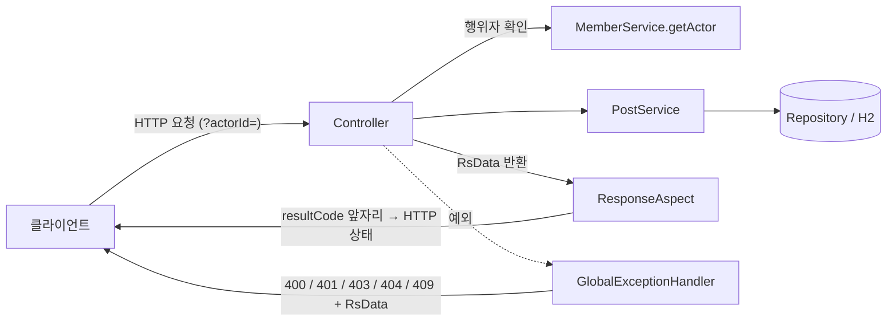

# REST4 — 스프링부트 REST API by TDD

글/댓글 REST API를 처음부터 만들고, 테스트 코드로 다듬고, API 문서를 자동 생성한 뒤, 회원과 작성자 권한까지 TDD로 구현해 나가는 학습용 저장소입니다.

- 모든 커밋에는 `001`, `002` … 처럼 **순번 태그**가 붙어 있습니다.
- 커밋 메세지에는 **무엇을 / 왜 / 확인** 이 자세히 적혀 있습니다.
- 단계별 상세 기록은 파트별 문서([1부](docs/part1-rest-api.md) · [2부](docs/part2-tdd.md) · [3부](docs/part3-api-docs-cors.md) · [4부](docs/part4-member-auth.md))에 있습니다.

  

## 목차
- [학습 흐름](#학습-흐름)
- [기술 스택과 실행 방법](#기술-스택과-실행-방법)
- [커밋 따라가는 방법](#커밋-따라가는-방법)
- [전체 구조 한눈에 보기](#전체-구조-한눈에-보기)
- [API 명세](#api-명세)
- [실험 커밋 목록](#실험-커밋-목록)
- [핵심 개념 정리](#핵심-개념-정리)
- [최종 테스트 결과](#최종-테스트-결과)

## 학습 흐름

| 파트 | 태그 | 무엇을 만드나 | 핵심 개념 | 상세 |
|---|---|---|---|---|
| 1부 | 001 ~ 048 | 프로젝트 세팅, 글/댓글 CRUD REST API | 엔티티 vs DTO, 순환 참조, 트랜잭션, `RsData`, AOP 로 상태 코드 설정 | [1부 문서](docs/part1-rest-api.md) |
| 2부 | 049 ~ 083 | MockMvc 컨트롤러 테스트, 전역 예외 처리, TDD 로 댓글 작성 | 요청 → 검증 구조, `@ControllerAdvice`, 400/404, `flush()` | [2부 문서](docs/part2-tdd.md) |
| 3부 | 084 ~ 099 | SpringDoc API 문서, 메인 페이지, CORS | OpenAPI, 그룹, `produces`, 동일 출처 정책 | [3부 문서](docs/part3-api-docs-cors.md) |
| 4부 | 100 ~ 130 | 회원가입/내 정보, 작성자, 작성자 본인만 수정·삭제 (모두 TDD) | `actorId`, 401 vs 403, 409, 권한 검사는 엔티티에 | [4부 문서](docs/part4-member-auth.md) |
| 정리 | 131 | README 구조 개편 | - | - |

## 기술 스택과 실행 방법

| 구분 | 내용 |
|---|---|
| 언어 / 빌드 | Java 25, Gradle (Kotlin DSL, 래퍼 포함) |
| 프레임워크 | Spring Boot 4.1.2, Spring Web MVC |
| 편의 도구 | Lombok, Spring Boot DevTools |
| 데이터 | Spring Data JPA, H2 (개발용 파일 DB / 테스트용 메모리 DB), H2 콘솔 |
| 검증 | Bean Validation (spring-boot-starter-validation) |
| 테스트 | JUnit 5, MockMvc, AssertJ, Hamcrest |
| API 문서 | SpringDoc OpenAPI 3.2.0 (Swagger UI) |

> 이후 단계에서 의존성이 늘어나면 이 표도 함께 갱신됩니다.

실행:
```bash
./gradlew bootRun    # 서버 실행 (기본 포트 8080, dev 프로파일, 샘플 데이터 자동 생성)
./gradlew test       # 테스트 실행 (test 프로파일, 메모리 DB)
```

| 주소 | 설명 |
|---|---|
| http://localhost:8080/ | 메인 페이지 (서버 정보, API 문서 링크) |
| http://localhost:8080/swagger-ui/index.html | API 문서 (Swagger UI, `apiV1` / `home` 그룹) |
| http://localhost:8080/v3/api-docs | OpenAPI 명세 JSON |
| http://localhost:8080/h2-console | H2 콘솔 (개발 DB) |

- CORS 허용 출처(`/api/**`): `https://cdpn.io`, `http://localhost:3000`

## 커밋 따라가는 방법

- **변경 내용(diff)** : `https://github.com/tbafe26/REST4/commit/태그` — 커밋 메세지와 바뀐 코드를 함께 봅니다.
- **그 시점의 코드** : `https://github.com/tbafe26/REST4/tree/태그` — 그 단계의 README와 코드 전체를 봅니다.
- **내 PC에서** :
  ```bash
  git clone https://github.com/tbafe26/REST4.git
  cd REST4
  git checkout 010      # 010 단계 코드로 이동
  git checkout main     # 최신으로 복귀
  ```
- 표시
  - **[실험]** : 일부러 문제가 드러나는 상태를 남긴 커밋입니다. 바로 다음 커밋에서 해결합니다.
  - 🔴 Red : 실패하는 테스트를 먼저 작성한 커밋
  - 🟢 Green : 테스트를 통과하도록 구현한 커밋
  - 🔵 Refactor : 동작은 그대로 두고 구조를 다듬은 커밋

## 전체 구조 한눈에 보기

### 요청 처리 흐름



### 예외 → 응답

| 예외 | 언제 | 응답 |
|---|---|---|
| `MethodArgumentNotValidException` | 요청 본문 검증 실패 | 400 `400-1` |
| `HttpMessageNotReadableException` | JSON 문법 오류 | 400 `400-1` |
| `UnauthenticatedException` | actorId 없음 / 존재하지 않는 회원 | 401 `401-1` |
| `AccessDeniedException` | 작성자가 아닌 회원의 수정·삭제 | 403 `403-1` |
| `NoSuchElementException` | 없는 글/댓글 | 404 `404-1` |
| `MemberDuplicateUsernameException` | 중복 username 가입 | 409 `409-1` |

### 패키지 구조

```
com.back
├─ BackApplication
├─ domain
│  ├─ member
│  │  └─ member
│  │     ├─ controller   ApiV1MemberController
│  │     ├─ dto          MemberDto (password 없음)
│  │     ├─ entity       Member
│  │     ├─ repository   MemberRepository
│  │     └─ service      MemberService (join, getActor)
│  ├─ home
│  │  └─ home
│  │     └─ controller   HomeController (메인 페이지, fetch 실습)
│  └─ post
│     ├─ post
│     │  ├─ controller   ApiV1PostController
│     │  ├─ dto          PostDto
│     │  ├─ entity       Post
│     │  ├─ repository   PostRepository
│     │  └─ service      PostService
│     └─ postComment
│        ├─ controller   ApiV1PostCommentController
│        ├─ dto          PostCommentDto
│        └─ entity       PostComment
└─ global
   ├─ aspect             ResponseAspect (resultCode → HTTP 상태 코드)
   ├─ globalExceptionHandler  GlobalExceptionHandler (예외 → RsData 응답)
   │                     MemberDuplicateUsernameException(409), UnauthenticatedException(401), AccessDeniedException(403)
   ├─ initData           BaseInitData (샘플 데이터)
   ├─ jpa.entity         BaseEntity
   ├─ rsData             RsData (공통 응답)
   ├─ springDoc          SpringDocConfig (API 문서 설정)
   └─ webMvc             WebMvcConfig (CORS)
```

도메인(`domain`)은 `기능/세부기능/계층` 순서로 나누고, 여러 도메인이 함께 쓰는 코드는 `global` 에 둡니다.

## API 명세

기본 경로는 `http://localhost:8080` 입니다. 단계가 진행되면서 응답 형태가 바뀌므로, 아래는 **최신 단계 기준**이며 단계별 변화는 작업내역에 적혀 있습니다.

### 행위자(actorId) 규칙

로그인 기능 대신 요청 주소에 `?actorId=회원번호` 를 붙여 "누가 요청했는지" 를 표현합니다.

- 행위자가 필요한 액션: 내 정보, 글 작성/수정/삭제, 댓글 작성/수정/삭제
- `actorId` 가 없거나 존재하지 않는 회원이면 **401** (`401-1`, `로그인 후 이용해주세요.`)
- 글/댓글 수정·삭제에서 행위자가 작성자가 아니면 **403** (`403-1`, `권한이 없습니다.`)

샘플 회원 (비밀번호는 모두 `12345678`)

| username | 이름 | 샘플 데이터 |
|---|---|---|
| system | 시스템 | - |
| admin | 관리자 | - |
| user1 | 유저1 | 1번 글, 1·4번 댓글 작성자 |
| user2 | 유저2 | 2번 글, 2·5번 댓글 작성자 |
| user3 | 유저3 | 3번 글, 3번 댓글 작성자 |
| user4 | 유저4 | - |

### 회원 `/api/v1/members`

| 메서드 | 경로 | 요청 본문 | 성공 응답 |
|---|---|---|---|
| POST | `/api/v1/members/join` | `{"username", "password", "name"}` | 201, `RsData<Void>` (`201-1`) |
| GET | `/api/v1/members/me?actorId=` | - | 200, `MemberDto` (`id, createDate, modifyDate, username, name`) |

### 글 `/api/v1/posts`

| 메서드 | 경로 | 요청 본문 | 성공 응답 |
|---|---|---|---|
| GET | `/api/v1/posts` | - | 200, `PostDto[]` |
| GET | `/api/v1/posts/{id}` | - | 200, `PostDto` |
| POST | `/api/v1/posts?actorId=` | `{"title", "content"}` | 201, `RsData<PostDto>` (`201-1`) |
| PUT | `/api/v1/posts/{id}?actorId=` | `{"title", "content"}` | 200, `RsData<Void>` (`200-1`) |
| DELETE | `/api/v1/posts/{id}?actorId=` | - | 200, `RsData<Void>` (`200-1`) |

### 댓글 `/api/v1/posts/{postId}/comments`

| 메서드 | 경로 | 요청 본문 | 성공 응답 |
|---|---|---|---|
| GET | `/api/v1/posts/{postId}/comments` | - | 200, `PostCommentDto[]` |
| GET | `/api/v1/posts/{postId}/comments/{id}` | - | 200, `PostCommentDto` |
| POST | `/api/v1/posts/{postId}/comments?actorId=` | `{"content"}` | 201, `RsData<PostCommentDto>` (`201-1`) |
| PUT | `/api/v1/posts/{postId}/comments/{id}?actorId=` | `{"content"}` | 200, `RsData<Void>` (`200-1`) |
| DELETE | `/api/v1/posts/{postId}/comments/{id}?actorId=` | - | 200, `RsData<Void>` (`200-1`) |

`PostDto` 는 `id, createDate, modifyDate, authorId, authorName, title, content`, `PostCommentDto` 는 `id, createDate, modifyDate, authorId, authorName, content` 입니다.

### 응답 규칙

조회를 제외한 응답은 `RsData` 형태이며, `resultCode` 앞자리가 HTTP 상태 코드가 됩니다(`ResponseAspect`).

```json
{
  "resultCode": "201-1",
  "msg": "4번 글이 작성되었습니다.",
  "data": { "id": 4, "createDate": "...", "modifyDate": "...", "authorId": 3, "authorName": "유저1", "title": "제목", "content": "내용" }
}
```

실패 응답도 같은 형태입니다(`GlobalExceptionHandler`).

| 상황 | HTTP 상태 | resultCode | msg |
|---|---|---|---|
| 없는 글/댓글 조회 | 404 | `404-1` | 해당 데이터가 존재하지 않습니다. |
| 요청 본문 검증 실패 | 400 | `400-1` | `필드-제약-메시지` (여러 줄, 정렬) |
| JSON 문법 오류 | 400 | `400-1` | 요청 본문이 올바르지 않습니다. |
| actorId 없음 / 존재하지 않는 회원 | 401 | `401-1` | 로그인 후 이용해주세요. |
| 작성자가 아닌 회원의 수정·삭제 | 403 | `403-1` | 권한이 없습니다. |
| 이미 사용 중인 username 으로 가입 | 409 | `409-1` | `{username}(은)는 이미 사용중인 username 입니다.` |

## 실험 커밋 목록

일부러 문제가 드러나는 상태를 남긴 커밋입니다. 바로 뒤 커밋에서 해결합니다.

| 태그 | 실험 | 드러나는 문제 |
|---|---|---|
| [`009`](https://github.com/tbafe26/REST4/commit/009) | 엔티티를 그대로 JSON 으로 반환 | 글 ↔ 댓글 순환 참조로 직렬화가 끝나지 않음 (`Document nesting depth (501) exceeds the maximum allowed`) |
| [`014`](https://github.com/tbafe26/REST4/commit/014) | 엔티티 필드명 `createDate` → `createdDate` | 응답 JSON 키가 바뀌고 기존 행의 값이 `null` 이 됨 |
| [`015`](https://github.com/tbafe26/REST4/commit/015) | 엔티티 필드명 `title`/`content` → `subject`/`body` | 응답 키가 `subject`, `body` 로 바뀌고, 댓글까지 키가 `body` 로 바뀜 |
| [`017`](https://github.com/tbafe26/REST4/commit/017) | getter 없는 `PostDto` 반환 | 오류 없이 빈 객체가 응답됨: 다건 `[{},{},{}]`, 단건 `{}` |
| [`024`](https://github.com/tbafe26/REST4/commit/024) | `@Transactional` 없이 댓글 삭제 | "1번 댓글이 삭제되었습니다." 응답 후에도 댓글이 그대로 남아 있음 |
| [`030`](https://github.com/tbafe26/REST4/commit/030) | 댓글 전용 `RsData` 로 글 삭제 응답 | 컴파일 오류: `PostDto cannot be converted to PostCommentDto` |
| [`082`](https://github.com/tbafe26/REST4/commit/082) | `flush()` 없이 댓글 작성 후 응답 | 응답이 `0번 댓글이 작성되었습니다.`, `data.id = 0`, 날짜 `null` |

## 핵심 개념 정리

<details>
<summary><b>엔티티를 그대로 응답하지 않는 이유 (DTO)</b> — 1부</summary>

- 엔티티를 그대로 JSON 으로 내보내면 **필드 이름이 곧 API 스펙**이 되어, 이름 하나 바꾸려고 엔티티·서비스·DB 까지 고쳐야 합니다(014~016).
- 양방향 연관관계는 **순환 참조**로 직렬화가 끝나지 않습니다(009).
- 비밀번호 같은 **민감 정보**가 실수로 나갈 수 있습니다(108, `MemberDto` 에는 password 필드가 없음).
- 응답 전용 record(`PostDto`, `PostCommentDto`, `MemberDto`)로 필요한 필드만 고릅니다.
</details>

<details>
<summary><b>트랜잭션, 더티체킹, flush</b> — 1부·2부</summary>

- 영속 상태의 엔티티를 바꾸면 **트랜잭션 커밋 시점**에 UPDATE/DELETE 가 실행됩니다. 트랜잭션이 없으면 반영되지 않습니다(024 → 025).
- 새 엔티티의 INSERT 도 기본적으로 커밋 시점에 실행되므로, 응답에 id 를 담으려면 `flush()` 로 먼저 반영합니다(082 → 083).
</details>

<details>
<summary><b>RsData 와 ResponseAspect</b> — 1부</summary>

- 조회가 아닌 응답은 `RsData<T>(resultCode, msg, data)` 로 통일합니다. 데이터가 없으면 `RsData<Void>`.
- `resultCode` 앞자리(예: `201-1` → 201)를 `ResponseAspect` 가 HTTP 상태 코드로 설정하므로 액션마다 `ResponseEntity` 를 쓸 필요가 없습니다(046).
- 예외 핸들러는 AOP 대상이 아니므로 `ResponseEntity` 로 상태 코드를 직접 지정합니다(072).
</details>

<details>
<summary><b>컨트롤러 테스트와 TDD</b> — 2부·4부</summary>

- MockMvc 테스트는 언제나 **요청 → 검증** 두 단계입니다. `handler()`, `status()`, `jsonPath()` 로 응답 스펙을 고정합니다.
- 요구사항이 바뀌면 **테스트를 먼저** 고치고(🔴) 구현합니다(🟢). 구조 개선(🔵)은 기존 테스트가 안전망입니다.
- 테스트는 `@Transactional` 로 롤백되어 서로 영향을 주지 않습니다.
</details>

<details>
<summary><b>API 문서와 CORS</b> — 3부</summary>

- SpringDoc 이 컨트롤러 코드에서 OpenAPI 명세를 만들고 Swagger UI 로 보여 줍니다. `@Tag`, `@Operation`, `@Parameter` 로 설명을 보강합니다.
- 브라우저는 **동일 출처 정책** 때문에 다른 출처로 보낸 요청의 응답을 기본적으로 스크립트에 주지 않습니다. 서버가 허용 출처를 응답 헤더로 알려야 합니다(098 → 099).
</details>

<details>
<summary><b>401 과 403</b> — 4부</summary>

- **401(인증 실패)**: 누구인지 모른다 — `actorId` 가 없거나 존재하지 않는 회원.
- **403(인가 실패)**: 누구인지는 알지만 권한이 없다 — 작성자가 아닌 회원의 수정·삭제.
- 행위자 확인은 `MemberService.getActor()` 한 곳에, 권한 판단은 엔티티(`checkActorCanModify/Delete`)에 두고, 응답 변환은 전역 예외 핸들러가 맡습니다.
</details>

## 최종 테스트 결과

`./gradlew test` (130 시점) — **35개 모두 통과**

| 테스트 클래스 | 테스트 수 |
|---|---|
| `ApiV1PostControllerTest` | 16 |
| `ApiV1PostCommentControllerTest` | 12 |
| `ApiV1MemberControllerTest` | 6 |
| `BaseInitDataTest` | 1 |

[실험]·🔴 커밋은 각 시점으로 체크아웃해 직접 실행한 결과를 커밋 메시지와 단계별 문서의 "확인" 에 기록했습니다.
