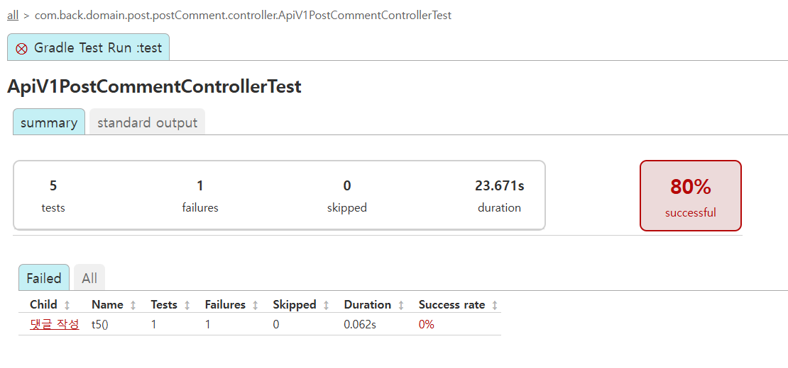
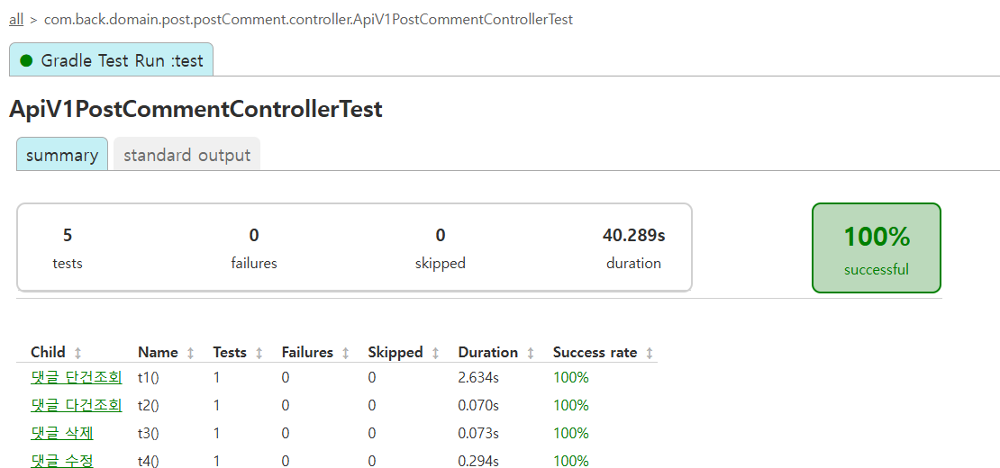

# 2부. REST API by TDD (049 ~ 083)

[← README](../README.md) · [1부](part1-rest-api.md) · **2부** · [3부](part3-api-docs-cors.md) · [4부](part4-member-auth.md)

## 요약

| 태그 | 내용 | 핵심 개념 |
|---|---|---|
| [`049`](https://github.com/tbafe26/REST4/commit/049) | ApiV1PostControllerTest, ApiV1PostCommentControllerTest 생성 | 컨트롤러 테스트 준비 |
| [`050`](https://github.com/tbafe26/REST4/commit/050) | 글 작성 요청 테스트(MockMvc) | @SpringBootTest, @AutoConfigureMockMvc, @Transactional 롤백 |
| [`051`](https://github.com/tbafe26/REST4/commit/051) | `.andDo(print())` | 테스트 중 요청/응답 확인 |
| [`052`](https://github.com/tbafe26/REST4/commit/052) | `.andExpect(status().isCreated())` | 응답 검증 |
| [`053`](https://github.com/tbafe26/REST4/commit/053) | `ResultActions` 로 요청/검증 분리 | 테스트 구조(요청 → 검증) |
| [`054`](https://github.com/tbafe26/REST4/commit/054) | 글 수정 테스트(PUT, 200) | put() 요청 빌더 |
| [`055`](https://github.com/tbafe26/REST4/commit/055) | ResponseAspect 포인트컷을 RsData 반환 메서드로 한정 | 포인트컷, 테스트가 리팩터링의 안전망 |
| [`056`](https://github.com/tbafe26/REST4/commit/056) | `handler().handlerType/methodName` 검증 | 요청 매핑 검증 |
| [`057`](https://github.com/tbafe26/REST4/commit/057) | 최신 글·전체 글 수를 DB 에서 조회해 응답과 대조 | jsonPath, 쿼리 메서드 findFirstByOrderByIdDesc |
| [`058`](https://github.com/tbafe26/REST4/commit/058) | data.post 의 모든 필드 검증 | 응답 스펙을 테스트로 고정 |
| [`059`](https://github.com/tbafe26/REST4/commit/059) | 🔴 작성 응답 data 를 PostDto 로 기대하도록 테스트 수정 | 요구 변경 시 테스트 먼저 |
| [`060`](https://github.com/tbafe26/REST4/commit/060) | 🟢 PostWriteResBody 제거, `RsData<PostDto>` | Red → Green |
| [`061`](https://github.com/tbafe26/REST4/commit/061) | 글 수정 테스트에 handler, resultCode, msg 검증 | 응답 본문 검증 |
| [`062`](https://github.com/tbafe26/REST4/commit/062) | 수정 후 DB 값 assertThat 검증(선택) | AssertJ |
| [`063`](https://github.com/tbafe26/REST4/commit/063) | DB 재조회 검증 제거 | 컨트롤러 테스트의 범위 |
| [`064`](https://github.com/tbafe26/REST4/commit/064) | 글 삭제 테스트(DELETE, 200-1) | delete() 요청 빌더 |
| [`065`](https://github.com/tbafe26/REST4/commit/065) | 글 단건조회 테스트, 필드 형태(isNumber/isString) 검증 | 필수 검증 범위 |
| [`066`](https://github.com/tbafe26/REST4/commit/066) | 단건조회 응답을 DB 값과 대조(선택) | 검증 강도 조절 |
| [`067`](https://github.com/tbafe26/REST4/commit/067) | 글 다건조회 테스트, 배열 각 원소 검증 | jsonPath 배열 인덱스 |
| [`068`](https://github.com/tbafe26/REST4/commit/068) | `$.length()` 로 글 개수 검증 | 목록 길이 검증 |
| [`069`](https://github.com/tbafe26/REST4/commit/069) | 🔴 없는 글 조회 시 404, `404-1` 기대 | 실패 시나리오 테스트 |
| [`070`](https://github.com/tbafe26/REST4/commit/070) | 🟢 GlobalExceptionHandler 로 NoSuchElementException 처리 | @ControllerAdvice, @ExceptionHandler |
| [`071`](https://github.com/tbafe26/REST4/commit/071) | @RestControllerAdvice + @ResponseStatus(NOT_FOUND) | 예외 응답 상태 코드 지정 방법 A |
| [`072`](https://github.com/tbafe26/REST4/commit/072) | ResponseEntity 방식 + @ControllerAdvice | 예외 응답 상태 코드 지정 방법 B |
| [`073`](https://github.com/tbafe26/REST4/commit/073) | 제목 없이 작성 시 400, MethodArgumentNotValidException 처리 | @Valid 실패 응답 |
| [`074`](https://github.com/tbafe26/REST4/commit/074) | 내용 없이 작성 시 400 테스트 | 같은 규칙의 실패 케이스 추가 |
| [`075`](https://github.com/tbafe26/REST4/commit/075) | 잘못된 JSON 시 400, HttpMessageNotReadableException 처리 | 역직렬화 실패 응답 |
| [`076`](https://github.com/tbafe26/REST4/commit/076) | ApiV1PostCommentControllerTest 설정(MockMvc, PostService) | 테스트 클래스 공통 설정 |
| [`077`](https://github.com/tbafe26/REST4/commit/077) | 댓글 단건조회 테스트 | 중첩 경로 요청, DB 대조 |
| [`078`](https://github.com/tbafe26/REST4/commit/078) | 댓글 다건조회 테스트, 개수·원소 검증 | 목록 검증 |
| [`079`](https://github.com/tbafe26/REST4/commit/079) | 댓글 삭제 테스트(DELETE, 200-1) | 삭제 응답 검증 |
| [`080`](https://github.com/tbafe26/REST4/commit/080) | 댓글 수정 테스트(PUT, 200-1) | 수정 응답 검증 |
| [`081`](https://github.com/tbafe26/REST4/commit/081) | 🔴 댓글 작성 테스트(201-1, data 검증) | 테스트 먼저 작성 |
| [`082`](https://github.com/tbafe26/REST4/commit/082) | [실험] 댓글 작성 구현(flush 없음) | 쓰기 지연, IDENTITY 와 INSERT 시점 |
| [`083`](https://github.com/tbafe26/REST4/commit/083) | 🟢 `postService.flush()` 로 즉시 INSERT | flush, 영속성 컨텍스트 동기화 |

## 단계별 상세

#### 049 컨트롤러 테스트 클래스 생성
[이 시점의 코드](https://github.com/tbafe26/REST4/tree/049) · [변경 내용](https://github.com/tbafe26/REST4/commit/049)

**무엇을** 빈 테스트 클래스 `ApiV1PostControllerTest`, `ApiV1PostCommentControllerTest` 를 테스트 쪽에 컨트롤러와 같은 패키지로 만들고, 기본 생성된 `BackApplicationTests` 는 지웠습니다.

**왜** 지금까지는 기능을 만든 뒤 curl 로 손수 확인했습니다. 여기서부터는 **테스트 코드로 요청을 보내고 결과를 검증**합니다. 테스트가 있으면 이후 공통 코드를 바꿀 때도 기존 기능이 깨졌는지 즉시 알 수 있습니다. 컨트롤러 테스트는 언제나 "1. 요청을 보낸다 → 2. 응답을 검증한다" 두 단계로 이루어집니다.

**확인** 테스트 클래스만 생겼고 테스트 메서드는 아직 없습니다.

#### 050 글 작성 테스트 — MockMvc 로 POST 요청 보내기
[이 시점의 코드](https://github.com/tbafe26/REST4/tree/050) · [변경 내용](https://github.com/tbafe26/REST4/commit/050)

**무엇을** `ApiV1PostControllerTest` 에 글 작성 테스트 `t1` 을 추가했습니다. `MockMvc` 로 `POST /api/v1/posts` 에 JSON 본문을 보냅니다. 아직 검증은 없습니다.

<details>
<summary>코드 보기</summary>

```java
@ActiveProfiles("test")  // 메모리 DB 를 쓰는 test 프로파일
@SpringBootTest          // 애플리케이션 전체를 띄운다
@AutoConfigureMockMvc    // 서버 없이 HTTP 요청을 흉내 내는 MockMvc 준비
@Transactional           // 테스트가 끝나면 롤백 → 테스트끼리 데이터가 섞이지 않음
public class ApiV1PostControllerTest {
    @Autowired
    private MockMvc mvc;

    @Test
    @DisplayName("글 작성")
    void t1() throws Exception {
        mvc.perform(post("/api/v1/posts").contentType(MediaType.APPLICATION_JSON)
                .content("""{ "title": "제목", "content": "내용" }"""));
    }
}
```

</details>

**왜** 실제 톰캣을 띄우지 않고도 Postman 처럼 요청을 보낼 수 있어야 테스트가 빠르고 반복 가능합니다. `@Transactional` 덕분에 테스트에서 만든 글은 롤백되어 다른 테스트에 영향을 주지 않습니다.

**확인** `./gradlew test --tests "*ApiV1PostControllerTest"`

#### 051 요청과 응답을 출력하는 andDo(print())
[이 시점의 코드](https://github.com/tbafe26/REST4/tree/051) · [변경 내용](https://github.com/tbafe26/REST4/commit/051)

**무엇을** 요청 뒤에 `.andDo(print())` 를 붙였고, 050 에서 설명용으로 단 어노테이션 주석은 정리했습니다.

**왜** 테스트 실행 로그에 요청(메서드, URI, 본문)과 응답(상태, 헤더, 본문)이 모두 찍혀서 무엇이 오갔는지 눈으로 확인하며 검증 코드를 작성할 수 있습니다.

**확인** 테스트 실행 로그에 `MockHttpServletResponse: Status = ..., Body = ...` 가 출력됩니다.

#### 052 응답 상태 코드 201 검증
[이 시점의 코드](https://github.com/tbafe26/REST4/tree/052) · [변경 내용](https://github.com/tbafe26/REST4/commit/052)

**무엇을** `.andExpect(status().isCreated())` 로 응답 상태 코드가 201 인지 검증합니다.

**왜** 출력만으로는 사람이 매번 눈으로 확인해야 합니다. 기대값을 코드로 적어 두면 테스트가 자동으로 성공/실패를 판정합니다. 201 은 `ResponseAspect` 가 `resultCode` `201-1` 을 보고 설정한 값입니다.

**확인** `./gradlew test --tests "*ApiV1PostControllerTest"`

#### 053 요청과 검증 단계를 ResultActions 로 분리
[이 시점의 코드](https://github.com/tbafe26/REST4/tree/053) · [변경 내용](https://github.com/tbafe26/REST4/commit/053)

**무엇을** 요청 결과를 `ResultActions resultActions` 변수에 받고, 검증은 `resultActions.andExpect(...)` 로 따로 씁니다.

**왜** 컨트롤러 테스트는 항상 "요청 → 검증" 두 단계입니다. 코드에서도 두 단계를 나눠 두면 검증 항목이 늘어나도 읽기 쉽습니다.

```java
ResultActions resultActions = mvc.perform(post("/api/v1/posts") ...).andDo(print());

resultActions
        .andExpect(status().isCreated());
```

**확인** 검증 내용은 052 와 같습니다.

#### 054 글 수정 테스트
[이 시점의 코드](https://github.com/tbafe26/REST4/tree/054) · [변경 내용](https://github.com/tbafe26/REST4/commit/054)

**무엇을** `t2`("글 수정") 를 추가했습니다. `PUT /api/v1/posts/1` 에 새 제목/내용을 보내고 상태 코드 200 을 검증합니다.

**왜** 이미 만든 수정 API 도 테스트로 보호합니다. 1번 글은 샘플 데이터로 항상 존재하고, `@Transactional` 롤백 덕분에 수정해도 다른 테스트에 영향이 없습니다.

**확인** `./gradlew test --tests "*ApiV1PostControllerTest"`

#### 055 ResponseAspect 적용 범위 개선
[이 시점의 코드](https://github.com/tbafe26/REST4/tree/055) · [변경 내용](https://github.com/tbafe26/REST4/commit/055)

**무엇을** `ResponseAspect` 의 포인트컷을 "`RsData` 를 반환하는 public 메서드 중 `@Controller`/`@RestController` 의 매핑 메서드" 로 바꿨습니다. 대상이 항상 `RsData` 이므로 `instanceof` 검사도 없앴습니다.

**왜** 반환 타입으로 대상을 좁히면 불필요한 메서드까지 가로채지 않고 의도가 명확해집니다. 이런 **프로젝트 전반에 영향을 주는 변경**을 할 때 테스트가 있으면, 테스트를 돌리는 것만으로 기존 API 가 그대로 동작하는지 확인할 수 있습니다.

```java
@Around("""
        execution(public com.back.global.rsData.RsData *(..)) &&
        (within(@Controller *) || within(@RestController *)) &&
        (@annotation(GetMapping) || @annotation(PostMapping) || ...)
        """)
```

**확인** `./gradlew test` — 글 작성(201), 글 수정(200) 테스트가 그대로 통과해야 합니다.

#### 056 요청을 처리한 컨트롤러와 메서드 검증
[이 시점의 코드](https://github.com/tbafe26/REST4/tree/056) · [변경 내용](https://github.com/tbafe26/REST4/commit/056)

**무엇을** 글 작성 테스트에 `handler().handlerType(ApiV1PostController.class)`, `handler().methodName("write")` 검증을 추가했습니다.

**왜** 상태 코드만 맞아도 엉뚱한 메서드가 요청을 처리했을 수 있습니다. 의도한 컨트롤러의 의도한 액션이 실행됐는지까지 확인합니다.

**확인** `./gradlew test --tests "*ApiV1PostControllerTest"`

#### 057 글 작성 응답을 DB 데이터와 대조
[이 시점의 코드](https://github.com/tbafe26/REST4/tree/057) · [변경 내용](https://github.com/tbafe26/REST4/commit/057)

**무엇을** `PostRepository.findFirstByOrderByIdDesc()`, `PostService.findLatest()` 를 추가했습니다. 테스트에서는 요청 후 가장 최근 글과 전체 글 수를 DB 에서 꺼내 `resultCode`, `msg`, `data.totalCount`, `data.post.id` 를 대조합니다.

**왜** 상태 코드만으로는 응답 본문이 맞는지 알 수 없습니다. "방금 만든 글" 을 DB 에서 꺼내 응답 값과 비교하면 응답이 실제 저장 결과를 정확히 반영하는지 확인됩니다.

```java
Post post = postService.findLatest().get();
long totalCount = postService.count();

resultActions
        .andExpect(jsonPath("$.resultCode").value("201-1"))
        .andExpect(jsonPath("$.msg").value("%d번 글이 작성되었습니다.".formatted(post.getId())))
        .andExpect(jsonPath("$.data.totalCount").value(totalCount))
        .andExpect(jsonPath("$.data.post.id").value(post.getId()));
```

**확인** `./gradlew test --tests "*ApiV1PostControllerTest"`

#### 058 응답 JSON 의 모든 필드 검증
[이 시점의 코드](https://github.com/tbafe26/REST4/tree/058) · [변경 내용](https://github.com/tbafe26/REST4/commit/058)

**무엇을** `data.post` 의 `createDate`, `modifyDate`, `title`, `content` 까지 검증합니다. 날짜는 DB 값과 응답의 정밀도가 다를 수 있어 앞 20자리만 `Matchers.startsWith` 로 비교합니다.

**왜** 응답에 담긴 **모든 필드**를 테스트해야 클라이언트에게 약속한 응답 형태(스펙)가 바뀌었을 때 바로 알 수 있습니다. 테스트가 곧 살아 있는 API 문서가 됩니다.

**확인** `./gradlew test --tests "*ApiV1PostControllerTest"`

#### 059 🔴 요구사항 변경(totalCount 제거)을 테스트에 먼저 반영
[이 시점의 코드](https://github.com/tbafe26/REST4/tree/059) · [변경 내용](https://github.com/tbafe26/REST4/commit/059)

**무엇을** "글 작성 응답에 `totalCount` 는 더 이상 필요 없고, `data` 에 글 정보만 바로 담아 달라"는 변경 요구를 받았습니다. 구현은 그대로 두고 테스트의 기대값만 `$.data.post.*` → `$.data.*` 로 바꿨습니다.

**왜** 이미 있는 기능의 요구사항이 바뀌면 **테스트를 먼저 고쳐** 새 요구를 코드로 명시합니다. 그러면 테스트가 실패하면서 "아직 구현이 요구를 만족하지 않는다"는 것을 보여 주고, 구현을 고친 뒤 통과하는 것으로 완료를 판단할 수 있습니다.

**확인** `글 작성` 테스트가 `No value at JSON path "$.data.id"` 로 실패합니다. 구현은 아직 `data.totalCount`, `data.post` 구조로 응답하기 때문입니다.

#### 060 🟢 글 작성 응답을 RsData<PostDto> 로 변경
[이 시점의 코드](https://github.com/tbafe26/REST4/tree/060) · [변경 내용](https://github.com/tbafe26/REST4/commit/060)

**무엇을** `PostWriteResBody` 와 `totalCount` 조회를 없애고 글 작성이 `RsData<PostDto>` 를 반환하게 했습니다. 테스트에서 쓰지 않게 된 `totalCount` 변수도 지웠습니다.

**왜** 059 에서 바꾼 테스트를 통과시키는 최소한의 구현입니다. 테스트가 통과하면 요구 변경이 반영된 것입니다.

**확인** `./gradlew test --tests "*ApiV1PostControllerTest"`

#### 061 글 수정 테스트 보강
[이 시점의 코드](https://github.com/tbafe26/REST4/tree/061) · [변경 내용](https://github.com/tbafe26/REST4/commit/061)

**무엇을** 글 수정 테스트에서 대상 id 를 변수로 빼고, `handler()`(modify), `resultCode`(`200-1`), `msg` 검증을 추가했습니다.

**왜** 글 작성 테스트와 같은 수준으로 응답 본문까지 검증해야 수정 API 의 스펙이 테스트로 고정됩니다.

**확인** `./gradlew test --tests "*ApiV1PostControllerTest"`

#### 062 글 수정 결과가 DB 에 반영됐는지까지 확인
[이 시점의 코드](https://github.com/tbafe26/REST4/tree/062) · [변경 내용](https://github.com/tbafe26/REST4/commit/062)

**무엇을** 수정 요청 후 `postService.findById(id)` 로 글을 다시 조회해 제목/내용이 바뀌었는지 `assertThat` 으로 확인합니다.

**왜** 응답이 "수정되었습니다" 라고 해도 실제 저장이 안 됐을 수 있습니다. DB 까지 확인하는 것은 더 확실하지만, 컨트롤러 테스트의 필수 범위는 아닙니다(선택 사항).

**확인** `./gradlew test --tests "*ApiV1PostControllerTest"`

#### 063 컨트롤러 테스트에서 과한 DB 검증 제거
[이 시점의 코드](https://github.com/tbafe26/REST4/tree/063) · [변경 내용](https://github.com/tbafe26/REST4/commit/063)

**무엇을** 062 에서 추가한 DB 재조회 검증을 지웠습니다.

**왜** 컨트롤러 테스트는 **요청에 대한 응답**을 검증하는 것이 목적입니다. 저장 로직의 정확성은 서비스/리포지터리 쪽 관심사이고, 컨트롤러 테스트마다 DB 를 다시 확인하면 테스트가 길어지고 중복됩니다.

**확인** `./gradlew test --tests "*ApiV1PostControllerTest"`

#### 064 글 삭제 테스트
[이 시점의 코드](https://github.com/tbafe26/REST4/tree/064) · [변경 내용](https://github.com/tbafe26/REST4/commit/064)

**무엇을** `t3`("글 삭제") 를 추가했습니다. `DELETE /api/v1/posts/1` 후 handler(delete), 200, `resultCode` `200-1`, `msg` 를 검증합니다.

**왜** 글 CRUD 중 삭제도 테스트로 보호합니다. 롤백되므로 1번 글을 지워도 다른 테스트에 영향이 없습니다.

**확인** `./gradlew test --tests "*ApiV1PostControllerTest"`

#### 065 글 단건조회 테스트 — 응답 필드 형태 검증
[이 시점의 코드](https://github.com/tbafe26/REST4/tree/065) · [변경 내용](https://github.com/tbafe26/REST4/commit/065)

**무엇을** `t4`("글 단건조회") 를 추가했습니다. `GET /api/v1/posts/1` 응답에 `id`(숫자), `createDate`·`modifyDate`·`title`·`content`(문자열) 가 있는지 검증합니다.

**왜** 컨트롤러 테스트에서 **필수**인 것은 "응답 JSON 의 각 필드가 존재하고 형태가 유효한가" 입니다. 이 정도만으로도 응답 스펙이 깨지는 것을 잡을 수 있습니다.

**확인** `./gradlew test --tests "*ApiV1PostControllerTest"`

#### 066 글 단건조회 테스트 — 실제 DB 값과 대조
[이 시점의 코드](https://github.com/tbafe26/REST4/tree/066) · [변경 내용](https://github.com/tbafe26/REST4/commit/066)

**무엇을** 형태 검증을 실제 값 검증으로 바꿨습니다. `postService.findById(id)` 로 꺼낸 글의 id, 날짜(앞 20자리), 제목, 내용과 응답을 비교합니다.

**왜** 형태만 맞고 엉뚱한 글이 올 수도 있습니다. DB 값과 대조하면 더 확실하지만, 이 정도까지 하는 것은 **선택**입니다.

**확인** `./gradlew test --tests "*ApiV1PostControllerTest"`

#### 067 글 다건조회 테스트
[이 시점의 코드](https://github.com/tbafe26/REST4/tree/067) · [변경 내용](https://github.com/tbafe26/REST4/commit/067)

**무엇을** `t5`("글 다건조회") 를 추가했습니다. `postService.findAll()` 로 꺼낸 글 목록을 돌면서 응답 배열의 `$[i].id`, 날짜, 제목, 내용을 대조합니다.

**왜** 목록 응답은 순서와 각 원소의 내용이 모두 중요합니다. 반복문으로 모든 원소를 검사합니다.

```java
for (int i = 0; i < posts.size(); i++) {
    Post post = posts.get(i);
    resultActions.andExpect(jsonPath("$[%d].id".formatted(i)).value(post.getId())) ...;
}
```

**확인** `./gradlew test --tests "*ApiV1PostControllerTest"`

#### 068 글 다건조회 개수 검증
[이 시점의 코드](https://github.com/tbafe26/REST4/tree/068) · [변경 내용](https://github.com/tbafe26/REST4/commit/068)

**무엇을** 응답 배열 길이(`$.length()`)가 DB 의 글 수와 같은지 검증합니다.

**왜** 반복문 검증은 DB 목록 길이만큼만 돌기 때문에, 응답에 **원소가 더 많은 경우**는 잡지 못합니다. 길이를 따로 검사해 빈틈을 메웁니다.

**확인** `./gradlew test --tests "*ApiV1PostControllerTest"`

#### 069 🔴 존재하지 않는 글 조회 → 404 테스트
[이 시점의 코드](https://github.com/tbafe26/REST4/tree/069) · [변경 내용](https://github.com/tbafe26/REST4/commit/069)

**무엇을** `t6`("글 단건조회, 404") 를 추가했습니다. 존재할 수 없는 id(`Integer.MAX_VALUE`) 로 조회하면 404, `resultCode` `404-1`, `msg` `해당 데이터가 존재하지 않습니다.` 가 와야 한다고 기대합니다.

**왜** 지금 구현은 `Optional.get()` 이 예외를 던지고 그대로 끝납니다. 클라이언트가 이해할 수 있는 실패 응답을 주도록 **원하는 결과를 테스트로 먼저** 적습니다.

**확인** `글 단건조회, 404` 테스트가 `NoSuchElementException: No value present` 를 감싼 `ServletException` 으로 실패합니다. 예외를 응답으로 바꿔 주는 곳이 없어 요청 처리 자체가 실패합니다.

#### 070 🟢 전역 예외 핸들러 — @ControllerAdvice + @ResponseBody
[이 시점의 코드](https://github.com/tbafe26/REST4/tree/070) · [변경 내용](https://github.com/tbafe26/REST4/commit/070)

**무엇을** `global/globalExceptionHandler/GlobalExceptionHandler` 를 추가했습니다. 어느 컨트롤러에서든 `NoSuchElementException` 이 나면 `RsData("404-1", "해당 데이터가 존재하지 않습니다.")` 를 JSON 으로 응답합니다.

```java
@ControllerAdvice
public class GlobalExceptionHandler {
    @ExceptionHandler(NoSuchElementException.class)
    @ResponseBody
    public RsData<Void> handle() {
        return new RsData<>("404-1", "해당 데이터가 존재하지 않습니다.");
    }
}
```

**왜** 모든 액션에 try-catch 를 넣는 대신, 예외 → 응답 변환을 **한 곳에** 모읍니다. `Optional.get()` 이 던지는 `NoSuchElementException` 은 "데이터가 없다" 는 뜻이므로 404 로 보냅니다.

> **확인해 볼 것** 응답 본문은 `404-1` 이 되지만, 이 메서드는 `ResponseAspect` 대상(컨트롤러 매핑 메서드)이 아니라서 HTTP 상태 코드가 404 로 바뀌지 않습니다. 다음 단계에서 상태 코드를 직접 지정합니다.

#### 071 @RestControllerAdvice 와 @ResponseStatus(NOT_FOUND)
[이 시점의 코드](https://github.com/tbafe26/REST4/tree/071) · [변경 내용](https://github.com/tbafe26/REST4/commit/071)

**무엇을** `@ControllerAdvice` 를 `@RestControllerAdvice` 로 바꿔 `@ResponseBody` 를 없애고, `@ResponseStatus(NOT_FOUND)` 로 상태 코드를 404 로 지정했습니다.

**왜** `@RestControllerAdvice = @ControllerAdvice + @ResponseBody` 입니다(`@RestController` 와 같은 관계). 예외 핸들러는 `ResponseAspect` 가 상태 코드를 바꿔 주지 않으므로 `@ResponseStatus` 로 직접 지정합니다.

**확인** `./gradlew test --tests "*ApiV1PostControllerTest"` — 404 테스트(`t6`)가 통과해야 합니다.

#### 072 ResponseEntity 로 예외 응답 상태 코드 지정
[이 시점의 코드](https://github.com/tbafe26/REST4/tree/072) · [변경 내용](https://github.com/tbafe26/REST4/commit/072)

**무엇을** 핸들러가 `ResponseEntity<RsData<Void>>` 를 반환하며 `NOT_FOUND` 를 함께 담도록 바꿨습니다. `ResponseEntity` 는 그 자체로 응답 본문이 되므로 다시 `@ControllerAdvice` 로 돌렸습니다.

**왜** `@ResponseStatus` 는 상태 코드가 고정이지만, `ResponseEntity` 는 예외 내용에 따라 상태 코드를 코드로 정할 수 있어 핸들러가 늘어날 때 유연합니다. 두 방법 모두 정답이며 이 프로젝트는 `ResponseEntity` 방식으로 이어갑니다.

```java
@ExceptionHandler(NoSuchElementException.class)
public ResponseEntity<RsData<Void>> handle() {
    return new ResponseEntity<>(new RsData<>("404-1", "해당 데이터가 존재하지 않습니다."), NOT_FOUND);
}
```

**확인** `./gradlew test --tests "*ApiV1PostControllerTest"`

#### 073 제목 없이 글 작성 → 400
[이 시점의 코드](https://github.com/tbafe26/REST4/tree/073) · [변경 내용](https://github.com/tbafe26/REST4/commit/073)

**무엇을** 제목이 빈 문자열인 글 작성 테스트(`t7`)와, `MethodArgumentNotValidException` 핸들러를 추가했습니다. 핸들러는 필드 오류를 `필드-제약-메시지` 형태로 만들어 정렬한 뒤 줄바꿈으로 이어 `400-1` 로 응답합니다. 기존 404 핸들러에는 예외 매개변수를 명시했습니다.

```java
String msg = ex.getBindingResult().getAllErrors().stream()
        .filter(error -> error instanceof FieldError)
        .map(error -> (FieldError) error)
        .map(error -> error.getField() + "-" + error.getCode() + "-" + error.getDefaultMessage())
        .sorted()
        .collect(Collectors.joining("\n"));
```

**왜** `@Valid` 검증에 실패하면 스프링이 `MethodArgumentNotValidException` 을 던지고 기본 오류 응답이 나갑니다. 클라이언트가 어떤 필드가 왜 틀렸는지 알 수 있도록 `RsData` 형식으로 바꿉니다. 오류 순서는 실행마다 달라질 수 있어 **정렬**해야 테스트가 안정적입니다.

**확인** `./gradlew test --tests "*ApiV1PostControllerTest"`

#### 074 내용 없이 글 작성 → 400
[이 시점의 코드](https://github.com/tbafe26/REST4/tree/074) · [변경 내용](https://github.com/tbafe26/REST4/commit/074)

**무엇을** 내용이 빈 문자열인 글 작성 테스트(`t8`)를 추가했습니다. 기대 메시지는 `content-NotBlank-...`, `content-Size-...` 두 줄입니다.

**왜** 073 의 핸들러가 다른 필드에도 같은 규칙으로 동작하는지 확인합니다. 구현 변경은 없습니다.

**확인** `./gradlew test --tests "*ApiV1PostControllerTest"`

#### 075 잘못된 JSON 으로 글 작성 → 400
[이 시점의 코드](https://github.com/tbafe26/REST4/tree/075) · [변경 내용](https://github.com/tbafe26/REST4/commit/075)

**무엇을** 문법이 깨진 JSON 으로 글 작성을 요청하는 테스트(`t9`)와 `HttpMessageNotReadableException` 핸들러(`400-1`, `요청 본문이 올바르지 않습니다.`)를 추가했습니다.

**왜** JSON 자체를 읽을 수 없으면 `@Valid` 검증 전에 역직렬화 단계에서 실패합니다. 이 경우도 클라이언트가 원인을 알 수 있게 우리 응답 형식으로 돌려줍니다.

**확인** `./gradlew test --tests "*ApiV1PostControllerTest"`

#### 076 댓글 컨트롤러 테스트 준비
[이 시점의 코드](https://github.com/tbafe26/REST4/tree/076) · [변경 내용](https://github.com/tbafe26/REST4/commit/076)

**무엇을** `ApiV1PostCommentControllerTest` 에 글 테스트와 같은 설정(`@ActiveProfiles("test")`, `@SpringBootTest`, `@AutoConfigureMockMvc`, `@Transactional`)과 `MockMvc`, `PostService` 주입을 추가했습니다.

**왜** 댓글 API 도 같은 방식(요청 → 검증)으로 테스트하기 위한 준비입니다. 댓글은 글을 통해 조회하므로 `PostService` 가 필요합니다.

**확인** 테스트 메서드는 아직 없습니다.

#### 077 댓글 단건조회 테스트
[이 시점의 코드](https://github.com/tbafe26/REST4/tree/077) · [변경 내용](https://github.com/tbafe26/REST4/commit/077)

**무엇을** `t1`("댓글 단건조회") 를 추가했습니다. `GET /api/v1/posts/1/comments/1` 응답의 id, 날짜, 내용을 `post.findCommentById(1)` 결과와 대조합니다.

**왜** 글 단건조회 테스트와 같은 방식으로 댓글 조회 응답 스펙을 고정합니다.

**확인** `./gradlew test --tests "*ApiV1PostCommentControllerTest"`

#### 078 댓글 다건조회 테스트
[이 시점의 코드](https://github.com/tbafe26/REST4/tree/078) · [변경 내용](https://github.com/tbafe26/REST4/commit/078)

**무엇을** `t2`("댓글 다건조회") 를 추가했습니다. 1번 글의 댓글 목록과 응답 배열의 길이, 각 원소(id, 날짜, 내용)를 대조합니다.

**왜** 글 다건조회 테스트에서 배운 대로 길이와 원소를 모두 검증합니다.

**확인** `./gradlew test --tests "*ApiV1PostCommentControllerTest"`

#### 079 댓글 삭제 테스트
[이 시점의 코드](https://github.com/tbafe26/REST4/tree/079) · [변경 내용](https://github.com/tbafe26/REST4/commit/079)

**무엇을** `t3`("댓글 삭제") 를 추가했습니다. `DELETE /api/v1/posts/1/comments/1` 후 handler(delete), 200, `200-1`, `msg` 를 검증합니다.

**왜** 댓글 삭제 API 를 테스트로 보호합니다.

**확인** `./gradlew test --tests "*ApiV1PostCommentControllerTest"`

#### 080 댓글 수정 테스트
[이 시점의 코드](https://github.com/tbafe26/REST4/tree/080) · [변경 내용](https://github.com/tbafe26/REST4/commit/080)

**무엇을** `t4`("댓글 수정") 를 추가했습니다. `PUT /api/v1/posts/1/comments/1` 에 `{"content": "내용 new"}` 를 보내고 handler(modify), 200, `200-1`, `msg` 를 검증합니다.

**왜** 댓글 수정 API 를 테스트로 보호합니다. 이로써 댓글 작성을 제외한 댓글 API 가 모두 테스트로 덮였습니다.

**확인** `./gradlew test --tests "*ApiV1PostCommentControllerTest"`

#### 081 🔴 댓글 작성 테스트
[이 시점의 코드](https://github.com/tbafe26/REST4/tree/081) · [변경 내용](https://github.com/tbafe26/REST4/commit/081)

**무엇을** 아직 없는 댓글 작성 기능에 대한 테스트 `t5`("댓글 작성") 를 먼저 작성했습니다. `POST /api/v1/posts/1/comments` 에 `{"content": "내용"}` 을 보내면 201, `201-1`, `N번 댓글이 작성되었습니다.`, `data` 에 새 댓글 정보가 와야 합니다. 기대값은 요청 후 글의 마지막 댓글(`getComments().getLast()`)에서 꺼냅니다.

**왜** 이번에는 기능보다 **테스트를 먼저** 만듭니다. 원하는 동작을 테스트로 명확히 적어 두고, 그 테스트를 통과시키는 것을 구현의 목표로 삼습니다.

**확인** `댓글 작성` 테스트가 `No handler` 로 실패합니다. 아직 `POST` 를 처리할 액션이 없습니다.



#### 082 [실험] 댓글 작성 구현 — flush 없이
[이 시점의 코드](https://github.com/tbafe26/REST4/tree/082) · [변경 내용](https://github.com/tbafe26/REST4/commit/082)

**무엇을** `POST /api/v1/posts/{postId}/comments` 를 구현했습니다. 요청 본문은 `PostCommentWriteReqBody`(content), 응답은 `RsData<PostCommentDto>`(`201-1`) 입니다. `PostService.writeComment` 가 생성된 댓글을 반환하도록 바꿨습니다.

**왜** 댓글은 `post.addComment()` 로 컬렉션에 추가되고 cascade 에 의해 저장됩니다. 이렇게 저장되는 엔티티는 **언제 INSERT 가 실행되는지**에 따라 응답 시점의 `id` 값이 달라질 수 있습니다. 그 결과를 확인하는 실험입니다.

**확인** (test 프로파일로 서버 실행 후 `POST /api/v1/posts/1/comments`) 응답이 `{"resultCode":"201-1","msg":"0번 댓글이 작성되었습니다.","data":{"id":0,"createDate":null,"modifyDate":null,...}}` 입니다. 응답을 만드는 시점에는 아직 INSERT 가 실행되지 않아 id 와 생성일이 채워지지 않았습니다. 테스트(`댓글 작성`)도 `PostComment.getCreateDate()` 가 `null` 이라 실패합니다.

#### 083 🟢 flush() 로 INSERT 를 즉시 실행
[이 시점의 코드](https://github.com/tbafe26/REST4/tree/083) · [변경 내용](https://github.com/tbafe26/REST4/commit/083)

**무엇을** `PostService.flush()`(→ `postRepository.flush()`) 를 추가하고, 댓글 작성 액션에서 댓글을 추가한 직후 호출합니다.

```java
PostComment postComment = postService.writeComment(post, reqBody.content);
postService.flush(); // 지금까지의 변경을 DB 에 반영 → 댓글 id 확정
```

**왜** `flush()` 는 영속성 컨텍스트에 쌓인 변경 사항을 **트랜잭션 커밋 전에** DB 로 보냅니다. INSERT 가 실행되면 DB 가 만든 id 가 엔티티에 채워지므로 응답에 올바른 댓글 번호를 담을 수 있습니다. 트랜잭션은 그대로 유지되어 이후 예외가 나면 함께 롤백됩니다.

**확인** `./gradlew test --tests "*ApiV1PostCommentControllerTest"` — 댓글 작성 테스트가 통과해야 합니다.



---

[← README](../README.md) · [1부](part1-rest-api.md) · **2부** · [3부](part3-api-docs-cors.md) · [4부](part4-member-auth.md)
