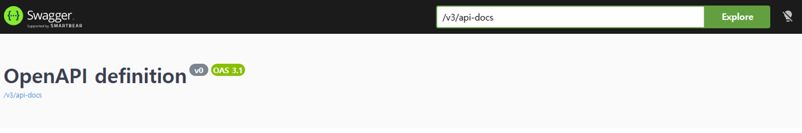
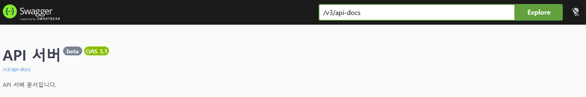
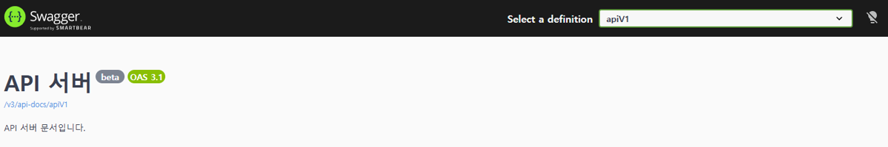
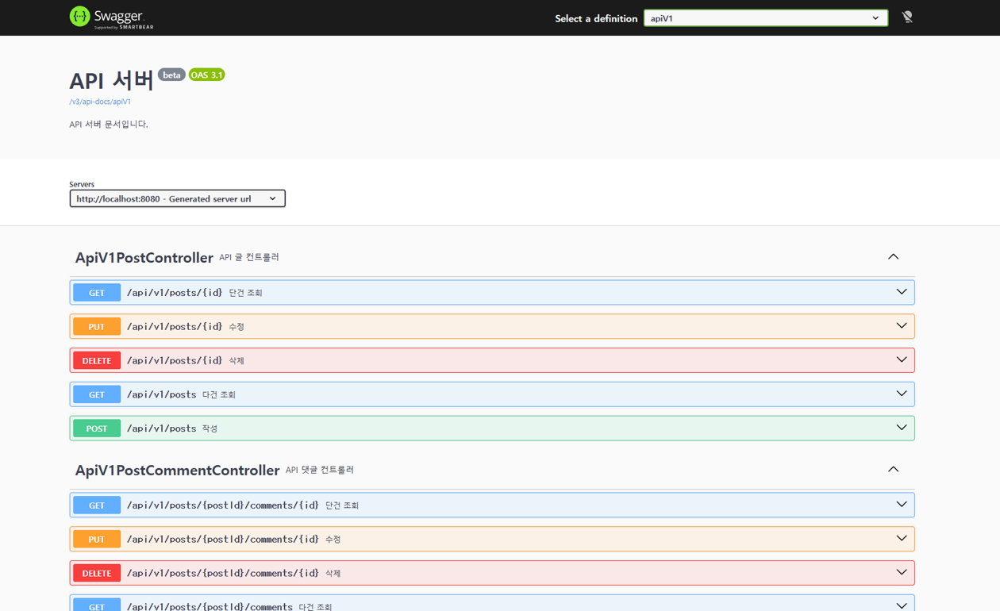
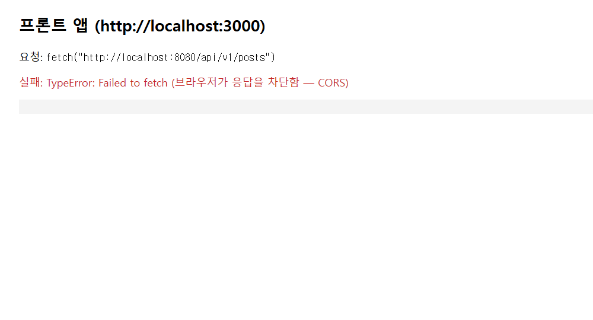
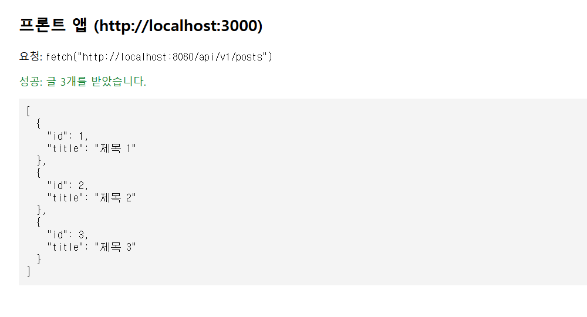

# 3부. API 문서와 CORS (084 ~ 099)

[← README](../README.md) · [1부](part1-rest-api.md) · [2부](part2-tdd.md) · **3부** · [4부](part4-member-auth.md)

## 요약

| 태그 | 내용 | 핵심 개념 |
|---|---|---|
| [`084`](https://github.com/tbafe26/REST4/commit/084) | springdoc-openapi-starter-webmvc-ui 의존성 | OpenAPI, Swagger UI |
| [`085`](https://github.com/tbafe26/REST4/commit/085) | SpringDocConfig(@Configuration, @OpenAPIDefinition) | 문서 설정 클래스 |
| [`086`](https://github.com/tbafe26/REST4/commit/086) | `@OpenAPIDefinition(info = @Info(...))` | 문서 메타 정보 |
| [`087`](https://github.com/tbafe26/REST4/commit/087) | `GET /` 메인 페이지(서버 정보, 문서 링크) | 접속 안내 페이지 |
| [`088`](https://github.com/tbafe26/REST4/commit/088) | `apiV1`(/api/v1/**) 과 `home`(그 외) 그룹 | GroupedOpenApi |
| [`089`](https://github.com/tbafe26/REST4/commit/089) | 매핑마다 `produces = APPLICATION_JSON_VALUE` | 문서의 응답 미디어 타입 |
| [`090`](https://github.com/tbafe26/REST4/commit/090) | `springdoc.default-produces-media-type` 설정 | 설정으로 일괄 적용 |
| [`091`](https://github.com/tbafe26/REST4/commit/091) | HomeController `produces = TEXT_HTML_VALUE` | 예외적인 응답 타입 지정 |
| [`092`](https://github.com/tbafe26/REST4/commit/092) | HomeController 에 @Tag, @Operation | 문서 설명 보강 |
| [`093`](https://github.com/tbafe26/REST4/commit/093) | ApiV1PostController 에 @Tag, @Operation | 문서 설명 보강 |
| [`094`](https://github.com/tbafe26/REST4/commit/094) | ApiV1PostCommentController 에 @Tag, @Operation | 문서 설명 보강 |
| [`095`](https://github.com/tbafe26/REST4/commit/095) | `GET /test/fetchPosts` — 페이지가 API 를 추가 요청 | 브라우저 fetch, 추가 요청 |
| [`096`](https://github.com/tbafe26/REST4/commit/096) | fetch 로 단건조회도 요청 | 여러 추가 요청 |
| [`097`](https://github.com/tbafe26/REST4/commit/097) | `fetch("/api/v1/posts")` 상대 경로 | 출처(프로토콜·도메인·포트) |
| [`098`](https://github.com/tbafe26/REST4/commit/098) | WebMvcConfig 로 `/api/**` CORS 허용 | 동일 출처 정책, CORS |
| [`099`](https://github.com/tbafe26/REST4/commit/099) | allowedOrigins 에 `http://localhost:3000` 추가 | 허용 출처 명시 |

## 단계별 상세

#### 084 SpringDoc 의존성 추가 — API 문서 자동 생성
[이 시점의 코드](https://github.com/tbafe26/REST4/tree/084) · [변경 내용](https://github.com/tbafe26/REST4/commit/084)

**무엇을** `build.gradle.kts` 에 `org.springdoc:springdoc-openapi-starter-webmvc-ui:3.2.0` 을 추가했습니다. README 실행 방법에 문서 주소를 적었습니다.

**왜** 프론트엔드 개발자에게 API 명세를 손으로 정리해 전달하면 코드와 문서가 금방 어긋납니다. SpringDoc 은 컨트롤러 코드를 읽어 **OpenAPI 명세(JSON)** 를 자동으로 만들고, Swagger UI 로 보여 줍니다. 문서에서 바로 API 를 호출해 볼 수도 있습니다.

**확인** `./gradlew bootRun` 후 http://localhost:8080/swagger-ui/index.html (명세 JSON: http://localhost:8080/v3/api-docs)



#### 085 SpringDocConfig 추가
[이 시점의 코드](https://github.com/tbafe26/REST4/tree/085) · [변경 내용](https://github.com/tbafe26/REST4/commit/085)

**무엇을** `global/springDoc/SpringDocConfig` 를 만들고 `@Configuration`, `@OpenAPIDefinition` 을 붙였습니다.

**왜** 문서의 제목, 그룹 같은 설정을 모아 둘 자리를 먼저 만듭니다. 이후 단계에서 이 클래스에 설정을 채워 갑니다.

**확인** 문서 화면은 이전과 같습니다.

#### 086 문서 제목·버전·설명 지정
[이 시점의 코드](https://github.com/tbafe26/REST4/tree/086) · [변경 내용](https://github.com/tbafe26/REST4/commit/086)

**무엇을** `@Info` 로 문서 제목(`API 서버`), 버전(`beta`), 설명(`API 서버 문서입니다.`)을 지정했습니다.

**왜** 기본값(`OpenAPI definition`, `v0`) 대신 이 서버가 무엇인지 문서 첫 화면에서 알 수 있게 합니다.

**확인** Swagger UI 상단에 제목과 버전, 설명이 표시됩니다.



#### 087 메인 페이지 HomeController
[이 시점의 코드](https://github.com/tbafe26/REST4/tree/087) · [변경 내용](https://github.com/tbafe26/REST4/commit/087)

**무엇을** `domain/home/home/controller/HomeController` 를 추가했습니다. `GET /` 으로 접속하면 서버의 호스트 이름/주소와 **API 문서로 이동** 링크를 보여 줍니다.

**왜** 프론트엔드 개발자가 서버 주소로 접속했을 때 빈 404 화면 대신 문서로 바로 갈 수 있는 안내가 있으면 편리합니다. 호스트 정보는 여러 서버 중 어디에 붙었는지 확인하는 데 쓰입니다.

**확인** http://localhost:8080/ 접속 시 안내 페이지가 보입니다.

#### 088 GroupedOpenApi 로 문서 그룹 나누기
[이 시점의 코드](https://github.com/tbafe26/REST4/tree/088) · [변경 내용](https://github.com/tbafe26/REST4/commit/088)

**무엇을** `GroupedOpenApi` 빈 두 개를 등록했습니다. `apiV1` 그룹은 `/api/v1/**`, `home` 그룹은 `/api/**` 를 제외한 나머지 경로를 보여 줍니다.

**왜** API 버전이 늘어나면(`/api/v2/...`) 한 화면에 모두 섞이게 됩니다. 버전별로, 그리고 API 가 아닌 것(메인 페이지 등)을 따로 묶어 두면 문서를 찾기 쉽습니다.

**확인** Swagger UI 오른쪽 위 그룹 선택에서 `apiV1`, `home` 을 고를 수 있습니다.



#### 089 문서의 응답 미디어 타입을 JSON 으로 — produces 지정
[이 시점의 코드](https://github.com/tbafe26/REST4/tree/089) · [변경 내용](https://github.com/tbafe26/REST4/commit/089)

**무엇을** 글 다건/단건조회 매핑에 `produces = APPLICATION_JSON_VALUE` 를 지정했습니다.

**왜** 기본 설정에서는 Swagger UI 가 응답 미디어 타입을 `*/*` 로 표시해, 문서에서 호출했을 때 결과가 JSON 으로 예쁘게 보이지 않습니다. 매핑에 응답 형식을 명시하면 문서에 `application/json` 으로 나옵니다. 다만 모든 매핑에 일일이 붙이는 것은 번거롭습니다.

**확인** Swagger UI 의 글 조회 API 응답 타입이 `application/json` 으로 표시됩니다.

#### 090 기본 응답 미디어 타입을 설정 파일로 지정
[이 시점의 코드](https://github.com/tbafe26/REST4/tree/090) · [변경 내용](https://github.com/tbafe26/REST4/commit/090)

**무엇을** 089 에서 붙인 `produces` 를 걷어내고 `application.yaml` 에 다음 설정을 넣었습니다.

```yaml
springdoc:
  default-produces-media-type: application/json;charset=UTF-8
```

**왜** 매핑마다 반복하는 대신 설정 한 줄로 모든 API 의 기본 응답 타입을 JSON 으로 지정합니다.

**확인** Swagger UI 의 모든 API 응답 타입이 `application/json;charset=UTF-8` 로 표시됩니다.

#### 091 메인 페이지는 HTML 로 표시
[이 시점의 코드](https://github.com/tbafe26/REST4/tree/091) · [변경 내용](https://github.com/tbafe26/REST4/commit/091)

**무엇을** `HomeController.main` 에 `@GetMapping(produces = TEXT_HTML_VALUE)` 를 지정했습니다.

**왜** 090 의 설정으로 모든 응답이 문서상 JSON 으로 표시되는데, 메인 페이지는 HTML 을 돌려줍니다. 예외인 곳만 명시해 문서에 올바른 응답 타입(`text/html`)이 나오게 합니다.

**확인** Swagger UI `home` 그룹에서 메인 페이지 응답 타입이 `text/html` 입니다.

#### 092 HomeController 문서 꾸미기
[이 시점의 코드](https://github.com/tbafe26/REST4/tree/092) · [변경 내용](https://github.com/tbafe26/REST4/commit/092)

**무엇을** `HomeController` 에 `@Tag(name = "HomeController", description = "홈 컨트롤러")`, `main` 에 `@Operation(summary = "메인 페이지")` 를 붙였습니다.

**왜** 문서에는 기본적으로 클래스/메서드 이름만 나옵니다. 사람이 읽는 설명을 붙여 문서만 보고도 각 API 의 용도를 알 수 있게 합니다.

**확인** Swagger UI 에 "홈 컨트롤러", "메인 페이지" 설명이 표시됩니다.

#### 093 글 API 문서 꾸미기
[이 시점의 코드](https://github.com/tbafe26/REST4/tree/093) · [변경 내용](https://github.com/tbafe26/REST4/commit/093)

**무엇을** `ApiV1PostController` 에 `@Tag(description = "API 글 컨트롤러")`, 각 액션에 `@Operation(summary = "다건 조회" / "단건 조회" / "삭제" / "작성" / "수정")` 을 붙였습니다.

**왜** 문서를 보는 프론트엔드 개발자가 메서드 이름(`getItems`, `write` …)을 해석하지 않아도 용도를 바로 알 수 있게 합니다.

**확인** Swagger UI `apiV1` 그룹의 글 API 에 설명이 표시됩니다.

#### 094 댓글 API 문서 꾸미기
[이 시점의 코드](https://github.com/tbafe26/REST4/tree/094) · [변경 내용](https://github.com/tbafe26/REST4/commit/094)

**무엇을** `ApiV1PostCommentController` 에 `@Tag(description = "API 댓글 컨트롤러")`, 각 액션에 `@Operation(summary = ...)` 을 붙였습니다.

**왜** 글 API 와 같은 수준으로 댓글 API 문서도 읽기 쉽게 만듭니다.

**확인** Swagger UI `apiV1` 그룹의 댓글 API 에 설명이 표시됩니다.



#### 095 브라우저 fetch 실습 페이지 — 글 다건조회
[이 시점의 코드](https://github.com/tbafe26/REST4/tree/095) · [변경 내용](https://github.com/tbafe26/REST4/commit/095)

**무엇을** `HomeController` 에 `GET /test/fetchPosts` 를 추가했습니다. 이 페이지의 스크립트가 `fetch("http://localhost:8080/api/v1/posts")` 로 글 목록을 요청해 콘솔에 출력합니다.

**왜** 실제 프론트엔드 앱은 HTML 을 받은 뒤 자바스크립트로 API 를 **추가 요청**합니다. 그 흐름을 가장 단순한 형태로 재현해 봅니다. 지금은 HTML 을 준 서버와 API 서버가 같습니다.

**확인** http://localhost:8080/test/fetchPosts 접속 후 개발자 도구 콘솔/네트워크 탭에서 `/api/v1/posts` 요청과 응답을 확인합니다.

#### 096 fetch 실습 — 글 단건조회 요청 추가
[이 시점의 코드](https://github.com/tbafe26/REST4/tree/096) · [변경 내용](https://github.com/tbafe26/REST4/commit/096)

**무엇을** 같은 페이지에서 `fetch("http://localhost:8080/api/v1/posts/1")` 요청을 하나 더 보냅니다.

**왜** 한 페이지가 여러 API 를 추가로 요청하는 일반적인 상황을 만듭니다. 같은 서버로의 요청은 모두 문제없이 처리됩니다.

**확인** 네트워크 탭에 `/api/v1/posts`, `/api/v1/posts/1` 두 요청이 보입니다.

#### 097 같은 서버로의 요청은 상대 경로로
[이 시점의 코드](https://github.com/tbafe26/REST4/tree/097) · [변경 내용](https://github.com/tbafe26/REST4/commit/097)

**무엇을** fetch 주소에서 `http://localhost:8080` 을 지우고 `/api/v1/posts`, `/api/v1/posts/1` 처럼 경로만 남겼습니다.

**왜** 요청 대상이 문서를 받아 온 서버와 같다면 **프로토콜·도메인·포트**를 생략할 수 있습니다. 브라우저가 현재 페이지의 출처(origin)를 기준으로 주소를 완성합니다. 서버 주소가 바뀌어도 코드를 고칠 필요가 없습니다.

**확인** 동작은 096 과 같습니다.

#### 098 CORS 허용 — WebMvcConfig
[이 시점의 코드](https://github.com/tbafe26/REST4/tree/098) · [변경 내용](https://github.com/tbafe26/REST4/commit/098)

**무엇을** `global/webMvc/WebMvcConfig` 에서 `/api/**` 경로에 대해 `https://cdpn.io` 출처의 요청을 허용했습니다(메서드 GET/POST/PUT/DELETE/PATCH, 모든 헤더, 자격 증명 포함).

**왜** 브라우저는 **동일 출처 정책** 때문에, 문서를 받아 온 서버와 출처가 다른 서버로 보낸 추가 요청의 응답을 기본적으로 스크립트에 넘겨주지 않습니다(예: 온라인 코드 편집기 페이지에서 `http://localhost:8080/api/v1/posts` 호출). 요청을 받는 서버가 "이 출처는 허용한다" 는 응답 헤더를 보내야 브라우저가 응답을 전달합니다. 그것이 CORS 설정입니다.

```java
registry.addMapping("/api/**")
        .allowedOrigins("https://cdpn.io")
        .allowedMethods("GET", "POST", "PUT", "DELETE", "PATCH")
        .allowedHeaders("*")
        .allowCredentials(true);
```

**확인** 허용한 출처의 페이지에서 `fetch("http://localhost:8080/api/v1/posts")` 를 호출하면 응답에 `Access-Control-Allow-Origin` 헤더가 붙습니다.



#### 099 프론트엔드 개발 서버 출처도 CORS 허용
[이 시점의 코드](https://github.com/tbafe26/REST4/tree/099) · [변경 내용](https://github.com/tbafe26/REST4/commit/099)

**무엇을** CORS 허용 출처에 `http://localhost:3000` 을 추가했습니다. README 실행 방법에 API 문서 주소와 CORS 허용 출처를 정리했습니다.

**왜** 프론트엔드 앱(예: 리액트 개발 서버)은 보통 다른 포트(3000)에서 실행되므로 백엔드와 출처가 다릅니다. 요청하는 주체(프론트 앱)의 출처를 **명시적으로** 하나씩 허용합니다. `*` 로 모두 허용하면 `allowCredentials(true)` 와 함께 쓸 수 없고 보안상으로도 좋지 않습니다.

**확인** `localhost:3000` 에서 실행한 프론트 앱이 API 를 호출할 수 있습니다.



---

[← README](../README.md) · [1부](part1-rest-api.md) · [2부](part2-tdd.md) · **3부** · [4부](part4-member-auth.md)
