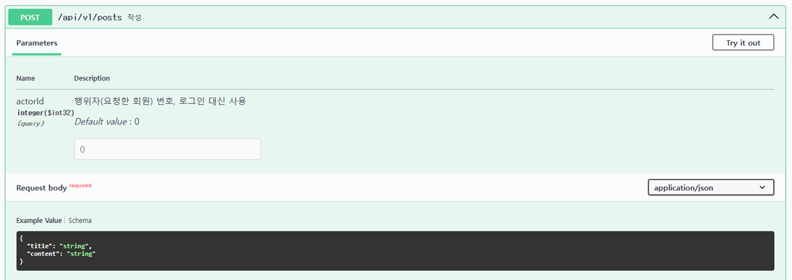

# 4부. 회원과 작성자 권한 by TDD (100 ~ 130)

[← README](../README.md) · [1부](part1-rest-api.md) · [2부](part2-tdd.md) · [3부](part3-api-docs-cors.md) · **4부**

## 요약

| 태그 | 내용 | 핵심 개념 |
|---|---|---|
| [`100`](https://github.com/tbafe26/REST4/commit/100) | Member 엔티티(username 유니크), Repository/Service/Controller 뼈대 | 새 도메인 추가, 유니크 제약 |
| [`101`](https://github.com/tbafe26/REST4/commit/101) | 🔴 `POST /api/v1/members/join` 성공 테스트(201-1) | 테스트 먼저 작성 |
| [`102`](https://github.com/tbafe26/REST4/commit/102) | 🟢 회원가입 구현, MemberJoinReqBody 제약 | @Valid, RsData<Void> |
| [`103`](https://github.com/tbafe26/REST4/commit/103) | 🔴 username 중복 시 409, `409-1` 기대 | 실패 시나리오 먼저 |
| [`104`](https://github.com/tbafe26/REST4/commit/104) | 🟢 중복 검사 + MemberDuplicateUsernameException → 409-1 | 의미 있는 예외 클래스, 예외 핸들러 |
| [`105`](https://github.com/tbafe26/REST4/commit/105) | 🔵 `findByUsername(...).ifPresent(_ -> throw)` | Optional, 이름 없는 변수 `_` |
| [`106`](https://github.com/tbafe26/REST4/commit/106) | 제약 위반 시 400, `400-1` 테스트 | 기존 핸들러 재사용 확인 |
| [`107`](https://github.com/tbafe26/REST4/commit/107) | 🔴 `GET /api/v1/members/me?actorId=` 테스트, password 미노출 | 행위자(actorId), 민감 정보 비노출 |
| [`108`](https://github.com/tbafe26/REST4/commit/108) | 🟢 `GET /me`, MemberDto(password 없음) | @RequestParam, 응답 DTO 로 민감 정보 차단 |
| [`109`](https://github.com/tbafe26/REST4/commit/109) | 🔴 없는 회원 번호면 401, `401-1` 기대 | 인증 실패(401) |
| [`110`](https://github.com/tbafe26/REST4/commit/110) | 🟢 UnauthenticatedException → 401-1 | orElseThrow, 인증 예외 |
| [`111`](https://github.com/tbafe26/REST4/commit/111) | 🔴 actorId 누락 시에도 401 기대 | 필수 파라미터 누락 |
| [`112`](https://github.com/tbafe26/REST4/commit/112) | 🟢 `@RequestParam(defaultValue = "0")` | 누락과 잘못된 값을 한 경로로 |
| [`113`](https://github.com/tbafe26/REST4/commit/113) | 🔴 샘플 회원 6명(system, admin, user1~4) 기대 | 샘플 데이터도 테스트로 고정 |
| [`114`](https://github.com/tbafe26/REST4/commit/114) | 🟢 BaseInitData 에 회원 생성(work1) 추가, 글/댓글은 work2 | 초기 데이터 순서 |
| [`115`](https://github.com/tbafe26/REST4/commit/115) | 🔴 글/댓글 응답에 authorId, authorName 기대 | 연관관계 추가 전 요구 고정 |
| [`116`](https://github.com/tbafe26/REST4/commit/116) | 🟢 Post.author, PostComment.author(@ManyToOne LAZY), DTO 에 authorId/authorName | 다대일 연관관계, 생성 시 필수 값 |
| [`117`](https://github.com/tbafe26/REST4/commit/117) | 🔴 `POST /api/v1/posts?actorId=` 작성자 검증, 누락/없는 회원 → 401 | 요구 변경 시 기존 테스트 먼저 수정 |
| [`118`](https://github.com/tbafe26/REST4/commit/118) | 🟢 글 작성에 `actorId` 적용, 임시 system 작성자 제거 | 행위자 = 작성자 |
| [`119`](https://github.com/tbafe26/REST4/commit/119) | 🔴 `POST .../comments?actorId=` 작성자 검증, 누락/없는 회원 → 401 | 같은 규칙을 댓글에 |
| [`120`](https://github.com/tbafe26/REST4/commit/120) | 🟢 댓글 작성에 `actorId` 적용, 임시 system 작성자 제거 | 인증 확인을 가장 먼저 |
| [`121`](https://github.com/tbafe26/REST4/commit/121) | 🔵 `memberService.getActor(actorId)` 로 중복 제거 | 중복 제거, 테스트가 안전망 |
| [`122`](https://github.com/tbafe26/REST4/commit/122) | 🔴 글 삭제: 작성자 성공, 타인 403, actorId 없음 401 | 인증(401)과 인가(403)의 구분 |
| [`123`](https://github.com/tbafe26/REST4/commit/123) | 🟢 `post.checkActorCanDelete(actor)`, AccessDeniedException → 403-1 | 권한 검사는 엔티티에, 응답 변환은 핸들러에 |
| [`124`](https://github.com/tbafe26/REST4/commit/124) | 🔴 글 수정: 작성자 성공, 타인 403, actorId 없음 401 | 같은 권한 규칙을 수정에 |
| [`125`](https://github.com/tbafe26/REST4/commit/125) | 🟢 `post.checkActorCanModify(actor)` | 수정 권한 검사 |
| [`126`](https://github.com/tbafe26/REST4/commit/126) | 🔴 댓글 삭제: 작성자 성공, 타인 403, actorId 없음 401 | 같은 규칙을 댓글에 |
| [`127`](https://github.com/tbafe26/REST4/commit/127) | 🟢 `postComment.checkActorCanDelete(actor)` | 댓글 삭제 권한 검사 |
| [`128`](https://github.com/tbafe26/REST4/commit/128) | 🔴 댓글 수정: 작성자 성공, 타인 403, actorId 없음 401 | 마지막 권한 규칙 |
| [`129`](https://github.com/tbafe26/REST4/commit/129) | 🟢 `postComment.checkActorCanModify(actor)` | 댓글 수정 권한 검사 |
| [`130`](https://github.com/tbafe26/REST4/commit/130) | actorId 에 `@Parameter` 설명, README API 명세·행위자 규칙 정리 | 문서와 코드의 일치 |

## 단계별 상세

#### 100 회원 도메인 뼈대 — Member, MemberRepository, MemberService, ApiV1MemberController
[이 시점의 코드](https://github.com/tbafe26/REST4/tree/100) · [변경 내용](https://github.com/tbafe26/REST4/commit/100)

여기부터는 글/댓글 API 에 **회원**과 **작성자 권한**을 더합니다. 로그인 기능은 만들지 않고, 요청 주소에 `?actorId=회원번호` 를 붙여 "누가 요청했는지(행위자)" 를 표현합니다. 모든 기능은 테스트를 먼저 작성하고(🔴) 통과시키는(🟢) 순서로 진행합니다.

**무엇을** `domain/member/member` 아래에 `Member` 엔티티(`username`, `password`, `name`), `MemberRepository`(`findByUsername`), 빈 `MemberService`, 빈 `ApiV1MemberController`(`/api/v1/members`) 를 만들었습니다. `username` 에는 `@Column(unique = true)` 를 걸었습니다.

**왜** 회원 기능을 테스트로 시작하려면 테스트가 참조할 컨트롤러 클래스와 서비스가 먼저 있어야 컴파일됩니다. 기능은 없는 뼈대만 두고, 동작은 테스트를 통해 하나씩 채웁니다. username 중복은 애플리케이션 검사와 별개로 DB 제약으로도 막습니다.

**확인** 아직 동작하는 API 는 없습니다.

#### 101 🔴 회원가입 테스트
[이 시점의 코드](https://github.com/tbafe26/REST4/tree/101) · [변경 내용](https://github.com/tbafe26/REST4/commit/101)

**무엇을** `ApiV1MemberControllerTest` 를 만들고 회원가입 테스트 `t1` 을 먼저 작성했습니다. `{"username": "user10", "password": "12345678", "name": "유저10"}` 으로 가입하면 201, `201-1`, `유저10님 환영합니다. 회원가입이 완료되었습니다.` 가 와야 하고, 가장 최근 회원의 username 이 `user10` 이어야 합니다. 최근 회원을 꺼내기 위해 `MemberRepository.findTopByOrderByIdDesc()`, `MemberService.findLatest()` 를 추가했습니다.

**왜** 기능을 만들기 전에 "어떤 요청에 어떤 응답이 와야 하는지" 를 테스트로 고정합니다. 이 테스트를 통과시키는 것이 다음 단계의 목표입니다.

**확인** `회원가입` 테스트가 `NoSuchElementException: No value present` 로 실패합니다. 가입 API 가 없어 회원이 저장되지 않았고, `findLatest()` 가 비어 있습니다.

#### 102 🟢 회원가입 구현
[이 시점의 코드](https://github.com/tbafe26/REST4/tree/102) · [변경 내용](https://github.com/tbafe26/REST4/commit/102)

**무엇을** `POST /api/v1/members/join` 을 구현했습니다. 요청 본문 `MemberJoinReqBody` 는 `username`(4~30자), `password`(8~30자), `name`(2~30자) 제약을 가지며, `MemberService.join` 이 회원을 저장합니다. 응답은 `RsData<Void>`(`201-1`) 이므로 `ResponseAspect` 가 HTTP 상태를 201 로 바꿉니다.

```java
@PostMapping("/join")
@Transactional
public RsData<Void> join(@RequestBody @Valid MemberJoinReqBody reqBody) {
    Member member = memberService.join(reqBody.username, reqBody.password, reqBody.name);
    return new RsData<>("201-1", "%s님 환영합니다. 회원가입이 완료되었습니다.".formatted(member.getName()));
}
```

**왜** 101 의 테스트를 통과시키는 최소 구현입니다. 글 API 에서 만든 규칙(ReqBody + `@Valid`, `RsData`, resultCode 로 상태 코드 결정)을 그대로 따릅니다.

**확인** `./gradlew test --tests "*ApiV1MemberControllerTest"`

#### 103 🔴 중복된 username 으로 회원가입 → 409 테스트
[이 시점의 코드](https://github.com/tbafe26/REST4/tree/103) · [변경 내용](https://github.com/tbafe26/REST4/commit/103)

**무엇을** 같은 `username` 으로 두 번 가입하는 테스트 `t2` 를 추가했습니다. 두 번째 요청에는 409(Conflict), `409-1`, `user10(은)는 이미 사용중인 username 입니다.` 가 와야 합니다.

**왜** 지금은 중복 검사를 하지 않아 두 번째 저장이 DB 유니크 제약에 걸립니다. 클라이언트가 이해할 수 있는 응답을 원하는 결과로 먼저 정의합니다. 409 는 "요청이 현재 리소스 상태와 충돌한다" 는 뜻으로 중복 가입에 맞는 코드입니다.

**확인** `회원가입, 중복된 username` 테스트가 `DataIntegrityViolationException`(Unique index or primary key violation) 으로 실패합니다. 애플리케이션이 중복을 검사하지 않아 DB 유니크 제약까지 가서 터집니다.

#### 104 🟢 MemberDuplicateUsernameException 으로 중복 가입 처리
[이 시점의 코드](https://github.com/tbafe26/REST4/tree/104) · [변경 내용](https://github.com/tbafe26/REST4/commit/104)

**무엇을** `MemberService.join` 이 저장 전에 `findByUsername` 으로 중복을 검사하고, 이미 있으면 `MemberDuplicateUsernameException` 을 던집니다. `GlobalExceptionHandler` 는 이 예외를 409, `409-1`, 예외 메시지로 응답합니다.

```java
if (memberRepository.findByUsername(username).isPresent()) {
    throw new MemberDuplicateUsernameException(username);
}
```

**왜** `IllegalArgumentException` 같은 범용 예외를 쓰면 "무엇이 잘못됐는지" 가 드러나지 않고, 핸들러에서 다른 상황과 구분하기도 어렵습니다. 상황에 맞는 예외 클래스를 두면 코드가 의도를 설명하고, 예외 → 응답 매핑을 정확하게 할 수 있습니다. 메시지는 예외가 만들어질 때 정해지므로 핸들러는 `ex.getMessage()` 만 쓰면 됩니다.

**확인** `./gradlew test --tests "*ApiV1MemberControllerTest"`

#### 105 🔵 Optional.ifPresent 로 중복 검사 정리
[이 시점의 코드](https://github.com/tbafe26/REST4/tree/105) · [변경 내용](https://github.com/tbafe26/REST4/commit/105)

**무엇을** `isPresent()` + `if` 문을 `Optional.ifPresent` 로 바꿨습니다. 쓰지 않는 람다 매개변수는 `_` 로 표기했습니다.

```java
memberRepository.findByUsername(username)
        .ifPresent(_ -> {
            throw new MemberDuplicateUsernameException(username);
        });
```

**왜** "있으면 예외" 라는 의도가 한 흐름으로 읽힙니다. 동작은 같으므로 104 의 테스트가 그대로 통과해야 합니다. 테스트가 리팩터링의 안전망 역할을 합니다.

**확인** `./gradlew test --tests "*ApiV1MemberControllerTest"`

#### 106 회원가입 요청 본문 제약 위반 → 400 테스트 추가
[이 시점의 코드](https://github.com/tbafe26/REST4/tree/106) · [변경 내용](https://github.com/tbafe26/REST4/commit/106)

**무엇을** username(3자), password(4자), name(1자) 으로 가입을 요청하는 테스트 `t3` 를 추가했습니다. 세 필드의 `Size` 위반이 정렬된 메시지로 400, `400-1` 응답되어야 합니다.

**왜** 글 작성에서 만든 `MethodArgumentNotValidException` 핸들러가 회원가입에도 그대로 적용되는지 확인합니다. 구현 변경 없이 통과해야 하므로 🔴 가 아니라 테스트만 추가한 커밋입니다.

**확인** `./gradlew test --tests "*ApiV1MemberControllerTest"`

#### 107 🔴 내 정보 테스트
[이 시점의 코드](https://github.com/tbafe26/REST4/tree/107) · [변경 내용](https://github.com/tbafe26/REST4/commit/107)

**무엇을** 내 정보 테스트 `t4` 를 추가했습니다. 회원가입 후 그 회원 번호로 `GET /api/v1/members/me?actorId={번호}` 를 요청하면 200 과 함께 `id`, `createDate`, `modifyDate`, `username`, `name` 이 와야 하고, **`password` 는 없어야** 합니다.

**왜** 로그인 기능이 없으므로 "누가 요청했는지" 는 `actorId` 쿼리 파라미터로 표현합니다. 응답에 비밀번호가 섞여 나가는 실수를 막기 위해 `jsonPath("$.password").doesNotExist()` 로 명시적으로 검증합니다.

**확인** `내 정보` 테스트가 `Handler type expected:<ApiV1MemberController> but was:<ResourceHttpRequestHandler>` 로 실패합니다. `/me` 매핑이 없어 정적 리소스 처리기가 요청을 받았습니다.

#### 108 🟢 내 정보 API 와 MemberDto
[이 시점의 코드](https://github.com/tbafe26/REST4/tree/108) · [변경 내용](https://github.com/tbafe26/REST4/commit/108)

**무엇을** `GET /api/v1/members/me` 를 구현했습니다. `@RequestParam int actorId` 로 받은 번호의 회원을 찾아 `MemberDto` 로 응답합니다. `MemberDto` 에는 `password` 필드가 아예 없습니다. `MemberService.findById` 를 추가했고, 테스트 파일의 import 순서를 정리했습니다.

```java
@GetMapping("/me")
public MemberDto me(@RequestParam int actorId) {
    Member actor = memberService.findById(actorId).get();
    return new MemberDto(actor);
}
```

**왜** 엔티티를 그대로 반환하면 `password` 까지 JSON 으로 나갑니다. 응답 전용 DTO 에서 필요한 필드만 고르면 민감 정보가 실수로 노출될 수 없습니다(1부에서 DTO 를 도입한 이유와 같습니다).

**확인** `./gradlew test --tests "*ApiV1MemberControllerTest"`

#### 109 🔴 존재하지 않는 actorId 로 내 정보 → 401 테스트
[이 시점의 코드](https://github.com/tbafe26/REST4/tree/109) · [변경 내용](https://github.com/tbafe26/REST4/commit/109)

**무엇을** 존재할 수 없는 회원 번호(`Integer.MAX_VALUE`) 로 내 정보를 요청하는 테스트 `t5` 를 추가했습니다. 401(Unauthorized), `401-1`, `로그인 후 이용해주세요.` 가 와야 합니다.

**왜** 지금은 `findById(...).get()` 이 `NoSuchElementException` 을 던져 **404** 로 응답합니다. 하지만 "행위자를 알 수 없다" 는 것은 데이터가 없는 것이 아니라 **인증이 안 된 것**이므로 401 이 맞습니다.

**확인** `내 정보, 존재하지 않는 actorId` 테스트가 `Status expected:<401> but was:<404>` 로 실패합니다. `get()` 의 `NoSuchElementException` 이 404 로 처리되고 있습니다.

#### 110 🟢 UnauthenticatedException 으로 401 응답
[이 시점의 코드](https://github.com/tbafe26/REST4/tree/110) · [변경 내용](https://github.com/tbafe26/REST4/commit/110)

**무엇을** `UnauthenticatedException`(메시지 `로그인 후 이용해주세요.`) 을 만들고, 내 정보에서 회원을 못 찾으면 `orElseThrow(UnauthenticatedException::new)` 로 던집니다. `GlobalExceptionHandler` 는 이를 401, `401-1` 로 응답합니다.

```java
Member actor = memberService.findById(actorId).orElseThrow(
        UnauthenticatedException::new
);
```

**왜** `get()` 은 값이 없을 때 `NoSuchElementException` 을 던져 404 가 됩니다. 상황에 맞는 예외를 직접 지정하면 같은 "값이 없음" 이라도 맥락에 맞는 응답(401)을 줄 수 있습니다.

**확인** `./gradlew test --tests "*ApiV1MemberControllerTest"`

#### 111 🔴 actorId 없이 내 정보 → 401 테스트
[이 시점의 코드](https://github.com/tbafe26/REST4/tree/111) · [변경 내용](https://github.com/tbafe26/REST4/commit/111)

**무엇을** `actorId` 없이 `GET /api/v1/members/me` 를 요청하는 테스트 `t6` 을 추가했습니다. 이 경우도 401, `401-1` 이어야 합니다.

**왜** 지금 `@RequestParam int actorId` 는 필수 파라미터라, 빠지면 스프링이 `MissingServletRequestParameterException` 을 던지고 400 계열 응답을 줍니다. 클라이언트 입장에서 "행위자 정보가 없다" 는 것은 존재하지 않는 회원과 같은 의미이므로 같은 401 로 맞춥니다.

**확인** `내 정보, actorId 없음` 테스트가 `Status expected:<401> but was:<400>` 으로 실패합니다. 필수 `@RequestParam` 누락은 스프링이 기본으로 400 처리합니다.

#### 112 🟢 actorId 기본값 0 으로 누락도 401 처리
[이 시점의 코드](https://github.com/tbafe26/REST4/tree/112) · [변경 내용](https://github.com/tbafe26/REST4/commit/112)

**무엇을** `@RequestParam(defaultValue = "0") int actorId` 로 바꿨습니다.

**왜** 파라미터가 없으면 0 이 들어오고, 0 번 회원은 존재하지 않으므로 110 에서 만든 `UnauthenticatedException` 경로를 그대로 탑니다. 누락과 잘못된 값을 **하나의 처리 경로**로 모아 별도 예외 핸들러 없이 401 을 줍니다.

**확인** `./gradlew test --tests "*ApiV1MemberControllerTest"`

#### 113 🔴 샘플 회원 6명 테스트
[이 시점의 코드](https://github.com/tbafe26/REST4/tree/113) · [변경 내용](https://github.com/tbafe26/REST4/commit/113)

**무엇을** `BaseInitDataTest` 를 만들어, 애플리케이션이 뜨면 회원이 정확히 6명 있고 각 username/이름/비밀번호가 아래와 같아야 한다고 정의했습니다. 조회를 위해 `MemberService.count()`, `findByUsername()` 을 추가했습니다.

| username | 이름 | 비밀번호 |
|---|---|---|
| system | 시스템 | 12345678 |
| admin | 관리자 | 12345678 |
| user1 ~ user4 | 유저1 ~ 유저4 | 12345678 |

**왜** 이후 작성자/권한 기능의 테스트는 이 샘플 회원들을 행위자로 씁니다. 샘플 데이터가 테스트의 전제이므로 그 자체도 테스트로 고정해 둡니다.

**확인** `샘플 회원 6명이 생성되어 있다` 테스트가 `expected: 6L but was: 0L` 로 실패합니다. 아직 샘플 회원을 만들지 않습니다.

#### 114 🟢 샘플 회원 6명 생성
[이 시점의 코드](https://github.com/tbafe26/REST4/tree/114) · [변경 내용](https://github.com/tbafe26/REST4/commit/114)

**무엇을** `BaseInitData` 에 회원 6명을 만드는 `work1` 을 추가하고, 기존 글/댓글 생성은 `work2` 로 옮겼습니다. 회원 → 글 순서로 실행하며, 각각 이미 데이터가 있으면 건너뜁니다. 회원은 `memberService.join` 으로 만들어 중복 검사 규칙도 그대로 적용됩니다.

**왜** 글/댓글에 작성자를 붙이려면 회원이 먼저 있어야 합니다. 회원과 글의 생성 여부를 따로 판단하면, 이미 글이 있는 개발 DB 에서도 회원은 새로 만들어집니다.

**확인** `./gradlew test --tests "*BaseInitDataTest"`

#### 115 🔴 샘플 글/댓글의 작성자 테스트
[이 시점의 코드](https://github.com/tbafe26/REST4/tree/115) · [변경 내용](https://github.com/tbafe26/REST4/commit/115)

**무엇을** 글/댓글 응답에 작성자 정보(`authorId`, `authorName`)가 있고, 샘플 데이터의 작성자가 아래와 같아야 한다는 테스트를 추가했습니다(글 `t10`, 댓글 `t6`). 두 테스트 클래스에 `MemberService` 를 주입했습니다.

| 글 | 작성자 | 댓글 | 작성자 |
|---|---|---|---|
| 1번 | user1 | 1번, 4번 | user1 |
| 2번 | user2 | 2번, 5번 | user2 |
| 3번 | user3 | 3번 | user3 |

**왜** "모든 글과 댓글은 작성자를 가진다" 는 요구를 응답 기준으로 먼저 정의합니다. 회원 번호는 하드코딩하지 않고 `findByUsername` 으로 조회해 비교합니다.

**확인** 두 테스트 모두 실패합니다. 글: `No value at JSON path "$.authorId"`, 댓글: `No value at JSON path "$[0].authorId"`. 아직 작성자 정보가 없습니다.

#### 116 🟢 글과 댓글에 작성자(author) 연관관계 추가
[이 시점의 코드](https://github.com/tbafe26/REST4/tree/116) · [변경 내용](https://github.com/tbafe26/REST4/commit/116)

**무엇을**
- `Post`, `PostComment` 에 `@ManyToOne(fetch = LAZY) Member author` 를 추가하고 생성자에서 받도록 했습니다(`new Post(author, title, content)`, `post.addComment(author, content)`).
- `PostService.write(author, ...)`, `writeComment(author, post, ...)` 로 시그니처를 바꿨습니다.
- `PostDto`, `PostCommentDto` 에 `authorId`, `authorName` 을 추가했습니다.
- 샘플 글/댓글을 정해진 작성자로 만듭니다.
- 테스트 파일의 import 그룹 사이 빈 줄을 정리했습니다.

**왜** "모든 글과 댓글은 작성자를 가진다" 를 만족시키려면 생성 시점에 작성자를 반드시 받아야 합니다. 생성자 인자로 강제하면 작성자 없는 글을 만들 수 없습니다. 작성자는 목록 조회마다 필요하지 않을 수 있어 `LAZY` 로 둡니다.

> **임시 처리** 아직 API 요청에서 행위자를 받는 수단이 없어서, API 로 작성하는 글/댓글은 잠시 `system` 회원을 작성자로 둡니다. 다음 단계에서 `actorId` 로 바꿉니다.

**확인** `./gradlew test --tests "*ApiV1PostControllerTest" --tests "*ApiV1PostCommentControllerTest"`

#### 117 🔴 글 작성 시 actorId 를 작성자로 — 테스트
[이 시점의 코드](https://github.com/tbafe26/REST4/tree/117) · [변경 내용](https://github.com/tbafe26/REST4/commit/117)

**무엇을** 글 작성 테스트 `t1` 을 `?actorId={user1 번호}` 로 요청하고 응답의 `authorId`, `authorName` 이 user1 이어야 하도록 바꿨습니다. `actorId` 없이(`t11`), 존재하지 않는 `actorId` 로(`t12`) 작성하면 401 이어야 한다는 테스트도 추가했습니다.

**왜** 글 작성자는 요청한 행위자여야 합니다. 지금은 임시로 `system` 이 작성자라 `t1` 이 실패하고, 행위자 없이도 작성되어 `t11`, `t12` 도 실패합니다. 기존 기능의 요구가 바뀌었으므로 **기존 테스트부터** 고칩니다.

**확인** 3개 테스트가 실패합니다. `글 작성`: `$.data.authorId expected:<3> but was:<1>`(user1 이 아니라 임시 작성자 system), `actorId 없음`/`존재하지 않는 actorId`: `Status expected:<401> but was:<201>`.

#### 118 🟢 글 작성자를 actorId 행위자로
[이 시점의 코드](https://github.com/tbafe26/REST4/tree/118) · [변경 내용](https://github.com/tbafe26/REST4/commit/118)

**무엇을** 글 작성 액션이 `@RequestParam(defaultValue = "0") int actorId` 를 받아 회원을 찾고, 없으면 `UnauthenticatedException`(401) 을 던집니다. 찾은 행위자를 작성자로 저장하며, 116 의 임시 `system` 작성자는 지웠습니다.

```java
Member actor = memberService.findById(actorId).orElseThrow(
        UnauthenticatedException::new
);
Post post = postService.write(actor, reqBody.title, reqBody.content);
```

**왜** 117 의 테스트를 통과시키는 구현입니다. 내 정보 API 에서 만든 "누락·잘못된 actorId → 401" 규칙을 그대로 재사용합니다. 요청 본문 검증(`@Valid`)은 메서드 실행 전에 일어나므로 제목/내용 검증 실패 테스트(400)는 actorId 없이도 그대로 통과합니다.

**확인** `./gradlew test --tests "*ApiV1PostControllerTest"`

#### 119 🔴 댓글 작성 시 actorId 를 작성자로 — 테스트
[이 시점의 코드](https://github.com/tbafe26/REST4/tree/119) · [변경 내용](https://github.com/tbafe26/REST4/commit/119)

**무엇을** 댓글 작성 테스트 `t5` 를 `?actorId={user2 번호}` 로 요청하고 `data.authorId`, `data.authorName` 이 user2 이어야 하도록 바꿨습니다. `actorId` 없이(`t7`), 존재하지 않는 `actorId` 로(`t8`) 작성하면 401 이어야 합니다.

**왜** 글 작성과 같은 요구를 댓글에도 적용합니다. 지금은 임시 `system` 작성자라서 실패합니다.

**확인** 3개 테스트가 실패합니다. `댓글 작성`: `$.data.authorId expected:<4> but was:<1>`(user2 가 아니라 임시 작성자 system), `actorId 없음`/`존재하지 않는 actorId`: `Status expected:<401> but was:<201>`.

#### 120 🟢 댓글 작성자를 actorId 행위자로
[이 시점의 코드](https://github.com/tbafe26/REST4/tree/120) · [변경 내용](https://github.com/tbafe26/REST4/commit/120)

**무엇을** 댓글 작성 액션도 `actorId` 로 행위자를 찾고(없으면 401), 그 회원을 작성자로 저장합니다. 임시 `system` 작성자는 지웠습니다.

**왜** 119 의 테스트를 통과시키는 구현입니다. 행위자 확인을 **글 조회보다 먼저** 해서, 인증되지 않은 요청에는 다른 정보(글 존재 여부 등)를 확인해 주지 않고 곧바로 401 을 돌려줍니다.

**확인** `./gradlew test --tests "*ApiV1PostCommentControllerTest"`

#### 121 🔵 행위자 조회를 MemberService.getActor 로 추출
[이 시점의 코드](https://github.com/tbafe26/REST4/tree/121) · [변경 내용](https://github.com/tbafe26/REST4/commit/121)

**무엇을** 세 곳(내 정보, 글 작성, 댓글 작성)에서 반복되던 `findById(actorId).orElseThrow(UnauthenticatedException::new)` 를 `MemberService.getActor(int actorId)` 하나로 옮겼습니다.

```java
public Member getActor(int actorId) {
    return findById(actorId).orElseThrow(UnauthenticatedException::new);
}
```

**왜** 앞으로 수정/삭제 액션에서도 같은 코드가 필요합니다. "행위자를 확인하고 없으면 401" 이라는 규칙을 한 곳에 두면 규칙이 바뀌어도 한 군데만 고치면 됩니다. 동작은 같으므로 기존 테스트로 확인합니다.

**확인** `./gradlew test`

#### 122 🔴 글 삭제는 작성자 본인만 — 테스트
[이 시점의 코드](https://github.com/tbafe26/REST4/tree/122) · [변경 내용](https://github.com/tbafe26/REST4/commit/122)

**무엇을** 글 삭제 테스트 `t3` 을 1번 글의 작성자(user1)를 행위자로 요청하도록 바꿨습니다. 작성자가 아닌 회원(user2)이 삭제하면 403, `403-1`, `권한이 없습니다.`(`t13`), `actorId` 없이 삭제하면 401(`t14`) 이어야 한다는 테스트를 추가했습니다.

**왜** **401(인증 실패)** 은 "누구인지 모른다", **403(인가 실패)** 은 "누구인지는 알지만 이 작업을 할 권한이 없다" 입니다. 두 상황을 다른 응답으로 구분해야 클라이언트가 "로그인 유도" 와 "권한 없음 안내" 를 다르게 처리할 수 있습니다. 지금은 누구든 삭제할 수 있어 두 테스트가 실패합니다.

**확인** `글 삭제, 작성자가 아닌 회원` 은 `Status expected:<403> but was:<200>`, `글 삭제, actorId 없음` 은 `Status expected:<401> but was:<200>` 으로 실패합니다. 지금은 누구든 삭제할 수 있습니다. 작성자 본인 테스트는 통과합니다.

#### 123 🟢 AccessDeniedException 으로 작성자 외 삭제 차단
[이 시점의 코드](https://github.com/tbafe26/REST4/tree/123) · [변경 내용](https://github.com/tbafe26/REST4/commit/123)

**무엇을**
- `AccessDeniedException`(메시지 `권한이 없습니다.`) 과 403, `403-1` 핸들러를 추가했습니다.
- `Post.checkActorCanDelete(actor)` 가 작성자와 행위자가 다르면 예외를 던집니다.
- 글 삭제 액션은 `actorId` 로 행위자를 확인(401) → 글 조회 → 권한 확인(403) → 삭제 순서로 동작합니다.

```java
public void checkActorCanDelete(Member actor) {
    if (author.getId() != actor.getId()) {
        throw new AccessDeniedException();
    }
}
```

**왜** "이 회원이 이 글을 지울 수 있는가" 는 글이 가장 잘 아는 규칙이므로 엔티티 메서드로 둡니다. 비교는 객체가 아니라 **id** 로 합니다. `author` 는 지연 로딩 프록시일 수 있어서 클래스가 달라 `equals` 비교가 실패할 수 있기 때문입니다.

**확인** `./gradlew test --tests "*ApiV1PostControllerTest"`

#### 124 🔴 글 수정은 작성자 본인만 — 테스트
[이 시점의 코드](https://github.com/tbafe26/REST4/tree/124) · [변경 내용](https://github.com/tbafe26/REST4/commit/124)

**무엇을** 글 수정 테스트 `t2` 를 작성자(user1)를 행위자로 요청하도록 바꾸고, 타인(user2) 수정 → 403(`t15`), `actorId` 없음 → 401(`t16`) 테스트를 추가했습니다.

**왜** 삭제와 마찬가지로 수정도 작성자만 할 수 있어야 합니다. 지금은 누구든 수정할 수 있어 새 테스트가 실패합니다.

**확인** `글 수정, 작성자가 아닌 회원` 은 `Status expected:<403> but was:<200>`, `글 수정, actorId 없음` 은 `Status expected:<401> but was:<200>` 으로 실패합니다. 지금은 누구든 수정할 수 있습니다. 작성자 본인 테스트는 통과합니다.

#### 125 🟢 작성자 외 글 수정 차단
[이 시점의 코드](https://github.com/tbafe26/REST4/tree/125) · [변경 내용](https://github.com/tbafe26/REST4/commit/125)

**무엇을** `Post.checkActorCanModify(actor)` 를 추가하고, 글 수정 액션이 `actorId` 행위자 확인(401) → 글 조회 → 수정 권한 확인(403) → 수정 순서로 동작하게 했습니다.

**왜** 124 의 테스트를 통과시키는 구현입니다. 지금은 삭제/수정 권한 규칙이 같지만(작성자 본인), 메서드를 나눠 두면 "관리자는 삭제만 가능" 처럼 규칙이 달라질 때 한쪽만 바꿀 수 있습니다.

**확인** `./gradlew test --tests "*ApiV1PostControllerTest"`

#### 126 🔴 댓글 삭제는 작성자 본인만 — 테스트
[이 시점의 코드](https://github.com/tbafe26/REST4/tree/126) · [변경 내용](https://github.com/tbafe26/REST4/commit/126)

**무엇을** 댓글 삭제 테스트 `t3` 을 1번 댓글의 작성자(user1)를 행위자로 요청하도록 바꾸고, 타인(user2) → 403(`t9`), `actorId` 없음 → 401(`t10`) 테스트를 추가했습니다.

**왜** 댓글도 작성자 본인만 삭제할 수 있어야 합니다. 글의 작성자가 아니라 **댓글의 작성자**가 기준입니다.

**확인** `댓글 삭제, 작성자가 아닌 회원` 은 `Status expected:<403> but was:<200>`, `댓글 삭제, actorId 없음` 은 `Status expected:<401> but was:<200>` 으로 실패합니다. 지금은 누구든 삭제할 수 있습니다. 작성자 본인 테스트는 통과합니다.

#### 127 🟢 작성자 외 댓글 삭제 차단
[이 시점의 코드](https://github.com/tbafe26/REST4/tree/127) · [변경 내용](https://github.com/tbafe26/REST4/commit/127)

**무엇을** `PostComment.checkActorCanDelete(actor)` 를 추가하고, 댓글 삭제 액션이 행위자 확인(401) → 글·댓글 조회 → 삭제 권한 확인(403) → 삭제 순서로 동작하게 했습니다.

**왜** 126 의 테스트를 통과시키는 구현입니다. 글과 같은 방식(엔티티가 권한을 판단, 전역 핸들러가 403 응답)을 댓글에 적용합니다.

**확인** `./gradlew test --tests "*ApiV1PostCommentControllerTest"`

#### 128 🔴 댓글 수정은 작성자 본인만 — 테스트
[이 시점의 코드](https://github.com/tbafe26/REST4/tree/128) · [변경 내용](https://github.com/tbafe26/REST4/commit/128)

**무엇을** 댓글 수정 테스트 `t4` 를 1번 댓글의 작성자(user1)를 행위자로 요청하도록 바꾸고, 타인(user2) → 403(`t11`), `actorId` 없음 → 401(`t12`) 테스트를 추가했습니다.

**왜** 수정/삭제 권한 규칙의 마지막 조각입니다. 지금은 누구든 댓글을 수정할 수 있어 새 테스트가 실패합니다.

**확인** `댓글 수정, 작성자가 아닌 회원` 은 `Status expected:<403> but was:<200>`, `댓글 수정, actorId 없음` 은 `Status expected:<401> but was:<200>` 으로 실패합니다. 지금은 누구든 수정할 수 있습니다. 작성자 본인 테스트는 통과합니다.

#### 129 🟢 작성자 외 댓글 수정 차단
[이 시점의 코드](https://github.com/tbafe26/REST4/tree/129) · [변경 내용](https://github.com/tbafe26/REST4/commit/129)

**무엇을** `PostComment.checkActorCanModify(actor)` 를 추가하고, 댓글 수정 액션이 행위자 확인(401) → 글·댓글 조회 → 수정 권한 확인(403) → 수정 순서로 동작하게 했습니다.

**왜** 128 의 테스트를 통과시키는 구현입니다. 이로써 행위자가 필요한 7개 액션(내 정보, 글 작성/수정/삭제, 댓글 작성/수정/삭제)이 모두 `actorId` 규칙을 따릅니다.

**확인** `./gradlew test`

#### 130 API 문서에 actorId 설명 추가, README 4부 정리
[이 시점의 코드](https://github.com/tbafe26/REST4/tree/130) · [변경 내용](https://github.com/tbafe26/REST4/commit/130)

**무엇을** 행위자가 필요한 7개 액션의 `actorId` 파라미터에 `@Parameter(description = "행위자(요청한 회원) 번호, 로그인 대신 사용")` 를 붙였습니다. README 의 API 명세를 회원 API, `actorId` 규칙, 샘플 회원, 401/403/409 응답까지 포함하도록 정리했습니다.

**왜** Swagger UI 를 보는 사람이 `actorId` 가 무엇인지 코드를 읽지 않고도 알 수 있어야 합니다. 기능이 모두 갖춰졌으므로 문서도 최종 상태에 맞춥니다.

**확인** `./gradlew bootRun` 후 http://localhost:8080/swagger-ui/index.html 에서 `actorId` 설명 확인



---

[← README](../README.md) · [1부](part1-rest-api.md) · [2부](part2-tdd.md) · [3부](part3-api-docs-cors.md) · **4부**
